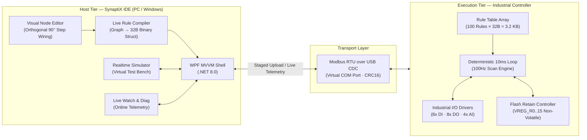

# SynaptiX IDE — Industrial PLC Programming & Automation Environment

[-006487?logo=dotnet)](https://dotnet.microsoft.com/)

> **Môi trường lập trình trực quan đồ họa (Visual Node-Graph) cho PLC công nghiệp, kết hợp bộ thực thi quy tắc nhị phân siêu gọn 32-byte chạy bare-metal với chu kỳ quét cố định 10ms (100Hz) trên vi điều khiển chuyên dụng.**

**SynaptiX IDE** tái cấu trúc phương thức tự động hóa máy móc cỡ vừa và nhỏ, tính toán biên (Edge Computing) và Industrial IoT (IIoT). Thay vì triển khai các máy ảo runtime nặng nề, SynaptiX IDE biên dịch sơ đồ khối trực quan thành các **bản ghi nhị phân cố định 32-byte**. Bộ điều khiển công nghiệp thực thi các bản ghi này bằng cơ chế lập chỉ mục con trỏ trực tiếp trong vòng quét **10ms (100Hz)**, cho phép nạp và chạy trơn tru tới 100 quy tắc tự động hóa chỉ trong **3.2 KB RAM**.

---

## 📥 Tải Về & Cài Đặt (Downloads & Installation)

Phần mềm SynaptiX IDE được đóng gói dạng **Standalone Single-File (chạy trực tiếp không cần cài đặt)**, đã tích hợp sẵn runtime:

| Phiên bản | Định dạng | Tệp tải về | Ghi chú |
| :---: | :---: | :---: | :--- |
| **v1.3.1 (Mới nhất)** | Windows x64 (.exe) | [**Tải `SimplePLC.Studio.exe`**](https://github.com/hoanv-synaptix/SynaptiX-IDE-Releases/releases/latest/download/SimplePLC.Studio.exe) | Chạy trực tiếp trên Windows 10/11 (x64) |
| **Toàn bộ bản phát hành** | Releases | [**Xem trang GitHub Releases**](https://github.com/hoanv-synaptix/SynaptiX-IDE-Releases/releases) | Xem Changelog & các phiên bản cũ |

### Yêu cầu hệ thống:
- **Hệ điều hành:** Windows 10 hoặc Windows 11 (64-bit).
- **Phần cứng:** Cổng USB vật lý hoặc cáp chuyển đổi USB-to-Serial (kết nối bộ điều khiển SynaptiX Controller qua USB CDC / Modbus RTU).
- **Bộ nhớ:** Tối thiểu 512 MB RAM khả dụng.

---

## 1. Hệ Thống Tính Năng Nổi Bật (Capabilities)

### 🖥️ Môi Trường Lập Trình SynaptiX IDE (Desktop Client / .NET 8 WPF)
- **Lập trình đồ họa Node-Graph chuẩn mực:** Thiết kế logic điều khiển qua chuỗi 4 công đoạn (`Input Tag` ➔ `Trigger` ➔ `Guard` ➔ `Action`). Dây nối uốn vuông góc 90 độ chuẩn bản vẽ điện công nghiệp (`StepConnection`), tự động căn thẳng hàng ngang tuyệt đối khi các khối cùng cao độ.
- **Trình biên dịch trực tiếp theo thời gian thực (Live Rule Compiler):** Phân tích hình học đồ thị và tự động sinh bản ghi nhị phân 32-byte ngay trong bộ nhớ, không cần người dùng phải bấm biên dịch thủ công qua file trung gian.
- **Quản lý 128 Tag Công nghiệp hợp nhất:** Giám sát và cấu hình 8 ngõ vào số 24VDC (DI), 8 ngõ ra rơ-le 24VDC (DO), 4 ngõ vào tương tự 12-bit (AI: 4–20mA / 0–10V), 16 cờ bit nội (VFLAG), 16 thanh ghi RAM (VREG), và 16 thanh ghi lưu trữ Flash an toàn khi mất điện (VREG_RETAIN).
- **Bảng quy tắc hiển thị kép (Dual-View Rule Table):** Xem song song câu diễn giải tự nhiên cùng chuỗi mã máy Hex 32-byte.
- **10 Thư viện mẫu công nghiệp sẵn có (Factory Blueprints):** 1 Cú click để sinh ngay mạch điều khiển thực tế: Cảnh báo dừng chuyền Andon OEE, Bộ đếm sản lượng tốc độ cao lưu Flash, Mạch dừng khẩn cấp E-Stop, Bảo vệ quá nhiệt động cơ, Khóa liên động cửa an toàn Interlock, Giám sát áp suất khí nén, Bơm chìm tự động, Chu kỳ bôi trơn định kỳ, Đèn tháp 3 màu, và Gọi cấp liệu.
- **Nạp an toàn 2 giai đoạn (Two-Phase Staged Deployment):** Nạp logic vào bộ đệm tạm (Staging Buffer), kiểm tra toàn vẹn CRC-16 độc lập và kích hoạt nguyên tử qua lệnh Atomic-Commit (`0xA5A5`), đáp ứng tiêu chuẩn an toàn **SPLC-AF-003**.
- **Bộ mô phỏng tích hợp (Virtual PLC Simulator):** Thử nghiệm và kiểm tra toàn bộ logic ngay trên máy tính mà không cần phần cứng thật: gạt công tắc ảo DI, kéo thanh trượt cảm biến AI, quan sát đèn LED ngõ ra DO và theo dõi nhật ký sự kiện Trace Log.
- **Giám sát sóng trực tuyến (Live Watch & Diagnostics):** Đọc giá trị biến theo thời gian thực kèm chỉ thị chất lượng (Good / Stale / Bad), biểu đồ vi mô Sparkline và khả năng force ghi đè giá trị kiểm thử tủ điện.
- **Tự động cập nhật phiên bản mới (Built-in Auto-Updater):** Tự động phát hiện bản phát hành mới từ GitHub Releases, hiển thị Changelog và hoán đổi nóng khởi động lại chỉ với 1 cú nhấp.
- **Giao diện kỹ thuật công nghiệp song ngữ:** Thiết kế phẳng chuẩn TIA Portal / TwinCAT (Siemens Petrol `#006487`, IEC Green `#107C41`, bo góc kỹ thuật 2px, không bóng mờ), chuyển đổi mượt mà giữa Tiếng Việt và Tiếng Anh.

### ⚡ Bộ Thực Thi Trên Bộ Điều Khiển (Controller Firmware Engine)
- **Chu kỳ quét xác định 10ms (100Hz Scan Loop):** Chu kỳ lặp cố định: lấy mẫu phần cứng ➔ quét mảng 100 quy tắc ➔ đánh giá logic ➔ cập nhật ngõ ra với độ trễ cực thấp (< 1ms).
- **Bảo vệ lưu đệm Flash khi mất điện (Power-Loss Retain):** Dữ liệu sản lượng chuyền và thông số cài đặt được lưu giữ bền vững trên bộ nhớ Flash nội với thuật toán cân bằng độ mòn (Wear-leveling > 100.000 chu kỳ).
- **Bộ lọc trễ chống dội phần cứng (Hardware Dwell Filter):** Tham số `for_ms` loại bỏ hoàn toàn hiện tượng dội tiếp điểm của cảm biến công nghiệp trước khi kích hoạt tải.

---

## 2. Kiến Trúc Hệ Thống (System Architecture)

### Chuỗi Xử Lý Tín Hiệu 4 Công Đoạn:
$$\mathbf{Input\ Tag} \longrightarrow \mathbf{Trigger\ (Edge/Timer)} \longrightarrow \mathbf{Guard\ (Compare/Interlock)} \longrightarrow \mathbf{Action\ (Output/Register)}$$

---

## 3. Đặc Tả Kỹ Thuật Định Dạng Rule Nhị Phân 32-Byte (Binary ABI Contract)

Mỗi chuỗi logic trực quan được biên dịch thành cấu trúc nhị phân cố định đúng **32 byte** (`struct SPLC_RuleRecord`, tương ứng 16 thanh ghi Modbus 16-bit):

| Khoảng thanh ghi | Byte Offset | Tên trường | Kiểu dữ liệu | Ý nghĩa kỹ thuật |
| :---: | :---: | :--- | :---: | :--- |
| `0..1` | `0x00..0x03` | `threshold_lo` | `int32_t` | Ngưỡng so sánh dưới / Giá trị cài đặt (Word cao trước) |
| `2..3` | `0x04..0x07` | `threshold_hi` | `int32_t` | Ngưỡng so sánh trên cho điều kiện Trong khoảng BETWEEN |
| `4..5` | `0x08..0x0B` | `for_ms` | `uint32_t` | Thời gian trễ lọc rung tín hiệu (Dwell) hoặc chu kỳ Timer (ms) |
| `6..7` | `0x0C..0x0F` | `action_param` | `int32_t` | Giá trị tham số thực thi cho Action (Word cao trước) |
| `8` | `0x10..0x11` | `trigger_tag` | `uint16_t` | Chỉ số Tag kích hoạt đầu vào (`0..127`) |
| `9` | `0x12..0x13` | `action_tag` | `uint16_t` | Chỉ số Tag nhận tác động đầu ra (`0..127`) |
| `10` | `0x14..0x15` | `guard_tag` | `uint16_t` | Chỉ số Tag điều kiện chặn (bit 15: Phủ định NEGATE, bit 0..14: Tag ID) |
| `11` | `0x16..0x17` | `enabled_trigger` | `uint16_t` | Byte cao: `enabled` (0/1); Byte thấp: `trigger_type` (0..4) |
| `12` | `0x18..0x19` | `guard_action` | `uint16_t` | Byte cao: `compare_op` (0..7); Byte thấp: `action_type` (0..7) |
| `13..15` | `0x1A..0x1F` | `reserved[3]` | `uint16_t[3]` | Thanh ghi dự phòng căn lề bộ nhớ (Ghi `0x0000`) |

---

## 4. Bản Đồ Ánh Xạ Bộ Nhớ 128 Tag (Tag Memory Map)

| Vùng Tag | Mã định danh | Kiểu dữ liệu | Tầng vật lý & Lưu trữ | Ứng dụng công nghiệp |
| :---: | :---: | :--- | :---: | :--- |
| **`0`** | `NONE` | — | Null Reference | Chân để trống hoặc không sử dụng Guard |
| **`1 .. 8`** | `DI0 .. DI7` | 1-bit | Ngõ vào cách ly quang 24VDC | Cảm biến tiệm cận, nút dừng khẩn E-Stop, công tắc hành trình |
| **`9 .. 16`** | `DO0 .. DO7` | 1-bit | Ngõ ra tiếp điểm Rơ-le 24VDC | Cuộn hút khởi động từ, van điện từ khí nén, còi báo động |
| **`17 .. 20`** | `AI0 .. AI3` | 12-bit | Ngõ vào tương tự 4–20mA / 0–10V | Cảm biến áp suất đường ống, đầu đo nhiệt độ bồn chứa |
| **`21 .. 36`** | `VFLAG0..15` | 1-bit | Bộ nhớ RAM (Mất khi tắt nguồn) | Cờ trạng thái nội (`in_shift`, `auto_mode`, `interlock`) |
| **`37 .. 52`** | `VREG0..15` | 16-bit | Bộ nhớ RAM (Mất khi tắt nguồn) | Biến tính toán số học, biến đếm thời gian tạm thời |
| **`53 .. 68`** | `VREG_R0..15` | 16-bit | **Bộ nhớ Flash nội (Không mất điện)** | **Lưu trữ bền vững:** Tổng sản lượng, đếm ca, mã công thức |

---

## 5. Hướng Dẫn Sử Dụng Nhanh (Quick Start Guide)

1. **Kết nối thiết bị:**
   - Cắm cáp USB nối máy tính với bộ điều khiển SynaptiX Controller (hoặc cổng COM giả lập).
   - Khởi động `SimplePLC.Studio.exe`.
   - Chọn đúng cổng COM trên thanh tiêu đề và bấm **Kết Nối** (hoặc chọn `SIMULATOR (VIRTUAL)` để chạy thử không cần phần cứng).
2. **Lập trình logic:**
   - Kéo thả các khối từ bảng bên trái vào màn hình vẽ (`Tag đầu vào` ➔ `Kích hoạt` ➔ `Chặn` ➔ `Hành động`).
   - Nối dây giữa các cổng Pin (dây tự động đi vuông góc 90°).
   - Hoặc mở tab **Thư Viện Mẫu** và bấm 1 cú nhấp vào mẫu mạch mong muốn (ví dụ: *Đếm sản lượng dây chuyền*).
3. **Kiểm tra và Nạp:**
   - Chuyển sang tab **Mô Phỏng** để gạt công tắc kiểm thử.
   - Bấm **Lưu & Biên Dịch** để xác nhận bảng quy tắc.
   - Chuyển sang tab **Nạp Thiết Bị** và bấm **Bắt Đầu Nạp** (Hệ thống tự động thực thi chu trình nạp an toàn 2 giai đoạn Staging + Atomic Commit).
4. **Cập nhật phần mềm:**
   - Vào menu **`Trợ giúp -> Kiểm tra bản cập nhật...`** để tự động tải bản mới nhất khi có thông báo.

---

## 6. Bản Quyền & Phát Triển (License & Copyright)

Bản quyền © 2026 **SynaptiX Company**. Mọi quyền được bảo lưu.  
Phát triển bởi đội ngũ kỹ thuật tự động hóa SynaptiX Industrial Ecosystem.