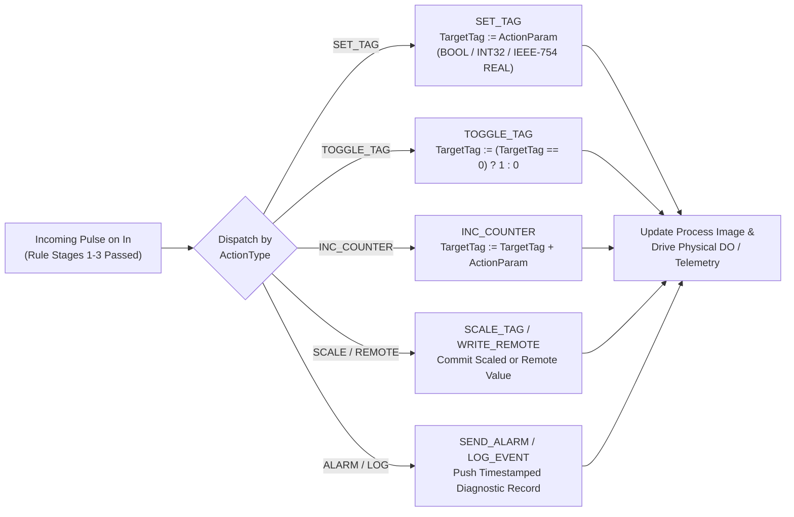
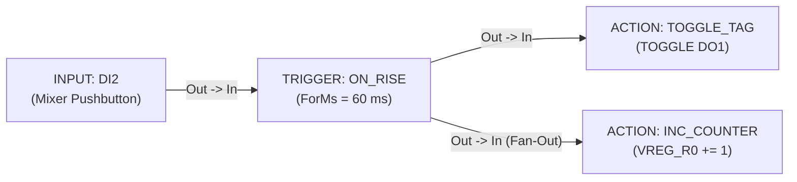

# ACTION — Rule Output Executor

  <strong>Block Code:</strong> ACTION
  <strong>Category:</strong> Core Rule Pipeline
  <strong>Execution Class:</strong> Terminal Rule Executor (Sink Node)
  <strong>Lowering Target:</strong> Rule Stage 4 (Deterministic Output Commit)

## 1. Synopsis & Execution Semantics

The **`ACTION`** block is the terminal execution sink of a Core Rule Pipeline network. Whenever an execution pulse reaches its `In` connector—having cleared upstream [`TRIGGER`](/blocks/trigger), [`COMPARATOR`](/blocks/comparator), [`GUARD`](/blocks/guard), [`TON`](/blocks/ton), [`CTU`](/blocks/ctu), or fieldbus/cloud completion pins—`ACTION` performs an atomic operation on `TargetTag` or the runtime event subsystem.

- **Scan-Synchronous Memory Commit:** Tag mutations (`SET_TAG`, `TOGGLE_TAG`, `INC_COUNTER`, `SCALE_TAG`) commit deterministically during the output update phase of the active scan cycle, ensuring predictable actuation latency across all rules.
- **Strict Type-Locked Parameterization:** Changing `TargetTag` immediately reconfigures `ActionParam` in the Inspector—presenting binary `[ 0 ]` / `[ 1 ]` buttons for `BOOL` coils/flags, exact integer parsing for `INT32` registers/counters, and IEEE-754 floating-point formatting (`0.0###`) for `REAL` registers.
- **Primary Industrial Use Cases:** Energizing and de-energizing physical relay/transistor outputs (`DO`), latching/clearing internal state flags (`VFLAG`), toggling push-on/push-off lighting or pump circuits (`TOGGLE_TAG`), incrementing batch production counters (`INC_COUNTER`), raising operator alarms (`SEND_ALARM`), and recording audit trail events (`LOG_EVENT`).

---

## 2. Pinout & Signal Contract

`ACTION` acts strictly as a terminal sink node and therefore exposes one event input connector and zero output connectors.

| Pin | Direction | Signal Kind | Data Type | Description |
| :--- | :--- | :--- | :--- | :--- |
| `In` | Input | Event / Execution (`IsEvent = true`) | Event Pulse | Triggers immediate execution of the configured `ActionType` upon each incoming pulse or active timer/counter output transition. |

---

## 3. Inspector Parameters & Validation Limits

| Parameter | Type / Options | Default | Constraints | Runtime Behavior |
| :--- | :--- | :--- | :--- | :--- |
| `ActionType` | `SET_TAG`, `TOGGLE_TAG`, `INC_COUNTER`, `WRITE_REMOTE`, `SEND_ALARM`, `LOG_EVENT`, `SCALE_TAG` | `SET_TAG` | Selecting `TOGGLE_TAG` requires a `BOOL` target; selecting `INC_COUNTER` requires a numeric/counter target. | Selects the deterministic mutation or system side-effect executed when `In` fires (see 7-mode specification below). |
| `TargetTag` | Writable Tag Selector (`DO`, `VFLAG`, `VREG`, `VREG_R`, `COUNTER`, `MB_COIL`, `MB_HOLDING`) | Unassigned *(must be selected)* | Read-only hardware inputs (`DI`, `AI`) cannot be written by `ACTION`. Incompatible `TargetTag` clears automatically on `ActionType` switch. | Destination process image variable or alarm/log subject tag. |
| `ActionParam` | Type-Locked Value (`[ 0 ]` `[ 1 ]` for `BOOL`; `INT32` or `REAL` input) | `1` (`"1"` or `"1.0"`) | Locked strictly to `TargetTag.DataType`. Hidden when `ActionType = TOGGLE_TAG`. | Literal value assigned (`SET_TAG`), signed delta added (`INC_COUNTER`), remote payload (`WRITE_REMOTE`), or scale factor (`SCALE_TAG`). |
| `CustomLabel` | Free-text String | Empty (`"Action"`) | Optional schematic title override. | Customizes the header title on the Logic Graph Canvas. |

### `ActionType` 7-Mode Reference Matrix

| Mode | Canvas Expression | Valid `TargetTag` Types | Execution Behavior |
| :--- | :--- | :--- | :--- |
| `SET_TAG` | `TAG = 1` / `TAG = 25.0` | `BOOL`, `INT32`, `REAL` | Writes `ActionParam` directly into `TargetTag` (stores IEEE-754 32-bit float bits when `TargetTag` is `REAL`). |
| `TOGGLE_TAG` | `TOGGLE TAG` | `BOOL` (`DO`, `VFLAG`, `MB_COIL`) | Inverts current digital state atomically (`0 → 1` or `1 → 0`) on each incoming execution pulse. |
| `INC_COUNTER` | `TAG += N` | `INT32` (`COUNTER`, `VREG`, `VREG_R`) | Adds signed integer `ActionParam` to the current register value (`TargetTag = TargetTag + ActionParam`). |
| `WRITE_REMOTE` | `MODBUS N` | Remote / Fieldbus Tag | Queues a remote register/coil write with value `ActionParam` (for full multi-pin RS-485 control, see [`MB_WRITE`](/blocks/mb-write)). |
| `SEND_ALARM` | `ALARM TAG` | Any Defined Tag | Emits a high-priority runtime alarm record tagged with `TargetTag` for SCADA / Live Watch annunciators. |
| `LOG_EVENT` | `LOG TAG` | Any Defined Tag | Appends a timestamped operational event entry into the controller's diagnostic event log. |
| `SCALE_TAG` | `TAG ← SCALE` | `INT32`, `REAL` (`VREG`, `VREG_R`) | Commits the linearly calibrated output value from an upstream [`SCALE`](/blocks/scale) pipeline into `TargetTag`. |

---

## 4. State Machine / Timing Diagram

The flow diagram below illustrates how `ACTION` validates target compatibility during authoring and executes atomic memory/event commits at runtime:

---

## 5. Input Defense & Live Diagnostics

### 5.1 Bad-Data Defense & Incompatible-Tag Auto-Guard

- **Automatic Incompatible Tag Clearing:** If `TargetTag` is currently bound to an integer register (`VREG0`) and you switch `ActionType` to `TOGGLE_TAG`, `ACTION` automatically clears `TargetTag` so a 32-bit register can never be treated as a single-bit coil. Conversely, switching to `INC_COUNTER` clears any boolean `TargetTag`.
- **Commit-Time Normalization & Revert (`CommitActionParam`):**
  - **Boolean Targets:** Displays `[ 0 ]` and `[ 1 ]` buttons; switching from an integer tag with `ActionParam = 50` to a boolean `DO` tag automatically clamps `ActionParam` to `"1"`.
  - **Integer Targets (`INT32`):** Normalizes `"100.0"` → `"100"`, and reverts fractional inputs like `"25.5"` or invalid text `"abc"` to the previous committed integer on `Enter` / `LostFocus`.
  - **Real Targets (`REAL`):** Normalizes `"25"` → `"25.0"` and `"25,5"` → `"25.5"`, encoding exact IEEE-754 single-precision bits into `ActionParam`.

### 5.2 Canvas Badges in Simulator (`F5`) & Online Live Debug (`F8`)

- **Simulator Fired Indicator (`F5`):** Displays `● FIRED` (`● ON` LED badge) whenever the rule fires during simulation, or shows the live scaled output value when operating in `SCALE_TAG` mode.
- **20 FPS Live Target Readback (`F8`):** Continuously displays the real-time state of `TargetTag` directly on the node card—such as `Main_Pump [Current: ON]` or `Batch_Count [Current: 1,420]`, appending ` [STALE]` if communication quality degrades and `[Last Known: ...]` when offline.

---

## 6. Practical Industrial Wiring Example

### Scenario: Single-Pushbutton Alternator (`TOGGLE_TAG`) & Cycle Counter (`INC_COUNTER`)

A momentary panel pushbutton on `DI2` controls a mixing agitator contactor (`DO1`) in push-on / push-off toggle fashion, while simultaneously incrementing a retentive maintenance stroke counter (`VREG_R0`) by `1` every time the operator toggles the mixer.

### Tag Configuration

| Tag Name | Kind | Data Type | Description / Alias |
| :--- | :--- | :--- | :--- |
| `DI2` | `DI` | `BOOL` | `Mixer Toggle Pushbutton (Momentary NO)` |
| `DO1` | `DO` | `BOOL` | `Agitator Motor Contactor` |
| `VREG_R0` | `VREG_R` | `INT32` | `Cumulative Agitator Actuation Counter` |

### Step-by-Step Canvas Wiring

1. Place **`INPUT`** (`Tag = DI2`) → **[`TRIGGER`](/blocks/trigger)** (`TriggerType = ON_RISE`, `ForMs = 60` ms contact debounce).
2. Wire `TRIGGER.Out` to a first **`ACTION`** block configured with `ActionType = TOGGLE_TAG` and `TargetTag = DO1` (`CustomLabel = "Toggle Agitator"`).
3. Drag a second fan-out wire from the same `TRIGGER.Out` pin to a second **`ACTION`** block configured with `ActionType = INC_COUNTER`, `TargetTag = VREG_R0`, and `ActionParam = 1` (`CustomLabel = "Count Operation"`).
4. Press `F5` to test in the **Simulator**: click the `DI2` toggle button (`0 → 1` for `60 ms`) repeatedly and verify `DO1` alternates cleanly `0 → 1 → 0 → 1` while `VREG_R0` increments `1 → 2 → 3` without double-counting contact bounce.

