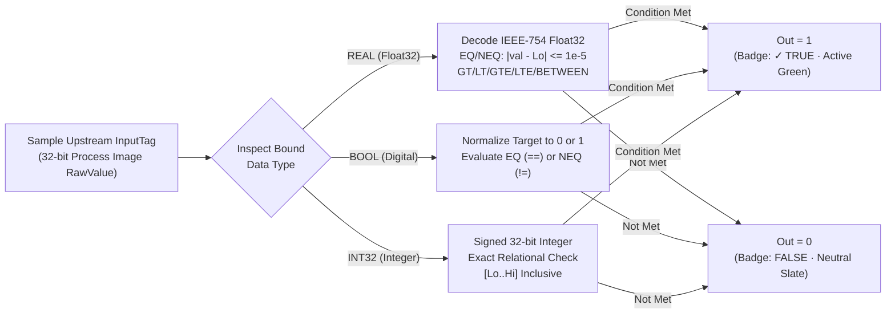
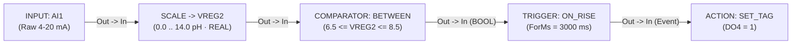

# COMPARATOR — Relational Logic

  <strong>Block Code:</strong> COMPARATOR (CMP)
  <strong>Category:</strong> Core Rule Pipeline
  <strong>Execution Class:</strong> Pure Combinational Function (IEC 61131-3 CMP)
  <strong>Lowering Target:</strong> Relational Condition Evaluator

## 1. Synopsis & Execution Semantics

The **`COMPARATOR`** (`CMP`) block is a type-locked relational function that continuously compares an upstream tag or calibrated engineering value (`In`) against one or two reference thresholds (`ThresholdLo`, `ThresholdHi`) and outputs a pure `BOOL` truth signal (`Out` = `TRUE` or `FALSE`) on every scan cycle.

- **Strict Type-Locked Evaluation:** The moment an upstream [`INPUT`](/blocks/input) or [`SCALE`](/blocks/scale) block connects to `In`, `COMPARATOR` locks its arithmetic mode and Inspector input formatters to the upstream physical data type (`INT32`, IEEE-754 `REAL`, or `BOOL`).
- **Floating-Point Epsilon Safety:** Direct bit-level equality checks on IEEE-754 floating-point sensor values notoriously fail due to binary representation rounding. When evaluating `REAL` (`Float32`) inputs, `COMPARATOR` automatically applies an industrial `1e-5` (`0.00001`) epsilon deadband on `EQ` (`==`) and `NEQ` (`!=`).
- **Combinational Level Output:** Because `Out` is a continuous boolean value pin (`IsEvent = false`), it can feed a [`TRIGGER`](/blocks/trigger) block for edge-triggered/debounced actuation, or wire directly into [`GUARD`](/blocks/guard), [`ACTION`](/blocks/action), [`MQTT_PUB`](/blocks/mqtt-pub), [`HTTP_CLIENT`](/blocks/http-client), or [`TCP_CLIENT`](/blocks/tcp-client).
- **Primary Industrial Use Cases:** Tank high/low level setpoints, temperature comfort band checking (`BETWEEN`), batch target match verification, and scaled pressure/flow alarm thresholds.

---

## 2. Pinout & Signal Contract

| Pin | Direction | Signal Kind | Data Type | Description |
| :--- | :--- | :--- | :--- | :--- |
| `In` | Input | Value / Data (`IsEvent = false`) | `INT32` \| `REAL` \| `BOOL` | Receives a live tag or scaled engineering value from an upstream [`INPUT`](/blocks/input) or [`SCALE`](/blocks/scale) node (or dynamic data pin from [`MB_READ`](/blocks/mb-read)). |
| `Out` | Output | Value / Data (`IsEvent = false`) | `BOOL` (`0` / `1`) | Outputs `1` (`✓ TRUE`) while the relational formula holds true, and `0` (`FALSE`) otherwise. |

---

## 3. Inspector Parameters & Validation Limits

| Parameter | Type / Options | Default | Constraints | Runtime Behavior |
| :--- | :--- | :--- | :--- | :--- |
| `CompareOp` | `EQ`, `NEQ`, `GT`, `LT`, `GTE`, `LTE`, `BETWEEN` | `GT` (`>`) | Required relational operator; for `BOOL` tags, `EQ` and `NEQ` evaluate exact binary state against `ThresholdLo`. | Selects the mathematical relation evaluated on every scan pass (see table below). |
| `ThresholdLo` | Type-Locked Numeric / `[ 0 ]` `[ 1 ]` Toggle | `50` (`"50.0"` if `REAL`) | Locked to `INT32`, `REAL`, or `BOOL` matching `InputTag`. | Primary reference threshold for single-setpoint operators, or inclusive lower bound (`Lo`) when `CompareOp = BETWEEN`. |
| `ThresholdHi` | Type-Locked Numeric | `100` (`"100.0"` if `REAL`) | Visible and active only when `CompareOp = BETWEEN`. Set `ThresholdHi >= ThresholdLo` for non-empty bands. | Inclusive upper bound (`Hi`) for range window evaluation (`ThresholdLo <= In <= ThresholdHi`). |
| `CustomLabel` | Free-text String | Empty (`"CMP (Comparator)"`) | Optional schematic title override. | Customizes the header title while preserving the live mathematical `FormulaExpression` summary on the canvas card. |

### Supported Relational Operators (7 Modes)

| Operator Code | Canvas Symbol | Formula Expression | `INT32` Semantics | `REAL` (`Float32`) Semantics |
| :--- | :--- | :--- | :--- | :--- |
| `EQ` | `==` | `Tag == Lo` | Exact integer equality (`val == loInt`) | Epsilon-safe equality: `abs(val - lo) <= 1e-5` |
| `NEQ` | `!=` | `Tag != Lo` | Exact integer inequality (`val != loInt`) | Epsilon-safe inequality: `abs(val - lo) > 1e-5` |
| `GT` | `>` | `Tag > Lo` | Strictly greater than (`val > loInt`) | Strictly greater than (`val > lo`) |
| `LT` | `<` | `Tag < Lo` | Strictly less than (`val < loInt`) | Strictly less than (`val < lo`) |
| `GTE` | `>=` | `Tag >= Lo` | Greater than or equal (`val >= loInt`) | Greater than or equal (`val >= lo`) |
| `LTE` | `<=` | `Tag <= Lo` | Less than or equal (`val <= loInt`) | Less than or equal (`val <= lo`) |
| `BETWEEN` | `IN_RANGE` | `Lo <= Tag <= Hi` | Inclusive integer band (`val >= loInt && val <= hiInt`) | Inclusive float band (`val >= lo && val <= hi`) |

---

## 4. State Machine / Timing Diagram

The flow diagram below details the type-dispatched evaluation pipeline executed inside `COMPARATOR` on each scan cycle and during 20 FPS Online Live Debug:

---

## 5. Input Defense & Live Diagnostics

### 5.1 Dynamic Type Re-Locking & Bad-Data Defense

`COMPARATOR` enforces physical memory integrity across both threshold fields (`CommitThresholdLo` and `CommitThresholdHi`) upon `Enter` or `LostFocus`:

- **Integer (`INT32`) Upstream Tag:** Typing `"100.0"` normalizes cleanly to `"100"`. Typing a fractional value like `"25.5"` or non-numeric characters `"abc"` is **strictly rejected** and automatically reverts to the last committed integer setpoint—preventing silent truncation mismatches between screen and controller.
- **Floating-Point (`REAL`) Upstream Tag:** Typing `"25"` normalizes to `"25.0"` and `"37,5"` normalizes to `"37.5"`.
- **Boolean (`BOOL`) Upstream Tag:** Replaces free-text entry with binary `[ 0 ]` / `[ 1 ]` quick buttons and normalizes boolean aliases (`"true"`, `"on"` → `"1"`; `"false"`, `"off"` → `"0"`).
- **Automatic Re-Format on Rewiring:** If you disconnect an `INT32` tag and wire a `REAL` tag into `In`, `ThresholdLoText` and `ThresholdHiText` immediately reformat (`"50"` → `"50.0"`) and update the data type badge (`INT32` → `REAL`).

### 5.2 Canvas Badges in Simulator (`F5`) & Online Live Debug (`F8`)

- **Live Formula Summary:** The node body continuously displays the human-readable mathematical expression, e.g., `4.0 <= Tank_pH <= 8.5` or `Furnace_Temp >= 650`.
- **Truth State & Quality Pill:** Displays `✓ TRUE` (active green highlight) when `IsConditionMet == true` and `FALSE` (neutral slate) when false. If upstream sensor quality degrades during Online Live Debug (`F8`), the node transitions to the `Stale` visual state to alert the operator.

---

## 6. Practical Industrial Wiring Example

### Scenario: Clean-in-Place (CIP) Neutralization pH Safe Band (`6.5 <= pH <= 8.5`)

In a food-processing neutralization tank, calibrated `REAL` pH measurement stored in `VREG2` (output of a [`SCALE`](/blocks/scale) block converting `4–20 mA` `AI1` into `0.0–14.0 pH`) must remain within the safe discharge band **`6.5` to `8.5 pH`** continuously for `3 seconds` before opening the effluent discharge valve (`DO4`).

### Tag Configuration

| Tag Name | Kind | Data Type | Description / Alias |
| :--- | :--- | :--- | :--- |
| `AI1` | `AI` | `INT32` | `Raw pH Transmitter ADC (4000-20000)` |
| `VREG2` | `VREG` | `REAL` | `Calibrated Tank pH (0.0-14.0)` |
| `DO4` | `DO` | `BOOL` | `Effluent Discharge Solenoid Valve` |

### Step-by-Step Canvas Wiring

1. Wire `INPUT (AI1)` → **[`SCALE`](/blocks/scale)** (`RawMin = 4000`, `RawMax = 20000`, `EngMin = 0.0`, `EngMax = 14.0`, `OutputTag = VREG2`).
2. Select the `SCALE` block and click **`COMPARATOR`** in the toolbox. The node auto-wires `SCALE.Out → COMPARATOR.In` and locks its type badge to `REAL`.
3. In the `COMPARATOR` **Inspector**, set `CompareOp = BETWEEN`, `ThresholdLo = 6.5`, and `ThresholdHi = 8.5`. Verify the node formula reads `6.5 <= VREG2 <= 8.5`.
4. Wire `COMPARATOR.Out` → **[`TRIGGER`](/blocks/trigger)** (`TriggerType = ON_RISE`, `ForMs = 3000`) → **[`ACTION`](/blocks/action)** (`ActionType = SET_TAG`, `TargetTag = DO4`, `ActionParam = 1`).
5. Press `F5` to simulate: inject raw values corresponding to `pH = 7.2` (`AI1 = 12228`), observe `COMPARATOR` assert `✓ TRUE`, wait `3000 ms` for the `TRIGGER` dwell filter, and confirm `DO4` energizes to `1`.

