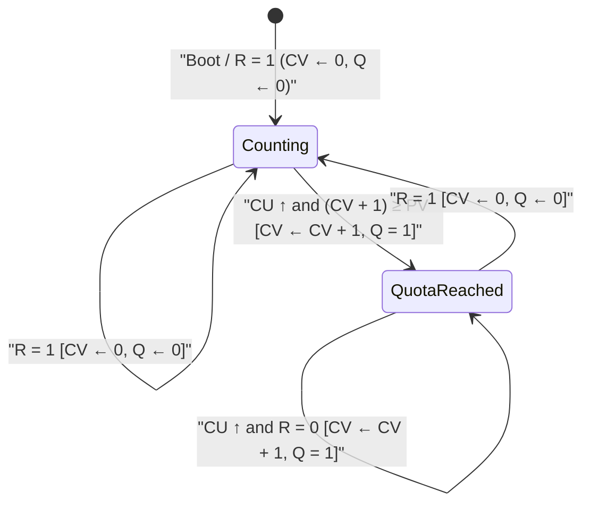
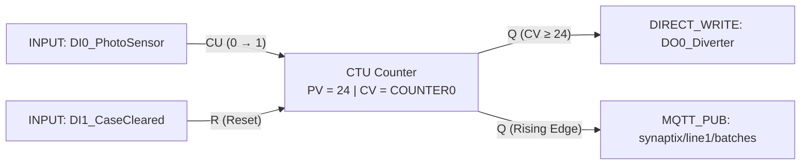

# CTU — Count Up Counter

  <strong>Document ID:</strong> SYNX-DOC-BLK-CTU
  <strong>Block Category:</strong> Timing, Counting &amp; Scaling
  <strong>Execution Class:</strong> Stateful Edge-Triggered Accumulator
  <strong>Standard:</strong> IEC 61131-3 Counter Model

## 1. Synopsis & Execution Semantics

The **`CTU`** (**Count Up Counter**) function block is a deterministic, rising-edge event accumulator designed for piece counting, batch totalizing, packaging quota control, and machine maintenance cycle tracking.

During each deterministic scan cycle of the SynaptiX runtime engine:
1. **Reset Priority Check (`R` / `ResetTag`):** If the reset input transitions active (or is held active), the internal accumulator **Current Value (`CV`)** immediately clears to `0`, and output **`Q`** de-asserts to `0` (`FALSE`).
2. **Rising-Edge Detection (`CU`):** When reset is inactive and the **`CU`** input transitions from `0 → 1` (rising edge), `CV` increments by exactly `+1` (`CV ← CV + 1`). Sustained `HIGH` levels on `CU` across subsequent scans do **not** increment the counter until `CU` returns to `0` and rises again.
3. **Threshold Comparison (`CV ≥ PV`):** Output **`Q`** evaluates to `1` (`TRUE`) whenever `CV ≥ PresetValue` (`PV`), and `0` (`FALSE`) while `CV < PresetValue`.
4. **Tag Synchronization:** `CV` mirrors directly into the bound **`CvTag`** (`COUNTER0..COUNTER7` or `VREG`), and `Q` writes to **`OutputTag`**.

::: info Post-Threshold Counting Behavior
If additional rising edges arrive on `CU` after `CV` reaches `PV` (while `R` remains `0`), `CV` continues incrementing up to the 32-bit signed integer ceiling (`+2,147,483,647` without wrap-around overflow), while `Q` remains latched at `1` until a reset occurs.
:::

---

## 2. Pinout & Signal Contract

`CTU` exposes two fixed event inputs on its left edge and one boolean status output on its right edge:

| Pin | Direction | Signal Kind | Data Type | Visibility | Functional Contract |
| :--- | :---: | :---: | :---: | :---: | :--- |
| **`CU`** | Input | Event (`0 → 1`) | `BOOL` | Always visible | **Count Up Trigger:** Increments `CV` by `+1` on each rising edge. Can be driven by an upstream canvas wire or bound directly via `InputTag`. |
| **`R`** | Input | Event / Level | `BOOL` | Always visible | **Reset Input:** Clears `CV → 0` and resets `Q → 0`. Takes precedence over `CU` if both are active in the same scan cycle. |
| **`Q`** | Output | Value | `BOOL` | Always visible | **Quota Reached Output:** Asserts `1` (`TRUE`) when `CV ≥ PV`; remains `0` (`FALSE`) while `CV < PV`. |

---

## 3. Inspector Parameters & Constraints

Selecting a `CTU` node on the [Logic Graph Canvas](/workspaces/logic-graph-tab) exposes the following configuration properties in the right-hand **Inspector** panel:

| Parameter | Property Key | Type & Domain | Default | Description & Physical Contract |
| :--- | :--- | :--- | :---: | :--- |
| **Custom Label** | `CustomLabel` | `String` | `"CTU Counter"` | User-defined block header shown on the canvas node card. |
| **Counter Mode** | `CounterMode` | `"CTU"` \| `"CTD"` | `"CTU"` | Selects upward counting (`CU`, `CV ≥ PV`). Switching to `"CTD"` converts pin `CU` to `CD` in-place. |
| **Preset Value (`PV`)** | `PresetValue` | `INT32` (`≥ 1`) | `10` | Target pulse count required to assert `Q = 1`. Enforces integer Bad-Data Defense (fractional inputs auto-revert or normalize). |
| **Count Input Tag** | `InputTag` | `TagModel?` (`BOOL`) | `null` | Optional direct binding to a digital tag (`DI0..DI7`, `VBIT`) when `CU` is not wired from another block. |
| **Current Value Tag (`CV`)** | `CvTag` | `TagModel?` (`INT32`) | `COUNTER0` | Hardware counter register (`COUNTER0..COUNTER7`) or virtual integer register (`VREG`) storing the live accumulated count. |
| **Output Tag (`Q`)** | `OutputTag` | `TagModel?` (`BOOL`) | `null` | Target coil or virtual boolean tag updated every scan with the comparison state `CV ≥ PV`. |
| **Reset Tag (`R`)** | `ResetTag` | `TagModel?` (`BOOL`) | `None` | Optional tag that resets `CV → 0` when active, complementing or replacing a wire on pin `R`. |

::: warning Integer Memory Contract on `PresetValue` and `CvTag`
Per SynaptiX [Tag Architecture & Data Types](/concepts/data-model-and-types), pulse counts are discrete physical events (`INT32`). `CvTag` only accepts integer-compatible registers (`COUNTER0..7` or `INT32` `VREG`), and `PresetValue` rejects malformed strings on `LostFocus` / `Enter`.
:::

---

## 4. State Machine & Timing Diagram

### Scan-Cycle Timing Walkthrough (`PV = 3`)

| Scan Event | `CU` Pin | `R` Pin | Accumulator `CV` | Output `Q` (`CV ≥ 3`) | Canvas Status Pill |
| :--- | :---: | :---: | :---: | :---: | :--- |
| Initial Boot | `0` | `0` | `0` | `0` | `PV: 3` (`0 / 3`) |
| Bottle #1 passes sensor | `0 → 1` | `0` | `1` | `0` | `PV: 3` (`1 / 3`) |
| Bottle #1 still blocking beam | `1` | `0` | `1` *(no edge)* | `0` | `PV: 3` (`1 / 3`) |
| Bottle #2 passes sensor | `0 → 1` | `0` | `2` | `0` | `PV: 3` (`2 / 3`) |
| Bottle #3 passes sensor | `0 → 1` | `0` | `3` | **`1`** | **`Q = ON`** (`3 / 3`) |
| Carton sealer resets batch | `0` | `0 → 1` | `0` | `0` | `PV: 3` (`0 / 3`) |

---

## 5. Validation, Error Handling & Live Diagnostics

- **Pre-Flight Compiler Checks (`F7`):**
  - Verifies that `PresetValue > 0`. Setting `PresetValue ≤ 0` triggers a validation warning because `Q` would immediately evaluate `TRUE` at `CV = 0`.
  - Verifies that `CvTag` is bound to a valid `COUNTER` or `VREG` tag and does not collide with another counter block writing to the same register.
- **Offline Simulation (`F5`) & Live Watch (`F8`):**
  - The node body renders a live progress counter **`{CurrentCount} / {PresetValue}`** (e.g., `7 / 10`).
  - The status pill transitions from neutral **`PV: 10`** to emerald **`Q = ON`** as soon as `CV ≥ PV`.
  - If hardware telemetry becomes stale during cable disconnection, `LiveVisualState` switches to `Stale` without falsifying the last known count.

---

## 6. Practical Industrial Wiring Example

### Carton Packaging Batch Sealer (24 Bottles per Case)

**Objective:** Count bottles passing a photoelectric sensor (`DI0`) on a bottling conveyor. When `24` bottles have entered the case, energize the carton diverter solenoid (`DO0`) and publish a completed batch telemetry frame via [`MQTT_PUB`](/blocks/mqtt-pub), then reset when the operator or pusher limit switch (`DI1`) confirms case ejection.

**Configuration Steps:**
1. In [Tag Catalog](/workspaces/tag-catalog-tab) (`Ctrl+3`), name `DI0` as `DI0_PhotoSensor`, `DI1` as `DI1_CaseCleared`, `COUNTER0` as `CNT_CaseBottles`, and `DO0` as `DO0_Diverter`.
2. Place a **`CTU`** block on the canvas and set:
   - `PresetValue` = `24`
   - `CvTag` = `CNT_CaseBottles` (`COUNTER0`)
   - `OutputTag` = `DO0_Diverter` (`DO0`)
3. Wire `DI0_PhotoSensor` to **`CU`** and `DI1_CaseCleared` to **`R`**.
4. Wire **`Q`** to the `Trig` pin of [`MQTT_PUB`](/blocks/mqtt-pub) (`PublishMode = Event`) to report each completed 24-bottle carton to the factory broker.
