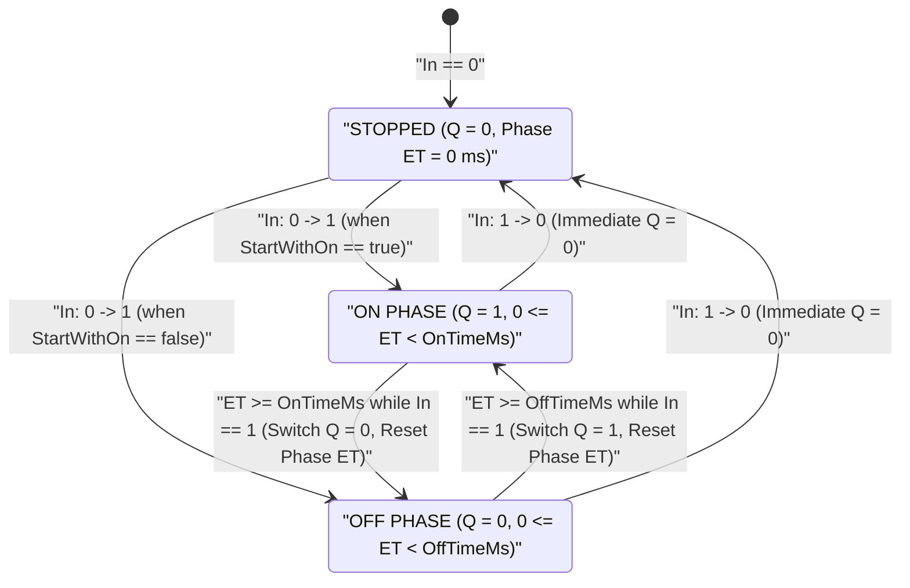
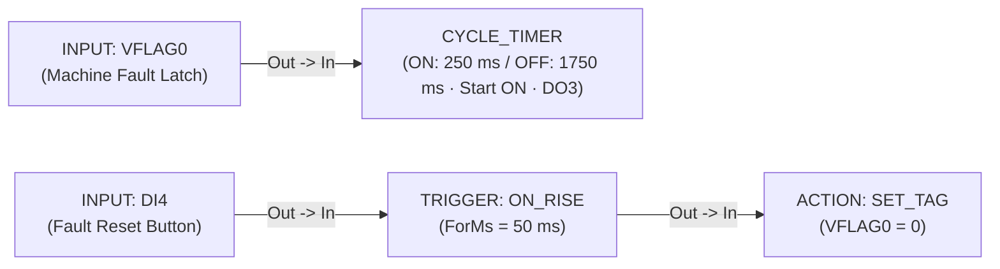

# CYCLE_TIMER — Asymmetric Oscillator

  <strong>Block Code:</strong> CYCLE_TIMER (CYCLE)
  <strong>Category:</strong> Timing, Counting &amp; Scaling
  <strong>Execution Class:</strong> Stateful Asymmetric Flasher / Duty-Cycle Oscillator
  <strong>Lowering Target:</strong> Dual-Phase Monotonic Oscillator Engine

## 1. Synopsis & Execution Semantics

The **`CYCLE_TIMER`** block is a continuous, level-enabled **asymmetric square-wave oscillator (flasher)**. Whenever its enable input `In` is active (`1`), `CYCLE_TIMER` alternates boolean output `Q` continuously between a configurable **ON phase (`OnTimeMs`)** and an independent **OFF phase (`OffTimeMs`)**, starting in either `ON` or `OFF` phase as configured.

- **Independent Asymmetric Duty Cycle:** Unlike fixed `50%` clock bits that require external counters and comparators to achieve short duty ratios, `CYCLE_TIMER` lets you combine millisecond pulses with minute/hour pauses in a single node (for example, `OnTimeMs = 500 ms` lubrication shot every `OffTimeMs = 15 min`).
- **Configurable Initial Phase (`StartWithOn`):**
  - **`Start with ON` (`true`):** Immediately asserts `Q = 1` for `OnTimeMs` on the very scan `In` becomes `1`, then pauses `Q = 0` for `OffTimeMs`, repeating indefinitely.
  - **`Start with OFF` (`false`):** Enters the `OffTimeMs` pause (`Q = 0`) first when `In` becomes `1`, asserting `Q = 1` only after `OffTimeMs` elapses.
- **Clean De-Energize on Disable:** The instant `In` drops to `0`, oscillation halts immediately, internal phase timers reset to `0`, and `Q` forces cleanly to `0`.
- **Primary Industrial Use Cases:** Andon fault tower strobe beacons and intermittent alarm buzzers, centralized bearing lubrication pumps, greenhouse misting/fogging cycles, and periodic filter backwash agitation.

---

## 2. Pinout & Signal Contract

| Pin | Direction | Signal Kind | Data Type | Description |
| :--- | :--- | :--- | :--- | :--- |
| `In` | Input | Event / Execution (`IsEvent = true`) | Level Enable (`BOOL`) | Enables continuous `ON`/`OFF` oscillation while `1`; halts oscillation and forces `Q = 0` immediately when `0`. |
| `Q` | Output | Value / Data (`IsEvent = false`) | `BOOL` (`0` / `1`) | Asymmetric periodic pulse output bound to `OutputTag`; wires to [`ACTION`](/blocks/action), [`MQTT_PUB`](/blocks/mqtt-pub), [`HTTP_CLIENT`](/blocks/http-client), or [`TCP_CLIENT`](/blocks/tcp-client). |

---

## 3. Inspector Parameters & Validation Limits

| Parameter | Type / Options | Default | Constraints | Runtime Behavior |
| :--- | :--- | :--- | :--- | :--- |
| `OnDurationValueText` + `OnTimeUnit` | Non-negative Numeric + Unit (`ms`, `s`, `min`, `h`) | `"1"` `s` (`1000 ms`) | Independent unit scaling; `OnTimeMs` clamps to `[1 .. 4,294,967,295] ms`. | Sets exact energized duration (`Q = 1`) per cycle and displays `= 1,000 ms (1s)` summary. |
| `OffDurationValueText` + `OffTimeUnit` | Non-negative Numeric + Unit (`ms`, `s`, `min`, `h`) | `"1"` `s` (`1000 ms`) | Independent unit scaling; `OffTimeMs` clamps to `[1 .. 4,294,967,295] ms`. | Sets exact de-energized pause duration (`Q = 0`) per cycle and displays `= 1,000 ms (1s)` summary. |
| `StartWithOn` (`StartPhaseIndex`) | `Start with ON` (`0`) \| `Start with OFF` (`1`) | `Start with ON` (`true`) | 2-option selector. | Selects whether `Q` begins immediately at `1` (`OnTimeMs`) or waits in `0` (`OffTimeMs`) when `In` transitions `0 → 1`. |
| `InputTag` | Digital Tag (`DI`, `DO`, `VFLAG`) | Auto-bound from upstream wire | Must reference a digital boolean tag. | Level-sensitive enable source sustaining oscillation while `!= 0`. |
| `OutputTag` (`Q`) | Writable Digital Tag (`DO`, `VFLAG`) | Unassigned *(must be selected)* | Must reference a writable digital tag (`DO` or `VFLAG`). | Toggles continuously between `1` (`OnTimeMs`) and `0` (`OffTimeMs`) while `In == 1`; forced `0` when `In == 0`. |
| `CustomLabel` | Free-text String | Empty (`"Cycle Timer"`) | Optional schematic title override. | Customizes the header title on the Logic Graph Canvas. |

::: warning Solid-State vs. Electromechanical Output Selection
For rapid strobe cadences (`OnTimeMs` or `OffTimeMs` below `2,000 ms`), always assign `OutputTag` to a **transistor / MOSFET / SSR discrete output** rather than a mechanical relay coil to prevent premature contact wear.
:::

---

## 4. State Machine / Timing Diagram

The state diagram below details the dual-phase oscillator lifecycle, including initial phase dispatch (`StartWithOn`) and immediate safe reset whenever `In` returns to `0`:

---

## 5. Input Defense & Live Diagnostics

### 5.1 Independent Dual-Unit Scaling & Bad-Data Defense

- **Cross-Scale Unit Freedom:** `OnTimeUnit` and `OffTimeUnit` are completely independent—allowing engineers to configure `OnDuration = 500 ms` alongside `OffDuration = 10 min` without converting `10 min` to `600,000 ms` by hand. Both fields render explicit millisecond verification summaries (`CalculatedOnMsSummary` and `CalculatedOffMsSummary`).
- **Tolerant Float Input & Boundary Clamping:** Comma decimals (`"0,5"`) convert automatically to invariant floating-point numbers, `"0"` clamps safely to `1 ms` to prevent zero-period infinite loops, and malformed text is ignored without corrupting active timing parameters.

### 5.2 Canvas Badges in Simulator (`F5`) & Online Live Debug (`F8`)

- **Asymmetric Timing Summary & Live Blink Pill:** Displays `CYCLE (250ms/1.75s) → DO3` and `ON: 250ms | OFF: 1.75s` on the node card, while the live status pill alternates crisply between `● ON` (energized green) and `● OFF` (neutral slate) in both Simulator (`F5`) and 20 FPS Online Live Debug (`F8`).

---

## 6. Practical Industrial Wiring Example

### Scenario: Asymmetric Machine Fault Warning Beacon (`250 ms` Flash / `1750 ms` Pause)

Whenever an unacknowledged machine fault latch (`VFLAG0` = `1`) is active, an amber/red LED stack-light beacon wired to solid-state output `DO3` must emit a high-visibility **short-flash warning pattern** (`250 ms ON`, `1,750 ms OFF` = `2.0 s` period, `12.5%` duty cycle) starting immediately with an `ON` flash the instant the fault occurs, and extinguishing immediately when the operator presses Fault Reset (`DI4`).

### Tag Configuration

| Tag Name | Kind | Data Type | Description / Alias |
| :--- | :--- | :--- | :--- |
| `VFLAG0` | `VFLAG` | `BOOL` | `Active Machine Fault Latch (1 = Fault Present)` |
| `DI4` | `DI` | `BOOL` | `Operator Fault Reset Pushbutton` |
| `DO3` | `DO` | `BOOL` | `LED Warning Beacon (Transistor Output)` |

### Step-by-Step Canvas Wiring

1. **Rung 1 (Asymmetric Beacon Oscillator):** Place **`INPUT`** (`Tag = VFLAG0`, `CustomLabel = "Machine Fault Flag"`) and wire `INPUT.Out` → **`CYCLE_TIMER`**.
2. In the `CYCLE_TIMER` **Inspector**, configure:
   - `OnDurationValueText = "250"`, `OnTimeUnit = "ms"` (`= 250 ms`)
   - `OffDurationValueText = "1750"`, `OffTimeUnit = "ms"` (or `"1.75"` `s`, `= 1,750 ms`)
   - `StartWithOn = Start with ON`
   - `OutputTag = DO3` (`CustomLabel = "Fault Strobe Beacon"`)
3. **Rung 2 (Operator Fault Clear):** Place **`INPUT`** (`Tag = DI4`) → **[`TRIGGER`](/blocks/trigger)** (`ON_RISE`, `ForMs = 50` ms) → **[`ACTION`](/blocks/action)** (`SET_TAG`, `TargetTag = VFLAG0`, `ActionParam = 0`).
4. Press `F5` to simulate: toggle `VFLAG0` to `1` and verify `DO3` immediately flashes `● ON` (`250 ms`) and `● OFF` (`1,750 ms`) repeatedly; press `DI4` to clear `VFLAG0 = 0` and verify `DO3` stops immediately at `0`.

