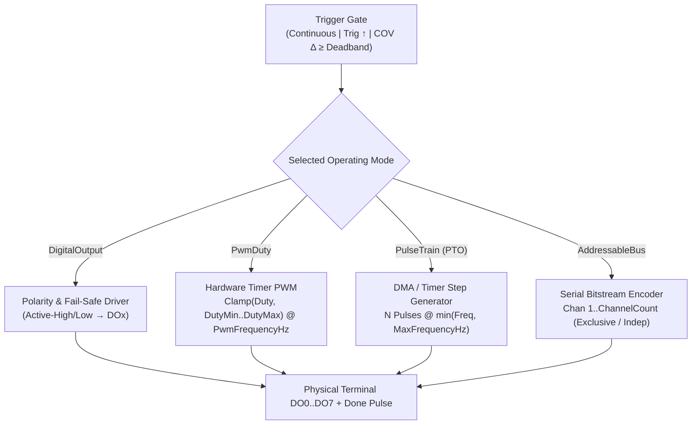
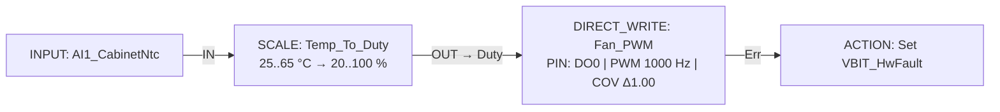

# DIRECT_WRITE — Direct Hardware Terminal Driver

  <strong>Document ID:</strong> SYNX-DOC-BLK-DIRWRITE
  <strong>Block Category:</strong> Fieldbus &amp; Hardware Actuation
  <strong>Execution Class:</strong> Deterministic Hardware Timer / GPIO Peripheral Driver
  <strong>Standard:</strong> IEC 61131-3 Digital, PWM &amp; PTO Actuation

## 1. Synopsis & Execution Semantics

The **`DIRECT_WRITE`** (**Pulse & Hardware Terminal Output Driver**) function block binds directly to a single physical transistor/relay output terminal (**`DO0 .. DO7`**) on the SynaptiX edge controller, unlocking hardware timer peripherals beyond basic boolean coils.

A single `DIRECT_WRITE` instance can operate in **four hardware actuation modes**:
1. **Digital Output (`DigitalOutput` — DO `0/1`):** Drives 24 VDC relays, solenoid valves, contactors, and pilot lamps with configurable `IsActiveHigh` polarity and deterministic `FailSafeState` behavior on fault/stop.
2. **PWM Duty Cycle (`PwmDuty` — `0..100%`):** Generates hardware timer pulse-width modulation at `PwmFrequencyHz` with `[DutyMin .. DutyMax]` clamping for proportional valves, DC motor speed drives, heaters, and LED dimmers.
3. **Pulse Train Output (`PulseTrain` — PTO):** Dispatches deterministic high-speed step bursts (`Pulses` count at `Freq` Hz, bounded by `MaxFrequencyHz` and `PulseWidthUs`) for stepper and servo `STEP/DIR` motion indexers.
4. **Addressable Actuator Bus (`AddressableBus`):** Drives single-wire serial addressable RGB/actuator chains (`1..ChannelCount`) with optional `IsExclusiveChannel` one-hot selection and `DefaultColorRgb`.

---

## 2. Pinout & Signal Contract

`DIRECT_WRITE` dynamically reconfigures its left-hand input connectors (`SynchronizeConnectors`) for the active **`Mode` × `TriggerMode`** combination so engineers only see pins that physically apply:

### 2.1. Dynamic Input Connector Topology Matrix

| Operating Mode | `Continuous` or `OnChangeOfValue` (COV) | `OnTriggerRisingEdge` | Input Signal Semantics |
| :--- | :---: | :---: | :--- |
| **1. `DigitalOutput`** | `[In]`, `[En]` | `[Trig]`, `[In]`, `[En]` | `In` (`BOOL`): desired state (`0`/`1`) · `En` (`BOOL`): output enable gate · `Trig`: rising-edge latch trigger. |
| **2. `PwmDuty`** | `[Duty]` | `[Trig]`, `[Duty]` | `Duty` (`INT32`/`REAL`, `0..100%`): target PWM duty cycle clamped to `[DutyMin..DutyMax]`. (`Param` pin hidden). |
| **3. `PulseTrain` (PTO)** | `[Pulses]`, `[Freq]` | `[Trig]`, `[Pulses]`, `[Freq]` | `Pulses` (`INT32`): step count to emit · `Freq` (`INT32` Hz): step frequency clamped to `MaxFrequencyHz`. |
| **4. `AddressableBus`** | `[Chan]`, `[Param]` | `[Chan]`, `[Param]` | `Chan` (`1..ChannelCount`): target pixel/node · `Param` (`UINT32` RGB / state). (`Trig` pin hidden). |

### 2.2. Fixed Output Connectors

| Pin | Direction | Signal Kind | Data Type | Visibility | Functional Contract |
| :--- | :---: | :---: | :---: | :---: | :--- |
| **`Done`** | Output | Event (Pulse) | `BOOL` | Always visible | Pulses `1` when a triggered write commits or when a PTO pulse burst finishes outputting all requested steps. |
| **`Err`** | Output | Value | `BOOL` | Always visible | Asserts `1` if `TargetPin` exceeds the active device preset's physical DO count or if hardware peripheral contention occurs. |

---

## 3. Inspector Parameters & Constraints

Click **`[ Configure... ]`** (or double-click the node) to open the **Direct Hardware Output Dialog**:

### 3.1. Terminal & Trigger Settings

| Parameter | Property Key | Type & Domain | Default | Description & Hardware Guard |
| :--- | :--- | :--- | :---: | :--- |
| **Target Terminal** | `TargetPin` | `DO0 .. DO7` | `DO0` | Physical output terminal driven by this block. Validated dynamically against the active [Device Preset](/concepts/ecosystem-overview) DO count. |
| **Operating Mode** | `Mode` | `DigitalOutput`, `PwmDuty`, `PulseTrain`, `AddressableBus` | `DigitalOutput` | Selects the MCU GPIO / Hardware Timer peripheral personality for `TargetPin`. |
| **Trigger Mode** | `TriggerMode` | `Continuous`, `OnTriggerRisingEdge`, `OnChangeOfValue` | `OnTriggerRisingEdge` | `Continuous`: updates every scan · `OnTriggerRisingEdge`: updates on `Trig` `0 → 1` · `OnChangeOfValue`: updates when `Δ ≥ Deadband`. |
| **COV Deadband** | `Deadband` | `Float` (`≥ 0.0`) | `0.5` | Minimum input delta required to update hardware in `OnChangeOfValue` mode (visible only when `IsCovMode = true`). |

### 3.2. Mode-Specific Hardware Parameters

| Mode | Parameter | Property Key | Default | Constraint / Physical Meaning |
| :--- | :--- | :--- | :---: | :--- |
| **1. `DigitalOutput`** | **Active Polarity** | `IsActiveHigh` | `true` | `true`: Active-High (`1 = 24V ON, 0 = 0V OFF`) · `false`: Active-Low (`0 = 24V ON, 1 = 0V OFF`). |
| **1. `DigitalOutput`** | **Fail-Safe State** | `FailSafeState` | `0` | `0`: De-energize (`OFF`) on stop/fault · `1`: Energize (`ON`) on stop/fault (e.g., normally-energized cooling valve). |
| **2. `PwmDuty`** | **PWM Frequency** | `PwmFrequencyHz` | `1000` Hz | Carrier frequency in Hz (use high-speed transistor outputs rather than mechanical relays!). |
| **2. `PwmDuty`** | **Duty Limits** | `DutyMin` .. `DutyMax` | `0` .. `100` % | Hardware saturation floor and ceiling (`0%..100%`). |
| **2. `PwmDuty`** | **Initial Duty** | `InitialDuty` | `0` % | Startup duty cycle applied upon controller boot before first trigger. |
| **3. `PulseTrain`** | **Pulse Width** | `PulseWidthUs` | `50` µs | High-pulse duration in microseconds (match stepper optocoupler minimum width, typically `5..100 µs`). |
| **3. `PulseTrain`** | **Max Frequency** | `MaxFrequencyHz` | `20000` Hz | Safety speed ceiling (`Hz`) protecting stepper mechanics from stall overspeed. |
| **4. `AddressableBus`** | **Channel Count** | `ChannelCount` | `18` | Number of daisy-chained addressable actuator/LED nodes on the wire. |
| **4. `AddressableBus`** | **Exclusive Channel** | `IsExclusiveChannel` | `true` | `true`: One-hot illumination (only active `Chan` stays lit) · `false`: Independent multi-node states. |
| **4. `AddressableBus`** | **Default Color RGB** | `DefaultColorRgb` | `0x00FF00` | Fallback 24-bit RGB hex value (`#00FF00` emerald green) when `Param` is `0`. |

::: danger Mechanical Relay Wear Warning in PWM & PTO Modes
Never configure `PwmDuty` or high-frequency `PulseTrain` on electromechanical relay outputs — rapid switching will weld relay contacts within minutes. Always select solid-state NPN/PNP transistor `DO` terminals as specified in your hardware preset datasheet.
:::

---

## 4. Hardware Mode & Trigger Dispatch Diagram

---

## 5. Validation, Error Handling & Live Diagnostics

- **Out-of-Range Hardware Pin Check (`(!)`):** If you switch a project from an 8-DO controller preset down to a 4-DO gateway preset (`DO0..DO3`), any `DIRECT_WRITE` assigned to `DO4..DO7` immediately flags `IsHardwarePinOutOfRange = true`, displays **`PIN: DO4 (!)`** on the node header, turns the status pill to **`ERR: PIN EXCEEDED`**, and blocks unsafe deployment in [Atomic Deploy](/workspaces/deploy-tab).
- **Duplicate Terminal Conflict Check:** The compiler verifies that two `DIRECT_WRITE` blocks do not simultaneously claim conflicting timer modes (e.g., `PwmDuty` and `DigitalOutput`) on the same `DOx` pin.
- **Interactive Signal Breakdown Preview:** The configuration modal includes a live simulator where you can test `SimDoValue`, `SimPwmDuty`, `SimPtoPulses`/`SimPtoFreq`, or `SimBusChannel` and inspect the generated hardware timing parameters prior to flashing.

---

## 6. Practical Industrial Wiring Example

### Proportional Cooling Fan PWM Control (`SCALE` → `DIRECT_WRITE` PWM on `DO0`)

**Objective:** Convert cabinet temperature (`25.0 °C .. 65.0 °C`) scaled by [`SCALE`](/blocks/scale) into a `20% .. 100%` `1000 Hz` PWM signal on solid-state output `DO0`, updating only when duty changes by at least `1.0%` (`OnChangeOfValue`).

**Configuration Steps:**
1. Configure [`SCALE`](/blocks/scale) using 2-Point Calibration (`X1 = 250, Y1 = 20`; `X2 = 650, Y2 = 100`, `IsClamped = true`) so output spans `20.0 .. 100.0 %`.
2. Add **`DIRECT_WRITE`** onto the canvas and open its configuration dialog:
   - `TargetPin = DO0`
   - `Mode = PwmDuty`
   - `PwmFrequencyHz = 1000`, `DutyMin = 20`, `DutyMax = 100`, `InitialDuty = 25`
   - `TriggerMode = OnChangeOfValue`, `Deadband = 1.0`
3. Notice the input connectors automatically simplify to a single **`Duty`** pin; wire `SCALE.OUT` directly to **`Duty`**.
