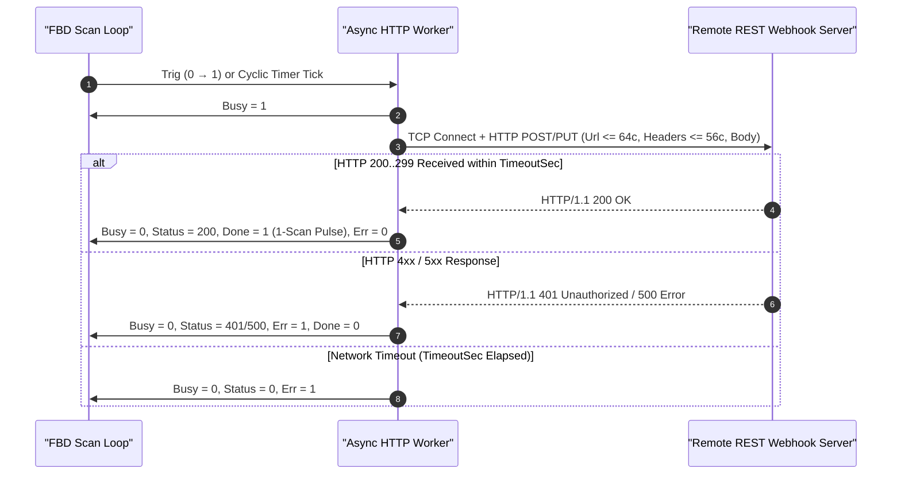
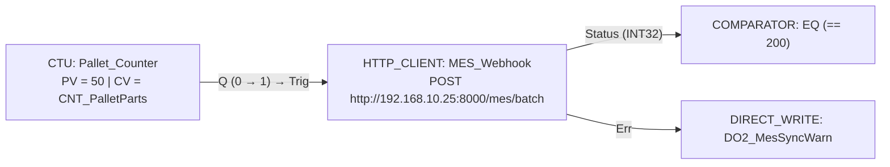

# HTTP_CLIENT — REST API & Webhook Dispatcher

  <strong>Document ID:</strong> SYNX-DOC-BLK-HTTP
  <strong>Block Category:</strong> IIoT Cloud &amp; IP Network
  <strong>Execution Class:</strong> Non-Blocking HTTP/HTTPS REST Client
  <strong>Standard:</strong> IETF RFC 9110 HTTP Semantics &bull; JSON Webhook Telemetry

## 1. Synopsis & Execution Semantics

The **`HTTP_CLIENT`** (**REST API & Webhook Client**) function block enables a SynaptiX edge controller to push structured JSON telemetry, production batch completions, or equipment fault alerts directly to enterprise ERP/MES endpoints, InfluxDB/Grafana webhooks, or custom REST APIs via **`POST`** or **`PUT`** requests without requiring an intermediate MQTT broker.

Execution guarantees:
- **Asynchronous Non-Blocking Socket Worker:** DNS lookup, TCP/TLS handshake, HTTP request serialization, and response header parsing execute on an isolated network task bounded by `TimeoutSec` (`1..30 s`). Network latency never delays the deterministic control scan cycle.
- **Live HTTP Status Inspection:** Captures the exact server response status code (`200`, `201`, `400`, `401`, `500`) on the **`Status`** (`StatusCode`) output pin so FBD logic can distinguish successful cloud ingestion (`2xx` → `Done` pulse) from authentication or server errors (`4xx`/`5xx` → `Err` flag).
- **Snapshot Configuration & JSON Validator:** The modal configuration dialog includes a live **Visual Field Builder**, placeholder injector, UTF-8 byte counter, and real-time `JsonDocument` syntax checker before deployment.

---

## 2. Pinout & Signal Contract

| Pin | Direction | Signal Kind | Data Type | Visibility | Functional Contract |
| :--- | :---: | :---: | :---: | :---: | :--- |
| **`Trig`** | Input | Event (`0 → 1`) | `BOOL` | Always visible | **Request Trigger:** Initiates an HTTP `POST`/`PUT` transaction on rising edge (`0 → 1`) when `TriggerMode = Event` (and allows manual override in `Cyclic` mode). |
| **`Data`** | Input | Value | `BOOL` / `INT32` / `REAL` | Always visible | **Single-Wire Payload Input:** Supplies the primary process value when `DataTag` is set to *FBD Canvas DATA Pin (Auto-link)* in `Raw` or single-value `Custom` mode. Multi-tag payloads bind via the **Fields** table in `JSON` mode. |
| **`Busy`** | Output | Value | `BOOL` | Always visible | **Transaction In-Flight:** Remains `1` from request dispatch until the server responds or `TimeoutSec` expires. |
| **`Done`** | Output | Event (Pulse) | `BOOL` | Always visible | **2xx Success Pulse:** Emits a 1-scan pulse (`1`) when an HTTP `200..299` response is received. |
| **`Err`** (`Error`) | Output | Event / Flag | `BOOL` | Always visible | **Fault Indicator:** Asserts `1` on DNS/socket connection failure, request timeout, or HTTP `4xx`/`5xx` error status. |
| **`Status`** (`StatusCode`) | Output | Value | `INT32` | Always visible | **HTTP Status Code:** Outputs numeric HTTP response code (`200`, `201`, `401`, `404`, `500`, or `0` on transport timeout). |

---

## 3. Inspector Parameters & Constraints

Click **`[ Configure HTTP Client... ]`** (or double-click the node) to open the **REST Webhook Configuration Dialog**:

| Parameter | Property Key | Type & Domain | Default | Firmware Limit & Validation Contract |
| :--- | :--- | :--- | :---: | :--- |
| **HTTP Method** | `Method` | `"POST"` \| `"PUT"` | `"POST"` | `POST` for appending event/telemetry records; `PUT` for idempotent state updates. |
| **Endpoint URL** | `Url` | `String` (**`<= 64 chars`**) | `"http://api.myserver.com/telemetry"` | Must start with `http://` or `https://` and must not exceed **`64` characters** (enforced automatically by `UrlValidationError` and input clamping). |
| **Custom Headers** | `CustomHeaders` | `String` (**`<= 56 chars`**) | `"Content-Type: application/json"` | Optional HTTP header line (`<= 56 chars`), e.g., `X-Api-Key: synx-prod-98a1` or `Content-Type: text/plain`. |
| **Request Timeout** | `TimeoutSec` | `UINT16` (`1..30 s`) | `5` s *(10 s max typ.)* | Maximum wait window (`1..30` seconds) before aborting an unresponsive socket and asserting `Err = 1`. |
| **Trigger Mode** | `TriggerMode` | `"Event"` \| `"Cyclic"` | `"Event"` | `Event`: transmits on `Trig` rising edge (`0 → 1`) · `Cyclic` (`Periodic`): transmits automatically on timer interval. |
| **Cyclic Interval** | `PeriodicIntervalSec` / `IntervalMs` | `UINT16` (`s` / `ms`) | `30` s (`5` s node) | Periodic dispatch interval when `TriggerMode = Cyclic`. |
| **Payload Mode** | `PayloadMode` | `"JSON"` \| `"Custom"` \| `"Raw"` | `"JSON"` | Selects **JSON Visual Field Builder**, **Custom Template** (`<= 128 chars`), or **Raw** scalar value. |
| **Custom Template** | `CustomTemplate` | `String` (**`<= 128 chars`**) | `{"device":"{device}","ts":{ts},"val":{val}}` | Active when `PayloadMode = Custom`. Supports caret insertion of `` `{device}` ``, `` `{ts}` ``, `` `{val}` ``, and `` `{tag}` ``. |

*(See [Payload Macros & Capacity Limits](/appendices/macro-tokens-and-limits) for firmware string budget optimization tips such as using concise reverse-proxy paths).*

---

## 4. Non-Blocking HTTP Request Lifecycle

---

## 5. Validation, Error Handling & Live Diagnostics

- **Strict Firmware String Length Guards:**
  - `Url` is capped at **`<= 64 chars`** and validated for `http://` or `https://` scheme prefix (`HasUrlError`). Tip: When integrating cloud webhooks with long query tokens, route through a short local/edge gateway path (e.g., `http://10.0.10.50:8080/api/v1/ingest`) and place short API keys in `CustomHeaders` (`<= 56 chars`).
  - `CustomTemplate` is capped at **`<= 128 chars`** and checked live with `JsonDocument.Parse` (`HasJsonError`) so missing quotes or commas are caught immediately inside the dialog.
- **Re-Entrancy Protection (`Busy = 1`):** Trigger edges arriving while `Busy = 1` are safely ignored so slow cloud endpoints cannot exhaust MCU socket descriptors.
- **Live Canvas Status Pill (`F8`):** Displays **`READY`**, **`TX...`** (in flight), **`HTTP 200 (#14)`** (last status code and cumulative request count), or **`ERR: <Reason>`**.

---

## 6. Practical Industrial Wiring Example

### MES Production Work-Order Completion Webhook (`CTU` → `HTTP_CLIENT` `POST`)

**Objective:** Every time a [`CTU`](/blocks/ctu) counter completes a `50`-part pallet (`Q` rising edge), send an HTTP `POST` JSON report containing part count (`CNT_PalletParts`) and line temperature (`VREG0_LineTemp`) to the plant MES server `http://192.168.10.25:8000/mes/batch`.

**Configuration Steps:**
1. Place **`HTTP_CLIENT`** on the canvas and open its configuration dialog:
   - `Method = "POST"`
   - `Url = "http://192.168.10.25:8000/mes/batch"` (`35` chars `<= 64`)
   - `CustomHeaders = "X-Api-Key: synx-mes-01"` (`22` chars `<= 56`)
   - `TimeoutSec = 5`, `TriggerMode = "Event"`, `PayloadMode = "JSON"`
2. In the **Visual Field Builder**, add two fields:
   - `qty` → `CNT_PalletParts` (`INT32`)
   - `temp_c` → `VREG0_LineTemp` (`REAL`)
3. Click **Apply**, wire `CTU.Q` to `HTTP_CLIENT.Trig`, and monitor `HTTP 200 (#1)` live during commissioning.
