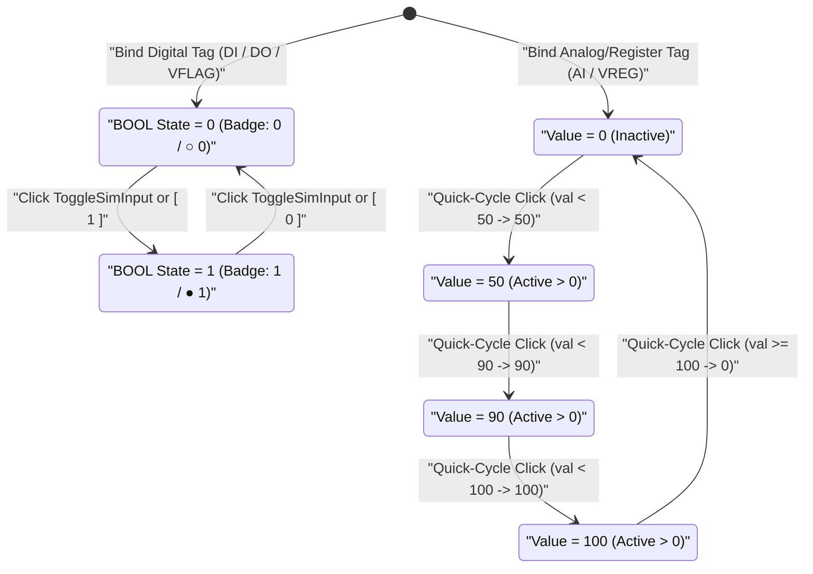
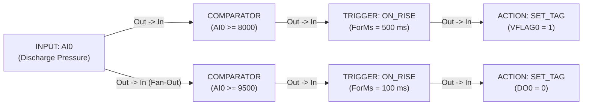

# INPUT — Tag Source Node

  <strong>Block Code:</strong> INPUT
  <strong>Category:</strong> Core Rule Pipeline
  <strong>Execution Class:</strong> Synchronous Scan Source (0 Latency)
  <strong>Lowering Target:</strong> Process Image Tag Binding

## 1. Synopsis & Execution Semantics

The **`INPUT`** block is the foundational signal entry point on the **SynaptiX IDE** Logic Graph Canvas. It binds a single physical I/O channel or virtual memory variable from the project [Tag Catalog](/workspaces/tag-catalog-tab) and exposes its live state onto the `Out` value connector on every scan cycle.

- **Deterministic Process Image Read:** At the start of each scan cycle on the **SynaptiX Runtime**, hardware inputs are latched into an immutable process image snapshot. Every `INPUT` block referencing the same tag reads an identical, race-free value throughout that scan pass.
- **Zero-Overhead Lowering:** `INPUT` does not consume a standalone execution slot; during compilation (`F7`), its bound tag index and physical data type (`BOOL`, `INT32`, or IEEE-754 `REAL`) propagate directly into downstream [`TRIGGER`](/blocks/trigger), [`COMPARATOR`](/blocks/comparator), [`SCALE`](/blocks/scale), [`TON`](/blocks/ton), [`CTU`](/blocks/ctu), or [`MQTT_PUB`](/blocks/mqtt-pub) blocks.
- **Primary Industrial Use Cases:** Reading discrete limit switches and E-Stop contacts (`DI`), monitoring coil feedback (`DO`), feeding raw `4–20 mA` / `0–10 V` sensor channels (`AI`) into calibration chains, and routing internal state flags (`VFLAG`) or retentive setpoints (`VREG_R`) across multi-rung control sequences.

---

## 2. Pinout & Signal Contract

`INPUT` acts strictly as a pure signal source and therefore exposes zero input connectors and one universal value output connector.

| Pin | Direction | Signal Kind | Data Type | Description |
| :--- | :--- | :--- | :--- | :--- |
| `Out` | Output | Value / Data (`IsEvent = false`) | Polymorphic (`BOOL` \| `INT32` \| `REAL`) | Emits the live value and tag metadata of the selected `Tag`. Capable of `1:N` fan-out to multiple downstream blocks simultaneously. |

---

## 3. Inspector Parameters & Validation Limits

Selecting an `INPUT` node opens its property sheet in the right-hand **Inspector** panel:

| Parameter | Type / Options | Default | Constraints | Runtime Behavior |
| :--- | :--- | :--- | :--- | :--- |
| `Tag` | Tag Selector (`DI`, `DO`, `AI`, `VFLAG`, `VREG`, `VREG_R`, `COUNTER`) | `DI0` (first available discrete input) | Must reference a valid defined tag (`Index < 65535`). Unassigned tags raise a pre-deploy compile error. | Determines both the physical memory address sampled each scan and the strict data type contract (`BOOL`, `INT32`, or `REAL`) enforced downstream. |
| `CustomLabel` | Free-text String | Empty *(uses `Tag.Name`, e.g., `DI0`)* | Optional display override; does not alter underlying tag address or alias in the Tag Catalog. | Replaces the header title on the canvas node for schematic readability (e.g., `"Tank High Float"`). |
| `TagValueText` *(Simulator)* | Type-Locked Input / Toggle (`[ 0 ]` `[ 1 ]` for `BOOL`; numeric field for `INT32` / `REAL`) | `"0"` (`"0.0"` for `REAL`) | Active in Offline & Simulator mode (`F5`). Subject to Bad-Data Defense normalization and auto-revert. | Injects synthetic process values directly into the simulated process image to exercise downstream triggers, timers, and comparators. |

### Supported Tag Memory Domains

| Tag Kind Badge | Memory Domain | Native Data Type | Typical Source |
| :--- | :--- | :--- | :--- |
| `DI` | Discrete Input | `BOOL` (`0` or `1`) | Opto-isolated physical digital input terminals (`24 VDC` sensors, pushbuttons). |
| `DO` | Discrete Output Readback | `BOOL` (`0` or `1`) | Current state of physical relay, transistor, or solid-state output channels. |
| `AI` | Analog Input | `INT32` / `REAL` | Onboard ADC channels (`4–20 mA`, `0–10 V`, NTC/RTD conditioning). |
| `VFLAG` | Virtual Flag | `BOOL` (`0` or `1`) | Internal volatile boolean state bit for multi-branch interlocking. |
| `VREG` | Virtual Register | `INT32` / `REAL` | Internal volatile 32-bit register for intermediate math, scaling, or fieldbus values. |
| `VREG_R` | Retentive Virtual Register | `INT32` / `REAL` | Non-volatile 32-bit register preserved across power cycles (recipes, calibration offsets). |
| `COUNTER` | Counter Accumulator (`CV`) | `INT32` | Live accumulated count register driven by high-speed or logic counters. |

---

## 4. State Machine / Timing Diagram

Because `INPUT` is a zero-latency combinational source in runtime and an interactive stimulus generator in **Simulator Mode** (`F5`), its interactive state transitions follow two deterministic pathways depending on whether the bound tag is **Digital (`BOOL`)** or **Analog / Register (`INT32` / `REAL`)**:

- **Digital Quick-Toggle:** Clicking the on-canvas simulation toggle button switches `Tag.Value` cleanly between `0` (`○ 0`) and `1` (`● 1`).
- **Analog 4-Step Quick-Cycle:** Clicking the quick-cycle button on an `AI` or `VREG` node steps through standard commissioning checkpoints `0 → 50 → 90 → 100 → 0`, while arbitrary exact engineering values can be typed directly into `TagValueText` in the Inspector.

---

## 5. Input Defense & Live Diagnostics

### 5.1 Bad-Data Defense (`SmartInputParser`)

To uphold the **Visual Truth Guarantee**—ensuring the Inspector display never contradicts physical memory—`TagValueText` enforces two-phase input resolution upon pressing `Enter` or leaving the field (`LostFocus`):

- **Digital (`BOOL`) Tags:** The Inspector presents dedicated binary `[ 0 ]` and `[ 1 ]` buttons alongside tolerant parsing (`"true"`, `"on"`, `"yes"` → `"1"`; `"false"`, `"off"`, `"no"` → `"0"`). Unparseable text immediately reverts to the last committed `"0"` or `"1"`.
- **Integer (`INT32`) Tags:** Accepts signed 32-bit integers. Tolerates harmless `.0` suffixes (`"100.0"` → normalized to `"100"`), but strictly **rejects fractional decimals** such as `"25.5"` or alphabetic strings (`"abc"`), reverting `TagValueText` to the exact integer stored in memory.
- **Floating-Point (`REAL`) Tags:** Accepts both dot and comma decimal separators (`"25,5"` → `"25.5"`) and automatically formats whole numbers with an explicit `.0` suffix (`"25"` → `"25.0"`) to confirm IEEE-754 32-bit float storage.

### 5.2 Canvas Badges in Simulator (`F5`) & Online Live Debug (`F8`)

| Operating Mode | Node Visual Indicator | Diagnostic Behavior |
| :--- | :--- | :--- |
| **Offline / Design** | Tag Kind pill (`DI`, `AI`, `VREG_R`) + `ValueBadgeText` | Displays initial/simulated value formatted strictly per tag data type (`0`/`1`, integer, or `0.0###` float). |
| **Simulator (`F5`)** | Interactive `○ 0` / `● 1` or step-cycle button + energized border | Border and output wire illuminate green whenever a digital tag equals `1` or an analog tag exceeds `0`. |
| **Online Live Debug (`F8`)** | 20 FPS `LiveBadgeText` (`1`, `0`, `1,250`, `36.5`) | Streams live hardware readings. Only boolean tags trigger active green node illumination; numeric registers display live formatted numbers cleanly on a neutral slate card. |
| **Quality Degradation** | ` [STALE]` suffix / Last Known badge | Appends ` [STALE]` if tag quality drops, and retains the final sampled reading on disconnect so intermittent wiring faults remain visible. |

---

## 6. Practical Industrial Wiring Example

### Scenario: Fan-Out from a Single Analog Pressure Sensor to Dual Threshold Alarms

A `4–20 mA` discharge pressure transmitter wired to analog input `AI0` (`0–10.0 bar` scaled into `VREG0` or read directly as raw millibar counts `0–10000`) must drive both a **High-Pressure Warning** (`8000 mbar`) and an **Over-Pressure Emergency Pump Trip** (`9500 mbar`) from a single `INPUT` source node.

### Tag Configuration

| Tag Name | Kind | Data Type | Description / Alias |
| :--- | :--- | :--- | :--- |
| `AI0` | `AI` | `INT32` | `Discharge Pressure (0-10000 mbar)` |
| `VFLAG0` | `VFLAG` | `BOOL` | `High Pressure Warning Flag` |
| `DO0` | `DO` | `BOOL` | `Main Booster Pump Contactor` |

### Step-by-Step Canvas Wiring

1. Press `Ctrl+2` to open the **Logic Graph Canvas** and add one **`INPUT`** block; bind `Tag = AI0` and set `CustomLabel = "Discharge Pressure"`.
2. With the `INPUT` node selected, add a **[`COMPARATOR`](/blocks/comparator)** (`CompareOp = GTE`, `ThresholdLo = 8000`) followed by a **[`TRIGGER`](/blocks/trigger)** (`TriggerType = ON_RISE`, `ForMs = 500`) and an **[`ACTION`](/blocks/action)** (`ActionType = SET_TAG`, `TargetTag = VFLAG0`, `ActionParam = 1`).
3. Drag a second wire (`1:N` fan-out) from the same `INPUT.Out` pin to a second **[`COMPARATOR`](/blocks/comparator)** (`CompareOp = GTE`, `ThresholdLo = 9500`) → **[`TRIGGER`](/blocks/trigger)** (`TriggerType = ON_RISE`, `ForMs = 100`) → **[`ACTION`](/blocks/action)** (`ActionType = SET_TAG`, `TargetTag = DO0`, `ActionParam = 0`).
4. Press `F5` to launch the **Simulator**, select the `AI0` `INPUT` node, and enter `"8200"` in `TagValueText` (`Enter`): verify `VFLAG0` latches `1` after `500 ms` while `DO0` stays `1`. Next, enter `"9600"` and confirm `DO0` trips to `0` after `100 ms`.

