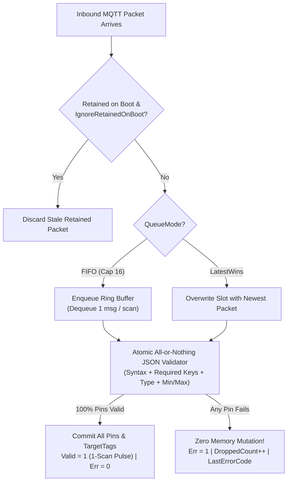
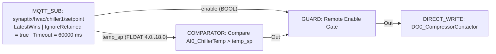

# MQTT_SUB — Cloud Command & Setpoint Subscriber

  <strong>Document ID:</strong> SYNX-DOC-BLK-MQTTSUB
  <strong>Block Category:</strong> IIoT Cloud &amp; IP Network
  <strong>Execution Class:</strong> Pure Background Inbound Listener &amp; Atomic JSON Parser
  <strong>Standard:</strong> OASIS MQTT v3.1.1 &bull; IEC 62443 Bad-Data Defense

## 1. Synopsis & Execution Semantics

The **`MQTT_SUB`** (**IIoT MQTT Inbound Subscriber**) function block is a **pure background source node** that subscribes to cloud/MES command topics, validates incoming JSON payloads against strict schema and range rules, and extracts typed fields directly onto FBD output pins and local tags.

Safety-critical industrial design guarantees:
- **Zero-Input Pure Listener Topology:** `MQTT_SUB` has **no `EN` or `Trig` input pins** — it listens continuously in the background whenever the broker transport is online, keeping downstream FBD sheets clean.
- **Atomic All-or-Nothing JSON Commit:** Every inbound message is validated across **all** configured dynamic `Pins` before touching runtime memory. If even one required field is missing, has a mismatched data type, or falls outside `[MinValue .. MaxValue]`, **zero** pins are modified, `DroppedCount` increments, and `Err` asserts with a specific diagnostic code.
- **Boot Retain Protection & Watchdog Fail-Safe:** `IgnoreRetainedOnBoot` prevents stale retained broker commands from unexpectedly starting machinery on power-up, while `FailSafeTimeoutMs` handles cloud silence deterministically.

---

## 2. Pinout & Signal Contract

`MQTT_SUB` exposes zero input pins on its left side and `2 + N` output pins on its right side:

| Pin | Direction | Signal Kind | Data Type | Visibility | Functional Contract |
| :--- | :---: | :---: | :---: | :---: | :--- |
| *(None)* | Input | — | — | Always empty | Pure background listener; requires no upstream enable wire. |
| **`Valid`** | Output | Event (1-Scan Pulse) | `BOOL` | Always visible | **Atomic Commit Pulse:** Pulses `1` for one scan cycle (`10 ms`) immediately after an inbound JSON packet passes all pin checks and updates all outputs simultaneously. |
| **`Err`** | Output | Value (Latched) | `BOOL` | Always visible | **Inbound Fault Flag:** Asserts `1` on JSON syntax error, missing field, type mismatch, out-of-range value, FIFO overflow, broker drop, or fail-safe timeout. Clears to `0` on next valid message. |
| **`<Pin.Label>`** | Output *(Dynamic)* | Value | `BOOL`, `INT16`, `INT32`, `FLOAT`, `STRING` | 1 pin per row in `Pins` | **Extracted JSON Field Output:** Emits the parsed value from `JsonPath` (auto-resolving both flat `{"grid": 5}` and wrapped `{"values": {"grid": 5}}` envelopes) and writes to `TargetTag`. |

---

## 3. Inspector Parameters & Constraints

### 3.1. Subscription, Queueing & Fail-Safe Properties

| Parameter | Property Key | Type & Domain | Default | Description & Industrial Safety Purpose |
| :--- | :--- | :--- | :---: | :--- |
| **Subscribe Topic** | `Topic` | `String` | `"synaptix/commands/inbound"` | MQTT topic filter (`SanitizeTopic` supported; MQTT single-level `+` and multi-level `#` wildcards permitted). |
| **QoS Level** | `Qos` | `0` \| `1` \| `2` | `1` | Defaults to `QoS 1` (at-least-once delivery) for reliable command reception. |
| **Queue Mode** | `QueueMode` | `FIFO` \| `LatestWins` | `FIFO` | **`FIFO`** (`Capacity = 16`): dequeues `1` message per scan in arrival order so back-to-back sorting commands are never lost. **`LatestWins`**: discards older queued packets and applies only the freshest setpoint. |
| **Queue Capacity** | `QueueCapacity` | `INT32` | `16` | Depth of the deterministic ring buffer when `QueueMode = FIFO`. |
| **Ignore Retained on Boot** | `IgnoreRetainedOnBoot` | `BOOL` | `true` | Discards retained packets flagged by the broker upon initial connection so old commands never trigger surprise motion. |
| **Fail-Safe Timeout** | `FailSafeTimeoutMs` (`TimeoutMs`) | `UINT32` (`ms`, `0` = Off) | `0` | Watchdog window in milliseconds. If no valid message arrives before expiration, triggers `FailSafeAction` and sets `ErrCode = TimeoutExpired`. |
| **Fail-Safe Action** | `FailSafeAction` | `KeepLastValue` \| `ResetToZero` \| `ResetToDefault` | `KeepLastValue` | Deterministic fallback applied to all dynamic pins when `FailSafeTimeoutMs` expires or broker connection drops. |

### 3.2. Dynamic JSON Pin Binding Properties (`MqttPinBindingViewModel`)

| Field | Property Key | Supported Options | Description |
| :--- | :--- | :--- | :--- |
| **Field / JSON Path** | `FieldName` / `JsonPath` | e.g., `grid`, `setpoint_temp`, `values.speed` | Key name or dot-path extracted from inbound JSON; automatically synchronizes the canvas pin `Label`. |
| **Data Type** | `DataType` | `Int16`, `Int32`, `Float`, `Bool`, `String` | Target type contract (`Bool` accepts `true`/`false`, `1`/`0`, `"TRUE"`/`"FALSE"`). |
| **Min / Max Bounds** | `MinValue`, `MaxValue` | `Double?` (optional) | Rejects the entire packet (`OutOfRange`) if the parsed number violates `[MinValue .. MaxValue]`. |
| **Default Value** | `DefaultValue` | `Double` (`0.0`) | Safe fallback value loaded when `FailSafeAction = ResetToDefault`. |
| **Target Tag** | `TargetTag` | `TagModel?` | Optional direct binding to a `VREG`, `VBIT`, or `DO` tag in [Tag Catalog](/workspaces/tag-catalog-tab). |

---

## 4. Queueing & Atomic All-or-Nothing State Machine

---

## 5. Validation, Error Handling & Live Diagnostics

### Standardized `MqttErrorCode` Diagnostic Table

| Code | Enum Identifier | Fault Condition | Runtime Memory Guarantee |
| :---: | :--- | :--- | :--- |
| **`0`** | `None` | Valid JSON parsed and committed. | All pins updated; `MsgCount` incremented. |
| **`1`** | `ConnectionLost` | Broker TCP/TLS session disconnected. | Applies `FailSafeAction`; `Err = 1`. |
| **`2`** | `JsonSyntaxError` | Malformed JSON brackets, quotes, or trailing commas. | Packet dropped (`DroppedCount++`); prior pin values untouched. |
| **`3`** | `MissingField` | A configured `JsonPath` key is absent from the JSON object. | Packet dropped atomically; identifies `FaultyField` in dialog. |
| **`4`** | `TypeMismatch` | Non-numeric string (e.g., `"abc"`) sent to `Int16`/`Float` pin. | Packet dropped atomically; zero tag corruption. |
| **`5`** | `OutOfRange` | Numeric value violates `[MinValue .. MaxValue]` safety bounds. | Packet dropped atomically; prevents unsafe actuator setpoints. |
| **`6`** | `QueueOverflow` | Burst rate exceeded `16`-slot `FIFO` buffer capacity. | Oldest/excess burst flagged so engineer can tune scan/QoS. |
| **`7`** | `TimeoutExpired` | No valid packet received within `FailSafeTimeoutMs`. | Executes `KeepLastValue`, `ResetToZero`, or `ResetToDefault`. |

- **Built-In Live JSON Payload Tester (`SimInputPayload`):** Both the Inspector and the `MQTT_SUB` modal dialog include an interactive **Test JSON Payload** box (`SimulateSend`). Paste any real cloud payload and click **Test Parse** to verify path extraction, range rejection, and `Valid` pulsing offline without needing a live broker!

---

## 6. Practical Industrial Wiring Example

### Remote HVAC Chiller Setpoint Dispatch with Bounds Defense (`LatestWins` + Watchdog)

**Objective:** Accept remote chilled-water temperature setpoints (`{"temp_sp": 7.5, "enable": true}`) on `synaptix/hvac/chiller1/setpoint`, enforce strict physical limits `[4.0 °C .. 18.0 °C]` so a cloud typo like `-10` can never freeze evaporator tubes, and fall back to `12.0 °C` if cloud heartbeat stops for `60,000 ms`.

**Configuration Steps:**
1. Drop **`MQTT_SUB`** on the canvas and set `Topic = "synaptix/hvac/chiller1/setpoint"`, `Qos = 1`, `QueueMode = LatestWins`, `IgnoreRetainedOnBoot = true`.
2. Set `FailSafeTimeoutMs = 60000` and `FailSafeAction = ResetToDefault`.
3. Add two dynamic pins:
   - `temp_sp`: `DataType = Float`, `MinValue = 4.0`, `MaxValue = 18.0`, `DefaultValue = 12.0`, `TargetTag = VREG_TempSp` (`REAL`).
   - `enable`: `DataType = Bool`, `DefaultValue = 0`, `TargetTag = VBIT_RemoteEn` (`BOOL`).
4. In the dialog's **Simulation** box, test `{"temp_sp": 25.0, "enable": true}` and confirm it immediately rejects with `OutOfRange` while leaving `VREG_TempSp` untouched!
