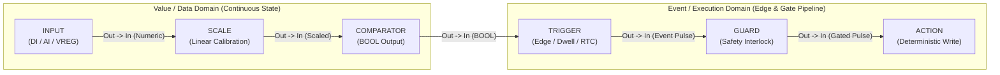

# Blocks Catalog & Pin Legend

  <strong>Document ID:</strong> SYNX-DOC-BLK-000
  <strong>Chapter:</strong> 04. Function Blocks Reference
  <strong>Workspace:</strong> Logic Graph Canvas (Ctrl+2)
  <strong>Standard:</strong> IEC 61131-3 FBD &bull; ANSI/ISA-101

The **Logic Graph Canvas** ([`Ctrl+2`](/workspaces/logic-graph-tab)) in **SynaptiX IDE** provides a deterministic visual Function Block Diagram (FBD) authoring environment tailored for edge control, industrial fieldbus polling, and IIoT telemetry. Every visual block encapsulates strict physical data type validation, cycle-accurate desktop simulation (`F5`), atomic deployment compilation (`F7`), and 20 FPS live telemetry overlays (`F8`) without requiring external scripting.

---

## 1. Master Directory of Function Blocks

The block library is organized into **four functional categories** matching the left toolbox palette in **SynaptiX IDE**. Select any block code below to open its dedicated engineering datasheet.

### 1.1 Core Rule Pipeline

Blocks in the Core Rule Pipeline compile directly into deterministic Event–Condition–Action (ECA) scan rules executed synchronously on every scan cycle of the **SynaptiX Runtime**.

| Block Code | Block Name | Pins (`In` → `Out`) | Primary Industrial Role |
| :--- | :--- | :--- | :--- |
| [`INPUT`](/blocks/input) | **Tag Source Node** | *(None)* → `Out` | Reads physical I/O (`DI`, `DO`, `AI`) or virtual memory tags (`VFLAG`, `VREG`, `VREG_R`, `COUNTER`) into a logic network and provides interactive value injection in Simulator mode. |
| [`TRIGGER`](/blocks/trigger) | **Edge & RTC Detector** | `In` → `Out` | Detects rising edges (`0 → 1`), falling edges (`1 → 0`), value changes, dwell/debounce durations (`ForMs`), periodic intervals, and real-time clock (`RTC`) shift windows. |
| [`COMPARATOR`](/blocks/comparator) | **Relational Logic (`CMP`)** | `In` → `Out` | Evaluates 7 relational operators (`==`, `!=`, `>`, `<`, `>=`, `<=`, `BETWEEN`) with strict `INT32`, `REAL` (`1e-5` tolerance), and `BOOL` type locking. |
| [`GUARD`](/blocks/guard) | **Safety Interlock Gate** | `In` → `Out` | Gates downstream execution pulses against a digital permissive or safety interlock tag (`Pass when 1/ON` or `Invert NOT 0/OFF`). |
| [`ACTION`](/blocks/action) | **Rule Output Executor** | `In` → *(None)* | Terminates a rule network by executing deterministic tag writes (`SET_TAG`, `TOGGLE_TAG`, `INC_COUNTER`, `SCALE_TAG`), remote writes, alarms, or event logs. |

### 1.2 Timing, Counting & Scaling

Stateful timing, pulse counting, and two-point linear calibration blocks for signal conditioning and sequential machine control.

| Block Code | Block Name | Pins (`In` → `Out`) | Primary Industrial Role |
| :--- | :--- | :--- | :--- |
| [`TON`](/blocks/ton) | **On-Delay Timer** | `In` → `Q` | Delays activation of output `Q` until `In` remains continuously active for `PresetMs` (`ms`, `s`, `min`, `h`); suppresses sensor chatter and transient spikes. |
| [`TOF`](/blocks/tof) | **Off-Delay Timer** | `In` → `Q` | Energizes `Q` immediately when `In = 1` and holds `Q = 1` for `PresetMs` after `In` transitions `1 → 0` (e.g., cooling fan post-run). |
| [`TP`](/blocks/tp) | **Monostable Pulse Timer** | `In` → `Q` | Generates a fixed-width, non-retriggerable pulse of exact duration `PresetMs` on a rising edge of `In` regardless of input fluctuations during the pulse. |
| [`CYCLE_TIMER`](/blocks/cycle-timer) | **Asymmetric Oscillator** | `In` → `Q` | Produces a continuous square-wave flasher with independent `OnTimeMs`, `OffTimeMs`, and configurable initial phase (`Start with ON` / `OFF`) while `In = 1`. |
| [`CTU`](/blocks/ctu) | **Count Up Counter** | `CU`, `R` → `Q` | Increments accumulated count `CV` on each rising edge of `CU` and asserts `Q = 1` when `CV >= PV`; resets `CV` to `0` on `R`. |
| [`CTD`](/blocks/ctd) | **Count Down Counter** | `CD`, `R` → `Q` | Decrements `CV` from preset `PV` on each rising edge of `CD` and asserts `Q = 1` when `CV <= 0`; reloads `CV = PV` on `R`. |
| [`SCALE`](/blocks/scale) | **Linear Calibration** | `In` → `Out` | Maps raw ADC or fieldbus counts (`[RawMin..RawMax]`) linearly to engineering units (`[EngMin..EngMax]`) with optional clamping. |

### 1.3 Fieldbus & Hardware Actuation

Asynchronous RS-485 Modbus RTU Master transactions and direct microcontroller peripheral drivers (`DO`, `PWM`, `PTO`).

| Block Code | Block Name | Pins (`In` → `Out`) | Primary Industrial Role |
| :--- | :--- | :--- | :--- |
| [`MB_READ`](/blocks/mb-read) | **Modbus RTU Poller** | `EN` → `Valid`, `Error`, `ErrCode`, `Pin1..N` | Polls external RS-485 Modbus RTU slaves (`FC01`, `FC02`, `FC03`, `FC04`) and unpacks multi-register payloads (`INT16`, `UINT16`, `INT32`, `FLOAT32`) onto typed output pins. |
| [`MB_WRITE`](/blocks/mb-write) | **Modbus RTU Writer** | `Trig`, `Pin1..N` (or `Ch`/`Cmd`/`Param`) → `Done`, `Busy`, `Error`, `ErrCode` | Dispatches single or multi-register Modbus RTU write frames (`FC05`, `FC06`, `FC15`, `FC16`) in Pin-Bound or Channel-Indexed actuation modes. |
| [`DIRECT_WRITE`](/blocks/direct-write) | **Direct Hardware Output** | `Trig` *(optional)*, `Val` → `Done`, `Busy`, `Err` | Drives high-speed onboard hardware channels directly, including discrete outputs (`DO`), variable duty-cycle `PWM`, pulse-train `PTO`, and local bus outputs. |

### 1.4 IIoT Cloud & IP Network

Non-blocking edge-to-cloud telemetry publishers, JSON command subscribers, REST webhooks, and raw TCP socket clients.

| Block Code | Block Name | Pins (`In` → `Out`) | Primary Industrial Role |
| :--- | :--- | :--- | :--- |
| [`MQTT_PUB`](/blocks/mqtt-pub) | **Telemetry Publisher** | `Trig`, `Val1..N` → `Done`, `Err` | Formats bound tag values and runtime macros into JSON or custom payloads and publishes to an MQTT / TLS broker with configurable `QoS` and `Retain`. |
| [`MQTT_SUB`](/blocks/mqtt-sub) | **Command Subscriber** | `EN` → `Valid`, `Err`, `Pin1..N` | Subscribes to inbound MQTT command topics, extracts JSON keys into typed output pins, and pulses `Valid` upon clean payload arrival. |
| [`HTTP_CLIENT`](/blocks/http-client) | **REST Webhook** | `Trig`, `Val1..N` → `Busy`, `Done`, `Error`, `StatusCode` | Dispatches `GET`, `POST`, or `PUT` HTTP/HTTPS requests with custom headers and templated JSON payloads to MES, ERP, or webhook endpoints. |
| [`TCP_CLIENT`](/blocks/tcp-client) | **Raw Socket Stream** | `Send`, `DataIn` → `Conn`, `Done`, `Error`, `DataOut` | Maintains persistent or on-demand raw TCP socket streams for barcode scanners, industrial printers, weighbridges, and custom ASCII/hex protocols. |

---

## 2. Connector Pin Semantics & Wire Grammar

Every connector port on a **SynaptiX IDE** graph node belongs to one of two strict signal domains. Understanding the distinction between **Value/Data Pins** and **Event/Execution Pins** prevents structural wiring errors during compilation (`F7`).

### 2.1 Value / Data Pins vs. Event / Execution Pins

| Signal Domain | Representative Pins | Scan-Cycle Semantics |
| :--- | :--- | :--- |
| **Value / Data Pins** (`IsEvent = false`) | `INPUT.Out`, `SCALE.In` / `Out`, `COMPARATOR.In` / `Out`, `TON.Q`, `TOF.Q`, `TP.Q`, `CYCLE_TIMER.Q`, `CTU.Q`, `CTD.Q`, dynamic `Data` pins on `MB_READ` & `MQTT_SUB` | Carry continuous physical or virtual state values (`BOOL`, `INT32`, or `REAL`) evaluated every scan cycle. Upstream tag bindings propagate automatically across connected value wires. |
| **Event / Execution Pins** (`IsEvent = true`) | `TRIGGER.Out`, `GUARD.In` / `Out`, `ACTION.In`, `TON.In`, `TOF.In`, `TP.In`, `CYCLE_TIMER.In`, `CTU.CU` / `R`, `CTD.CD` / `R`, `Trig` / `Send` / `Done` / `Valid` / `Err` | Represent discrete execution transitions, gating pulses, or asynchronous completion strobes that sequence state changes and trigger downstream operations. |

### 2.2 Structural Wiring Rules

The **SynaptiX IDE** graph compiler enforces deterministic Function Block Diagram topology rules in real time as you drag wires on the canvas and during pre-deploy compilation (`F7`):

1. **Fan-Out Allowed (`1:N`), Fan-In Prohibited (`1:1` per Input Port):** A single output pin (such as `INPUT.Out` or `TRIGGER.Out`) may branch to multiple downstream blocks simultaneously. However, each individual target input port accepts **at most one incoming wire**.
2. **Directed Acyclic Graph (DAG) Enforcement:** A node can never wire to itself, and circular wire loops within the same combinational network are rejected at compile time. To feed state back into a subsequent scan cycle, write to a virtual tag (`VFLAG` or `VREG`) via an [`ACTION`](/blocks/action) block and read that tag from a separate [`INPUT`](/blocks/input) node.
3. **Source & Sink Boundaries:** [`INPUT`](/blocks/input) nodes act strictly as signal sources (zero input pins), whereas [`ACTION`](/blocks/action) nodes act strictly as terminal executors (zero output pins).
4. **Automatic Trigger Synthesis:** Wiring `INPUT → ACTION` or `INPUT → GUARD` directly is permitted; the compiler automatically synthesizes the appropriate transition rule while preserving deterministic scan behavior.
5. **Single-Stage Guard & Trigger Discipline:** `TRIGGER` cannot wire directly into another `TRIGGER`, and `GUARD` cannot chain directly into another `GUARD` (`GUARD → GUARD`) or loop back into `TRIGGER`. When combining multiple safety permissives, evaluate intermediate conditions into a `VFLAG` virtual flag tag.
6. **Smart Grid Auto-Alignment:** Selecting a node on the canvas and clicking a compatible block in the toolbox spawns the new block `240 px` to the right on the `20 px` snap grid, aligns its primary input pin horizontally, and wires the connection automatically.

---

## 3. Live Runtime Status Pill & Quality Legend

During **Offline Simulation** (`F5`) and **Online Live Debug** (`F8`), every block renders compact, high-contrast status pills adhering to the **ANSI/ISA-101 Gray Principle**—neutral slate surfaces at rest, reserving saturated green, amber, and red strictly for active operational states and faults.

| Canvas Badge / Pill | Visual State | Applicable Blocks | Engineering Meaning & Operator Action |
| :--- | :--- | :--- | :--- |
| `READY` | Neutral Slate (Idle) | `MB_READ`, `MB_WRITE`, `MQTT_PUB`, `MQTT_SUB`, `HTTP_CLIENT` | Block configuration is valid and the asynchronous worker is armed, awaiting an enable condition or rising-edge trigger. |
| `VALID` | Active Green Pulse | `MB_READ`, `MQTT_SUB` | A clean Modbus RTU response frame (valid CRC-16) or inbound JSON payload has been decoded and committed to output pins. |
| `Q = ON` | Energized Green | `TON`, `TOF`, `TP`, `CTU`, `CTD` | Timer elapsed time has satisfied its preset contract or Counter `CV` has reached preset `PV`, driving output pin `Q` to logic `1`. (`CYCLE_TIMER` displays `● ON` / `● OFF`). |
| `DONE #N` | Active Green / Cyan | `HTTP_CLIENT`, `MB_WRITE`, `DIRECT_WRITE`, `MQTT_PUB` | Cumulative transaction counter confirming `N` completed dispatches since runtime start (e.g., `DONE #12` or `HTTP 200 (#12)`). |
| `TX...` | Warning Amber (Busy) | `HTTP_CLIENT`, `MB_WRITE`, `MQTT_PUB` | Non-blocking I/O worker is actively transmitting over UART/RS-485 or TCP/TLS while the main control scan loop continues running uninterrupted. |
| `ERR` / `ERR: ...` | Fault Red (`Danger`) | Fieldbus, Direct Write & IIoT Blocks | Hardware or protocol fault detected (slave timeout, CRC mismatch, HTTP error, unreachable broker, or out-of-range channel). Inspect `ErrCode` pin or Live Watch diagnostics. |
| `[STALE]` | Warning Amber Suffix | All Tag-Bound Nodes (`INPUT`, `GUARD`, `ACTION`, `CMP`) | Appended to live values (e.g., `1 [STALE]` or `450 [STALE]`) when telemetry quality degrades to `Stale` due to communication drop or expired poll freshness. |

::: tip Offline Last-Known Retention
When disconnecting from **Online Live Debug** (`F8`), tag-bound nodes preserve their final sampled hardware state with an explicit `[Last Known: ...]` indicator so commissioning engineers can inspect post-disconnect states without confusing cached telemetry for live readings.
:::
