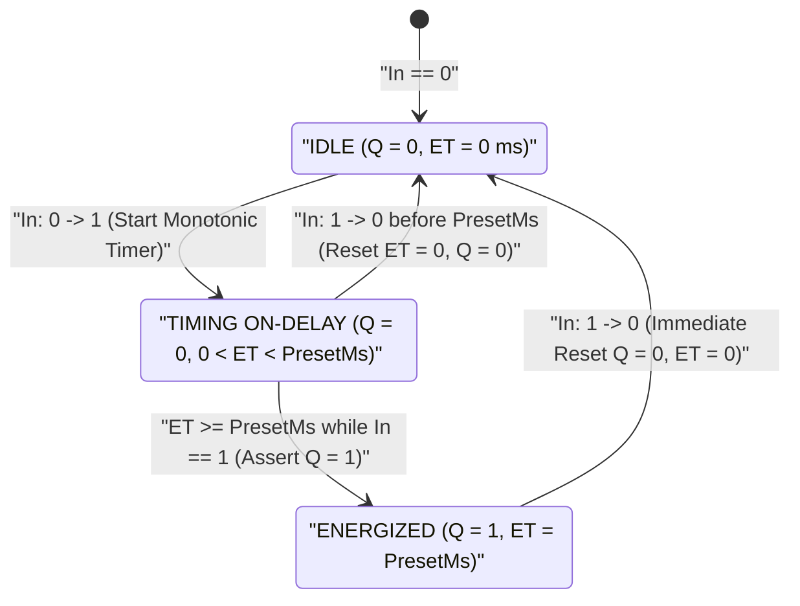
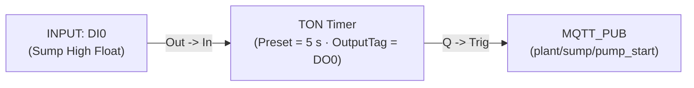

# TON — On-Delay Timer

  <strong>Block Code:</strong> TON
  <strong>Category:</strong> Timing, Counting &amp; Scaling
  <strong>Execution Class:</strong> Stateful Monotonic Timer (IEC 61131-3 TON)
  <strong>Lowering Target:</strong> Timer Macro / Monotonic Dwell State Machine

## 1. Synopsis & Execution Semantics

The **`TON`** (**Timer On-Delay**) block delays the activation of its boolean output `Q` until the input signal `In` has remained continuously active (`1`) for the full preset duration `PresetMs`.

- **Sustained Activation Contract:** On a rising transition of `In` (`0 → 1`), the internal elapsed counter `ET` begins advancing using the controller's monotonic millisecond clock while `Q` stays `0`. Only when `ET` reaches `PresetMs` does `Q` transition to `1` (`Q = ON`).
- **Instantaneous Reset on Input Drop:** If `In` drops back to `0` at **any** moment—whether mid-timing (`0 < ET < PresetMs`) or after `Q` has already energized—both `ET` and `Q` reset to `0` immediately on that scan cycle. Transient spikes or contact bounce shorter than `PresetMs` never reach downstream actuators.
- **Primary Industrial Use Cases:** Float-switch wave and turbulence debouncing, staggered multi-motor sequential star-delta orcascade startup, conveyor jam confirmation (photo-eye blocked continuously for `> 5 s`), and pneumatic clamp pressure-settle delays.

---

## 2. Pinout & Signal Contract

| Pin | Direction | Signal Kind | Data Type | Description |
| :--- | :--- | :--- | :--- | :--- |
| `In` | Input | Event / Execution (`IsEvent = true`) | Enabling State (`BOOL`) | Starts timing when asserted (`1`) and resets `ET` and `Q` immediately when de-asserted (`0`). Connects from [`INPUT`](/blocks/input), [`TRIGGER`](/blocks/trigger), or [`GUARD`](/blocks/guard). |
| `Q` | Output | Value / Data (`IsEvent = false`) | `BOOL` (`0` / `1`) | Delayed boolean output bound to `OutputTag`; drives downstream [`ACTION`](/blocks/action), [`MQTT_PUB`](/blocks/mqtt-pub), [`HTTP_CLIENT`](/blocks/http-client), or [`TCP_CLIENT`](/blocks/tcp-client) blocks. |

---

## 3. Inspector Parameters & Validation Limits

| Parameter | Type / Options | Default | Constraints | Runtime Behavior |
| :--- | :--- | :--- | :--- | :--- |
| `DurationValueText` | Non-negative Float / Integer | `"3"` | Accepts dot or comma decimals (`"2.5"`, `"2,5"`). Computed `PresetMs` clamps to `[1 .. 4,294,967,295] ms`. | Multiplied by the selected `TimeUnit` factor to compute exact hardware milliseconds (`PresetMs`). |
| `TimeUnit` | `ms`, `s`, `min`, `h` | `"s"` (`×1,000`) | Unit multipliers: `ms = 1`, `s = 1,000`, `min = 60,000`, `h = 3,600,000`. | Auto-selects the cleanest human-readable unit on load (`3,600,000 ms` → `1 h`, `60,000 ms` → `1 min`, `3,000 ms` → `3 s`) and displays `= 3,000 ms (3s)`. |
| `PresetMs` | Unsigned 32-bit Integer (`uint`) | `3000` (`3,000 ms`) | Minimum `1 ms`, maximum `4,294,967,295 ms` (~`49.7 days`). | Exact monotonic target time in milliseconds required before `Q` asserts `1`. |
| `InputTag` | Digital Tag (`DI`, `DO`, `VFLAG`) | Auto-bound from upstream wire | Must be a digital boolean source tag. | Monitored continuously each scan pass to drive the `TON` state machine. |
| `OutputTag` (`Q`) | Writable Digital Tag (`DO`, `VFLAG`) | Unassigned *(must be selected)* | Must be a writable boolean tag (`DO` or `VFLAG`). | Receives the delayed `Q` output (`1` when `ET >= PresetMs`, `0` when `In == 0`). |
| `CustomLabel` | Free-text String | Empty (`"TON Timer"`) | Optional schematic title override. | Customizes the header title on the Logic Graph Canvas. |

---

## 4. State Machine / Timing Diagram

The state machine and timing waveform trace below show both **aborted chatter** (`t1..t2`, shorter than `PresetMs`, keeping `Q = 0`) and **sustained activation** (`t3..t5`, reaching `ET == PresetMs` at `t4` to assert `Q = 1` until `In` drops at `t5`):

| Waveform Phase | Input `In` | Elapsed Time `ET` | Output `Q` | Canvas Status Pill |
| :--- | :--- | :--- | :--- | :--- |
| **1. At Rest** | `0` | `0 ms` | `0` | `3s (OFF)` / `PT: 3000 ms` |
| **2. Short Glitch (`< PresetMs`)** | `1 → 0` early | Rises then resets to `0 ms` | `0` (Unchanged) | Returns immediately to `3s (OFF)` |
| **3. Sustained Delay (`< PresetMs`)** | `1` | `0 → PresetMs` | `0` | `45% (3s)` · `1350 / 3000 ms` |
| **4. Delay Expired** | `1` | `PresetMs` (`3000 ms`) | `1` (`ON`) | `Q = ON` · `DONE · 3000 ms` |
| **5. Input Released** | `0` | `0 ms` | `0` (`OFF`) | `3s (OFF)` |

---

## 5. Input Defense & Live Diagnostics

### 5.1 Multi-Unit Scaling & Bad-Data Defense

- **Flexible Decimal & Comma Parsing:** Entering `"1,5"` with unit `"min"` automatically normalizes comma separators and computes `PresetMs = 90,000 ms`, displaying `= 90,000 ms (90s)` directly beneath the input box so operators verify exact millisecond hardware resolution at a glance.
- **Zero / Negative Clamping & Invalid Rejection:** Entering `"0"` clamps `PresetMs` safely to the minimum deterministic tick (`1 ms`), while negative numbers (`"-5"`) or alphabetic strings (`"abc"`) are ignored without corrupting the committed `PresetMs` value.

### 5.2 Canvas Badges in Simulator (`F5`) & Online Live Debug (`F8`)

- **Live Elapsed Progress (`F5`):** During Offline Simulation, `TON` renders both percentage completion (`TimerStatusPillText`, e.g., `66% (3s)`) and exact millisecond progress (`2000 / 3000 ms`), switching to active green `Q = ON` once `ET` reaches `PresetMs`.
- **20 FPS Hardware Output Tracking (`F8`):** Bound to `OutputTag`, the block reflects real-time `Q` actuation (`Q = ON` vs. `OFF`) and transitions to `Stale` visual state if communication quality degrades.

---

## 6. Practical Industrial Wiring Example

### Scenario: Sump Pit Float-Switch Wave Debounce & Staggered Booster Pump Startup

In an underground wastewater sump pit, surface turbulence causes the high-level float switch (`DI0`) to bob rapidly before the pit is genuinely full. Starting the `7.5 kW` submersible pump (`DO0`) on brief splashes causes contactor welding and motor overheating. A **`TON`** timer enforces a continuous **`5 s`** submergence requirement before energizing `DO0`.

### Tag Configuration

| Tag Name | Kind | Data Type | Description / Alias |
| :--- | :--- | :--- | :--- |
| `DI0` | `DI` | `BOOL` | `Sump Pit High-Level Float Switch` |
| `VFLAG0` | `VFLAG` | `BOOL` | `Confirmed High-Level State (TON Q)` |
| `DO0` | `DO` | `BOOL` | `Submersible Sump Pump Contactor` |

### Step-by-Step Canvas Wiring

1. Place **`INPUT`** (`Tag = DI0`, `CustomLabel = "High Float"`).
2. Select the `INPUT` node and click **`TON`** in the toolbox to auto-wire `INPUT.Out → TON.In`.
3. In the `TON` **Inspector**, set `DurationValueText = "5"`, `TimeUnit = "s"` (confirming `= 5,000 ms (5s)`), and bind `OutputTag = DO0` (or bind `OutputTag = VFLAG0` and wire `TON.Q → ACTION (SET_TAG DO0 = 1)` if combining with downstream telemetry).
4. Wire `TON.Q` → **[`MQTT_PUB`](/blocks/mqtt-pub)** (`Topic = "plant/sump/pump_start"`) if cloud notification is desired on confirmed pump startup.
5. Press `F5` to test: toggle `DI0` `0 → 1` for `2 seconds` then back to `0`—verify `ET` resets immediately to `0 ms` and `DO0` stays `0`. Next, toggle `DI0` `0 → 1` and hold for `5 seconds`—verify `Q = ON` illuminates and `DO0` energizes cleanly.

