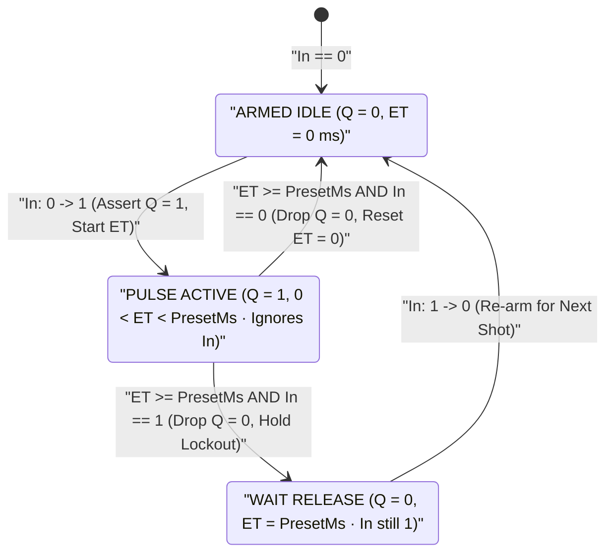
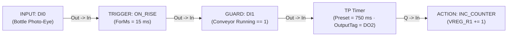

# TP — Monostable Pulse Timer

  <strong>Block Code:</strong> TP
  <strong>Category:</strong> Timing, Counting &amp; Scaling
  <strong>Execution Class:</strong> Non-Retriggerable Monostable Pulse (IEC 61131-3 TP)
  <strong>Lowering Target:</strong> Timer Macro / Fixed-Width Pulse Generator

## 1. Synopsis & Execution Semantics

The **`TP`** (**Timer Pulse**) block is a **monostable, non-retriggerable one-shot pulse generator**. Upon detecting a rising edge on input `In` (`0 → 1`), `TP` immediately drives boolean output `Q` to `1` for an **exact, immutable duration `PresetMs`**, then returns `Q` to `0`.

- **Strict Non-Retriggerable Guarantee:** Once a pulse is active (`0 < ET < PresetMs`), `Q` stays locked at `1` regardless of what happens on `In`:
  - If `In` drops back to `0` after just `10 ms`, `Q` continues holding `1` until the full `PresetMs` elapses.
  - If `In` bounces `1 → 0 → 1` repeatedly during the active pulse, `ET` is **never reset or extended**—guaranteeing an exact pulse width with millisecond precision.
- **Re-Arm Requirement When `In` Stays High:** If `In` is still held at `1` when `ET` reaches `PresetMs`, `Q` drops cleanly to `0` anyway and will not fire a second pulse until `In` first returns to `0` and produces a fresh rising edge (`0 → 1`).
- **Primary Industrial Use Cases:** Volumetric solenoid dosing shots, pneumatic cylinder eject/reject kicks, baghouse dust-collector jet-pulse blowdown valves, horn chirp acknowledgments, and fixed-width reset strobes for external drives.

---

## 2. Pinout & Signal Contract

| Pin | Direction | Signal Kind | Data Type | Description |
| :--- | :--- | :--- | :--- | :--- |
| `In` | Input | Event / Execution (`IsEvent = true`) | Rising-Edge Trigger (`BOOL`) | Initiates a `PresetMs` pulse on rising transition `0 → 1` when idle; ignored while pulse is in flight. |
| `Q` | Output | Value / Data (`IsEvent = false`) | `BOOL` (`0` / `1`) | Fixed-duration pulse output bound to `OutputTag`; drives downstream [`ACTION`](/blocks/action), [`MQTT_PUB`](/blocks/mqtt-pub), [`HTTP_CLIENT`](/blocks/http-client), or [`TCP_CLIENT`](/blocks/tcp-client). |

---

## 3. Inspector Parameters & Validation Limits

| Parameter | Type / Options | Default | Constraints | Runtime Behavior |
| :--- | :--- | :--- | :--- | :--- |
| `DurationValueText` | Non-negative Float / Integer | `"3"` | Accepts dot or comma decimals (`"0.25"`, `"0,25"`). Clamps `PresetMs` to `[1 .. 4,294,967,295] ms`. | Multiplied by `TimeUnit` to establish the exact pulse width `PresetMs`. |
| `TimeUnit` | `ms`, `s`, `min`, `h` | `"s"` (`×1,000`) | Unit multipliers: `ms = 1`, `s = 1,000`, `min = 60,000`, `h = 3,600,000`. | Auto-formats loaded millisecond presets and displays `= 3,000 ms (3s)` verification text. |
| `PresetMs` | Unsigned 32-bit Integer (`uint`) | `3000` (`3,000 ms`) | `1 .. 4,294,967,295 ms` (~`49.7 days`). | Exact duration for which `Q` stays `1` on each valid trigger. |
| `InputTag` | Digital Tag (`DI`, `DO`, `VFLAG`) | Auto-bound from upstream wire | Must reference a digital boolean tag. | Sampled each scan cycle for rising-edge (`0 → 1`) arming and re-arming transitions. |
| `OutputTag` (`Q`) | Writable Digital Tag (`DO`, `VFLAG`) | Unassigned *(must be selected)* | Must reference a writable digital tag (`DO` or `VFLAG`). | Pulsed to `1` for `PresetMs`, then forced back to `0`. |
| `CustomLabel` | Free-text String | Empty (`"TP Timer"`) | Optional schematic title override. | Customizes the header title on the Logic Graph Canvas. |

---

## 4. State Machine / Timing Diagram

The state machine below highlights both immunity to mid-pulse input bounce (`PulseActive` ignores `In` transitions) and the `WaitRelease` lock-out state when an operator or jammed sensor holds `In == 1` past `PresetMs`:

| Scenario | `In` Behavior | `Q` Output Duration | Protection Guarantee |
| :--- | :--- | :--- | :--- |
| **Brief Trigger Pulse (`20 ms`)** | `0 → 1 → 0` rapidly | Exact `PresetMs` | Stretches short sensor strobes into reliable valve actuation |
| **Noisy Bouncing Input** | `0 → 1 → 0 → 1` mid-shot | Exact `PresetMs` | Prevents double-dosing or extended pulse stretching |
| **Stuck-High Sensor (`In = 1` forever)** | `0 → 1` (never drops) | Exact `PresetMs`, then `0` | Prevents runaway chemical overflow if a bottle jams on conveyor |

---

## 5. Input Defense & Live Diagnostics

### 5.1 Precision Sub-Second & Multi-Unit Input Defense

- **Millisecond & Fractional Second Accuracy:** Jet-pulse and reject-solenoid applications frequently require sub-second precision (`150 ms` or `0.25 s`). Selecting `ms` and typing `"150"` (or selecting `s` and typing `"0,25"`) locks `PresetMs` deterministically to `150 ms` or `250 ms` with live confirmation text (`= 250 ms (0.25s)`).
- **Zero / Malformed Input Protection:** Values of `0` clamp safely to `1 ms`; negative or non-numeric strings are rejected without corrupting `PresetMs`.

### 5.2 Canvas Badges in Simulator (`F5`) & Online Live Debug (`F8`)

- **Real-Time Shot Progress (`F5`):** Displays `Q = ON` and live millisecond progress (`ElapsedMs / PresetMs`) throughout the monostable shot, returning cleanly to `OFF` upon completion even if the simulated `INPUT` toggle remains `● 1`.
- **20 FPS Live Pulse Monitoring (`F8`):** Streams real-time `OutputTag` state onto the canvas node at 20 FPS (`Q = ON` active green highlight during shots) with `[STALE]` quality supervision.

---

## 6. Practical Industrial Wiring Example

### Scenario: Bottling Line Additive Dosing Valve (`750 ms` Exact Volumetric Shot)

As bottles pass a retro-reflective photo-eye (`DI0`) on a filling conveyor, a high-speed dispensing solenoid valve (`DO2`) must open for **exactly `750 ms`** to inject `15 mL` of flavor concentrate—only when the conveyor drive is running (`DI1 = 1`). Even if the conveyor stops with a bottle blocking `DI0`, `DO2` must close strictly after `750 ms` to prevent tank spillage.

### Tag Configuration

| Tag Name | Kind | Data Type | Description / Alias |
| :--- | :--- | :--- | :--- |
| `DI0` | `DI` | `BOOL` | `Bottle Present Photo-Eye (0 -> 1 on Bottle Leading Edge)` |
| `DI1` | `DI` | `BOOL` | `Conveyor Drive Run Status Interlock` |
| `DO2` | `DO` | `BOOL` | `Concentrate Dosing Solenoid Valve` |
| `VREG_R1` | `VREG_R` | `INT32` | `Total Dosed Bottles Counter` |

### Step-by-Step Canvas Wiring

1. Place **`INPUT`** (`Tag = DI0`) → **[`TRIGGER`](/blocks/trigger)** (`TriggerType = ON_RISE`, `ForMs = 15` ms optical anti-glare debounce) → **[`GUARD`](/blocks/guard)** (`GuardTag = DI1`, `Negate = false`).
2. Wire `GUARD.Out` → **`TP`** timer (`DurationValueText = "750"`, `TimeUnit = "ms"`, `OutputTag = DO2`, `CustomLabel = "750ms Dose Shot"`).
3. Wire `TP.Q` → **[`ACTION`](/blocks/action)** (`ActionType = INC_COUNTER`, `TargetTag = VREG_R1`, `ActionParam = 1`) to increment the dosed bottle totalizer on every completed shot.
4. Press `F5` to test: set `DI1 = 1`, toggle `DI0` `0 → 1` and **leave `DI0` at `1`** (simulating a jammed bottle). Verify `DO2` energizes for exactly `750 ms` and then drops to `0`, refusing to dose again until `DI0` returns to `0` and sees the next bottle.

