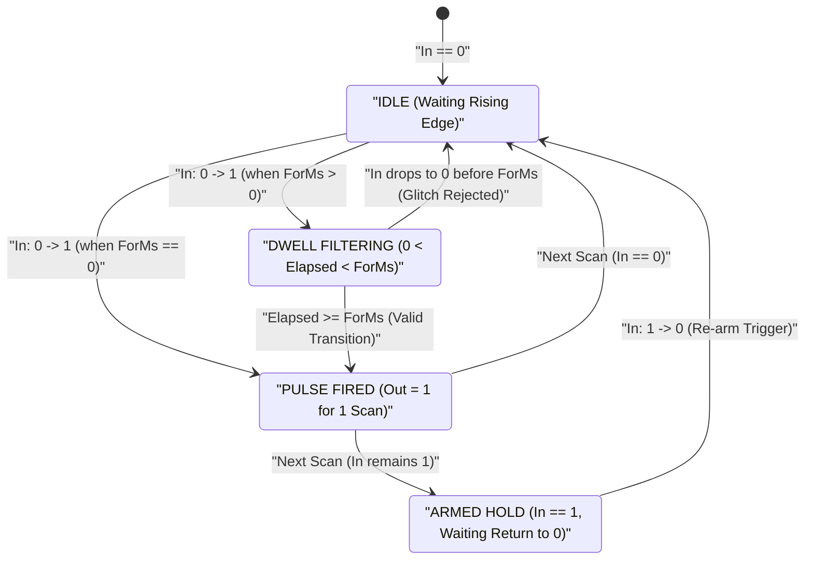
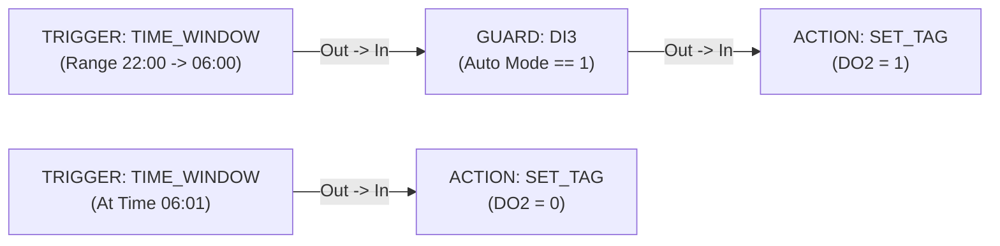

# TRIGGER — Edge & RTC Detector

  <strong>Block Code:</strong> TRIGGER
  <strong>Category:</strong> Core Rule Pipeline
  <strong>Execution Class:</strong> Edge, Dwell &amp; Schedule Evaluator
  <strong>Lowering Target:</strong> Rule Stage 1 (Event Trigger Engine)

## 1. Synopsis & Execution Semantics

The **`TRIGGER`** block converts continuous state signals, register values, monotonic system ticks, or Real-Time Clock (`RTC`) schedules into discrete **execution event pulses** (`Out`) that drive downstream [`GUARD`](/blocks/guard), [`ACTION`](/blocks/action), [`TON`](/blocks/ton), [`CTU`](/blocks/ctu), and fieldbus/IIoT blocks.

- **Single-Shot Edge Semantics:** Unlike level-sensitive combinational gates that fire repeatedly on every scan pass while a sensor stays high, `ON_RISE` and `ON_FALL` compare the current scan's process image value against the previous scan's latched state, emitting **one deterministic event pulse per valid transition**.
- **Built-In Dwell / Debounce Filter (`ForMs`):** Mechanical contacts, float switches, and noisy analog thresholds can be stabilized directly inside `TRIGGER` without consuming a separate timer block. Setting `ForMs > 0` requires the transition condition to hold uninterrupted for at least `ForMs` milliseconds before firing.
- **Autonomous Time Modes:** When configured as `INTERVAL` or `TIME_WINDOW`, `TRIGGER` operates autonomously from the internal monotonic clock or battery-backed `RTC` without requiring an upstream [`INPUT`](/blocks/input) wire.
- **Primary Industrial Use Cases:** Pushbutton and limit-switch edge detection, contact chatter suppression, periodic telemetry heartbeats (`INTERVAL`), daily/overnight shift scheduling (`TIME_WINDOW`), and compact analog threshold crossing rules.

---

## 2. Pinout & Signal Contract

| Pin | Direction | Signal Kind | Data Type | Description |
| :--- | :--- | :--- | :--- | :--- |
| `In` | Input | Value / Data (`IsEvent = false`) | `BOOL` \| `INT32` \| `REAL` *(Optional in `INTERVAL` / `TIME_WINDOW`)* | Receives continuous tag or comparator state from an upstream [`INPUT`](/blocks/input), [`COMPARATOR`](/blocks/comparator), [`SCALE`](/blocks/scale), [`MB_READ`](/blocks/mb-read), or [`MQTT_SUB`](/blocks/mqtt-sub) block. |
| `Out` | Output | Event / Execution (`IsEvent = true`) | Event Pulse | Emits a deterministic execution pulse whenever the configured edge, dwell, interval, or RTC condition fires. Supports `1:N` fan-out. |

---

## 3. Inspector Parameters & Validation Limits

| Parameter | Type / Options | Default | Constraints | Runtime Behavior |
| :--- | :--- | :--- | :--- | :--- |
| `TriggerType` | `ON_RISE`, `ON_FALL`, `ON_CHANGE`, `INTERVAL`, `TIME_WINDOW` | `ON_RISE` | Required enum selection. | Selects the event evaluation engine (see mode breakdown below). |
| `ForMs` | Unsigned 32-bit Integer (`uint`, ms) | `0` | `0 .. 4,294,967,295 ms`. In `INTERVAL` mode, set `>= 10 ms` for deterministic periodic loops. | **Edge modes:** Minimum continuous dwell/debounce persistence (`0` = immediate on first scan). **`INTERVAL` mode:** Period between recurring pulses. |
| `Schedule Mode` *(RTC)* | `Point-in-Time` (`EQ`) \| `Time Window Range` (`BETWEEN`) | `Point-in-Time` | Visible only when `TriggerType = TIME_WINDOW`. | Switches between exact daily minute matching (`HH:MM`) and continuous active window evaluation (`[Start..End]`). |
| `TimeStartHour` / `Minute` | Integer (`00..23` : `00..59`) | `07:00` (`700`) | Clamped automatically to `0..23` hours and `0..59` minutes. | Defines the exact trigger time (`Point-in-Time`) or window opening time (`Time Window Range`). |
| `TimeEndHour` / `Minute` | Integer (`00..23` : `00..59`) | `17:00` (`1700`) | Clamped to `0..23` hours and `0..59` minutes; active in `Time Window Range`. | Defines window closing time. Supports **overnight wrap-around** when `Start > End` (e.g., `22:00 → 06:00`). |
| `CompareOp` *(Inline)* | `NONE`, `EQ`, `NEQ`, `GT`, `LT`, `GTE`, `LTE`, `BETWEEN` | `NONE` | Optional inline filter on `In` tag; for dedicated type-locked relational visuals, prefer [`COMPARATOR`](/blocks/comparator). | Evaluates `In` against `ThresholdLo` (and `ThresholdHi` for `BETWEEN`) prior to firing. |
| `ThresholdLo` / `ThresholdHi` | Numeric (`double`) | `0` / `0` | Active when `CompareOp != NONE`. | Lower/target threshold and upper range bound (`[ThresholdLo..ThresholdHi]`). |
| `CustomLabel` | Free-text String | Empty (`"Trigger"`) | Optional schematic title override. | Customizes the node header on the Logic Graph Canvas. |

### `TriggerType` Operational Reference

| Mode | Condition Formula | Dwell / Period Role (`ForMs`) |
| :--- | :--- | :--- |
| `ON_RISE` | Previous scan `== 0` and Current scan `!= 0` (or upward threshold entry) | Condition must stay active for `ForMs` ms before emitting `1` pulse; resets if signal drops early. |
| `ON_FALL` | Previous scan `!= 0` and Current scan `== 0` (or downward threshold exit) | Low state must persist continuously for `ForMs` ms before emitting `1` pulse. |
| `ON_CHANGE` | Current scan value `!=` Previous scan value | Stabilizes for `ForMs` ms after change before firing downstream action. |
| `INTERVAL` | Autonomous monotonic timer modulo `ForMs` | Emits `1` execution pulse every `ForMs` milliseconds (e.g., `5000 ms` = every `5 s`). |
| `TIME_WINDOW` | Hardware `RTC` `HH:MM` (`Hour * 100 + Minute`) | **Same-day (`Start <= End`):** `Start <= Now <= End`. **Overnight (`Start > End`):** `Now >= Start` OR `Now <= End`. |

---

## 4. State Machine / Timing Diagram

The diagram below illustrates how `TRIGGER` (`ON_RISE` with `ForMs > 0`) rejects transient contact bounce shorter than `ForMs` while emitting a clean single-scan execution pulse once the dwell threshold is satisfied:

---

## 5. Input Defense & Live Diagnostics

### 5.1 Input Normalization & Clamping

- **RTC Hour & Minute Clamping:** Entering out-of-bounds values in `TimeStartHour` / `TimeEndHour` or `Minute` fields automatically clamps values to valid 24-hour clock coordinates (`00..23` and `00..59`) and updates the formatted badge (`HH:MM`). Switching from `Time Window Range` back to `Point-in-Time` automatically synchronizes `ThresholdHi = ThresholdLo`.
- **Threshold Input Formatting:** Inline `ThresholdLoText` and `ThresholdHiText` accept both dot and comma decimals (`"25,5"` → `"25.5"`) via flexible numeric parsing and revert malformed text to the last valid numeric threshold on commit. Float equality (`EQ` / `NEQ`) applies a `1e-5` epsilon tolerance.

### 5.2 Canvas Badges in Simulator (`F5`) & Online Live Debug (`F8`)

- **Compact Mode Badge:** Displays the active trigger signature directly on the node card—such as `RISING EDGE (0 → 1)`, `> 80 (500ms)`, `Loop 1000ms`, or `22:00 → 06:00`—alongside `🔗 Connected: <TagName>` when wired upstream.
- **Dwell Countdown & Fired Flash (`F5`):** During Offline Simulation, `TRIGGER` displays real-time dwell countdown (`SimDwellRemainingMs`) while filtering an edge and flashes its status pill (`TRIGGERED` / `WAITING PULSE`) when an event pulse fires down the wire.

---

## 6. Practical Industrial Wiring Example

### Scenario: Automated Night-Shift Perimeter Lighting (`22:00 → 06:00` Overnight RTC Schedule)

Factory yard floodlights wired to `DO2` must energize automatically throughout the night shift from **22:00** until **06:00** the following morning, gated by a master `Auto Mode` selector switch on `DI3`.

### Tag Configuration

| Tag Name | Kind | Data Type | Description / Alias |
| :--- | :--- | :--- | :--- |
| `DI3` | `DI` | `BOOL` | `Lighting Auto Mode Selector (1 = Auto)` |
| `DO2` | `DO` | `BOOL` | `Yard Perimeter Floodlights Contactor` |

### Step-by-Step Canvas Wiring

1. Add a **`TRIGGER`** block onto the Logic Graph Canvas (`Ctrl+2`) without any upstream `INPUT` node, and set `CustomLabel = "Night Shift Window"`.
2. In the **Inspector**, select `TriggerType = TIME_WINDOW`, enable **Time Window Range** (`BETWEEN`), and configure `Start = 22:00` and `End = 06:00`. Because `22:00 > 06:00`, the **SynaptiX Runtime** automatically evaluates the overnight wrap-around condition (`Now >= 22:00` OR `Now <= 06:00`).
3. Wire `TRIGGER.Out` into a **[`GUARD`](/blocks/guard)** block configured with `GuardTag = DI3` (`Negate = false`, pass when `Auto Mode = 1`), and wire `GUARD.Out` into an **[`ACTION`](/blocks/action)** block (`ActionType = SET_TAG`, `TargetTag = DO2`, `ActionParam = 1`).
4. Add a second compact `TRIGGER` (`TriggerType = TIME_WINDOW`, `Point-in-Time = 06:01`) wired to an **[`ACTION`](/blocks/action)** (`ActionType = SET_TAG`, `TargetTag = DO2`, `ActionParam = 0`) to de-energize the floodlights cleanly at daybreak.

::: tip Verify Battery-Backed RTC Before Commissioning
Before deploying `TIME_WINDOW` rules to field hardware, open the [Device Workspace (`Ctrl+1`)](/workspaces/device-tab) and synchronize the **SynaptiX Edge Controller** Real-Time Clock with your engineering workstation.
:::
