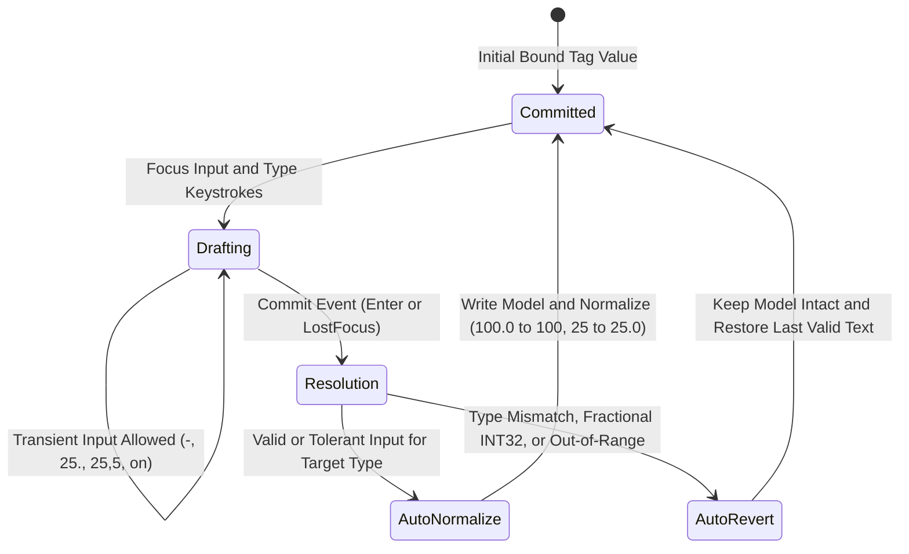

# Tag Architecture & Physical Data Types

  <strong>Document ID:</strong> SYNX-DOC-CON-002
  <strong>Chapter:</strong> 01. Introduction &amp; Core Concepts
  <strong>Applies To:</strong> SynaptiX IDE v2.x &bull; Tag Memory Contract
  <strong>Standard:</strong> IEC 61131-3 &bull; ANSI/ISA-101

In **SynaptiX IDE**, every physical sensor terminal, relay output, internal state flag, calibration constant, and fieldbus register is represented inside a single **Unified Tag Memory Model** (up to **128 runtime tags**).

Grounded in IEC 61131-3 principles, **SynaptiX IDE** treats data types not as cosmetic UI labels, but as **strict physical memory contracts** paired with a deterministic **Input State Machine (Bad-Data Defense)** so that what an engineer sees on screen is always a 1:1 reflection of what executes inside the **SynaptiX Edge Controller**.

---

## Unified Tag Memory Model (Up to 128 Tags)

Depending on the selected [Device Preset](/concepts/ecosystem-overview), a project allocates up to seven contiguous hardware and virtual tag families, plus read-only system status tags:

| Tag Family | Identifier Span | Default Type | Allowed Data Types | Access Mode | Persistence | Primary Engineering Purpose |
| :--- | :--- | :---: | :---: | :---: | :---: | :--- |
| **Digital Inputs** | `DI0 .. DI7` | `BOOL` | `BOOL` (Fixed) | Read-Only* | Hardware Live | Opto-isolated discrete field inputs (switches, safety doors, proximity sensors). |
| **Digital Outputs** | `DO0 .. DO7` | `BOOL` | `BOOL` (Fixed) | Read / Write | Volatile | Physical relay or transistor actuator outputs (fans, valves, alarms, PWM/PTO). |
| **Analog Inputs** | `AI0 .. AI3` | `INT32` | `INT32`, `REAL` | Read-Only* | Hardware Live | Hardware ADC channels (`4-20 mA`, `0-10 V`, raw counts, or scaled float units). |
| **Virtual Flags** | `VFLAG0 .. VFLAG31` | `BOOL` | `BOOL` (Fixed) | Read / Write | Volatile (RAM) | Intermediate boolean latches, timer done bits, interlock states, and remote commands. |
| **Virtual Registers** | `VREG0 .. VREG31` | `INT32` | `INT32`, `REAL` | Read / Write | Volatile (RAM) | Scratchpad 32-bit registers for [`SCALE`](/blocks/scale) outputs, [`MB_READ`](/blocks/mb-read) values, and [`MQTT_SUB`](/blocks/mqtt-sub) setpoints. |
| **Retentive Registers** | `VREG_RETAIN0 .. VREG_RETAIN31` | `INT32` | `INT32`, `REAL` | Read / Write | **Non-Volatile Flash** | Calibration offsets, alarm thresholds, and batch totals preserved across power loss and reboots. |
| **Counters** | `COUNTER0 .. COUNTER7` | `INT32` | `INT32` (Fixed) | Read / Write | Volatile / Managed | High-range 32-bit signed accumulators driven by [`CTU`](/blocks/ctu), [`CTD`](/blocks/ctd), or `INCREMENT`/`DECREMENT` actions. |

*\*Note: `DI` and `AI` tags are read-only to user control logic during normal hardware execution because their values are sampled directly from physical input terminals each scan. During [Offline Simulation](/tools/simulator-and-live-debug) (`F5`), engineers can freely toggle `DI` states and inject `AI` test values.*

::: tip Non-Volatile Retention Across Power Cycles (`VREG_RETAIN`)
Standard virtual tags (`VFLAG0..31` and `VREG0..31`) reside in volatile SRAM and reset to `0` (`0.0` for `REAL`) on cold boot. Whenever an operator-adjustable setpoint, PID/linear calibration factor, or production totalizer must survive unexpected plant power outages, bind it to **`VREG_RETAIN0 .. VREG_RETAIN31`**. The edge runtime automatically commits retentive register updates to non-volatile flash memory.
:::

### Symbolic Aliases & Display Formatting

In the [Tag Catalog](/workspaces/tag-catalog-tab) (`Ctrl+3`), every tag supports a human-readable **Alias** (for example, assigning `TankTemp` to `AI0` and `SafetyDoorOk` to `DI0`). Once defined, all dropdown selectors, node headers on the [Logic Graph Canvas](/workspaces/logic-graph-tab), and trace legends in [Live Watch](/workspaces/live-watch-tab) display the combined identifier `[AI0] — TankTemp` so hardware terminal wiring and process meaning remain visible simultaneously.

---

## Strict Physical Data Types

Microcontrollers and industrial edge runtimes operate strictly on binary bit-patterns inside 32-bit memory slots. **SynaptiX IDE** enforces three physical data types across all workspaces:

### 1. `BOOL` — Single-Bit Binary State
- **Valid Domain:** Strictly `0` (False / Low / Off) or `1` (True / High / On).
- **Applicable Tags:** Mandatory and fixed for `DI0..7`, `DO0..7`, and `VFLAG0..31`.
- **UI Control Contract:** Wherever a boolean constant is configured, **SynaptiX IDE** provides explicit binary state selectors (`0` / `1`) or normalizes boolean text keywords strictly to `"0"` or `"1"`.

### 2. `INT32` — 32-Bit Signed Two's Complement Integer
- **Valid Domain:** Exact whole integers from `-2,147,483,648` to `+2,147,483,647` (`-2^31` to `2^31 - 1`).
- **Applicable Tags:** Fixed for `COUNTER0..7`; selectable on `AI0..3`, `VREG0..31`, and `VREG_RETAIN0..31`.
- **Physical Ground Truth — Why `25.5` Cannot Exist in `INT32`:**
  In two's complement integer hardware, every bit weight represents an exact power of two (`2^0 = 1`, `2^1 = 2`, ..., `2^30`). **There are zero fractional bit positions.** A decimal value such as `25.5` physically cannot be stored in an `INT32` register without silent truncation (`25`) or fixed-point scaling (`255` in `0.1` tenths). Because silent truncation causes dangerous discrepancies between what an engineer typed and what the controller compares at runtime, **SynaptiX IDE** strictly rejects non-zero fractional inputs (such as `"25.5"`) on `INT32` fields.

### 3. `REAL` — 32-Bit IEEE-754 Single-Precision Floating-Point
- **Valid Domain:** IEEE-754 binary32 floating-point numbers (`1` sign bit, `8` exponent bits, `23` mantissa fraction bits; ~7 significant decimal digits).
- **Applicable Tags:** Selectable on `AI0..3`, `VREG0..31`, and `VREG_RETAIN0..31` in the [Tag Catalog](/workspaces/tag-catalog-tab).
- **Memory Representation:** Stored lossless in the 32-bit tag slot via IEEE-754 bit-casting (`SingleToInt32Bits`) and always rendered in **SynaptiX IDE** with at least one explicit decimal place (for example, `"25.0"`, `"65.25"`) so engineers can visually distinguish `REAL` tags from `INT32` tags at a glance.

::: warning Preventing Type-Mismatch Bugs Before Compilation
When you change a tag's data type in the [Tag Catalog](/workspaces/tag-catalog-tab) (for example, switching `AI0` from `INT32` to `REAL`), any connected [`COMPARATOR`](/blocks/comparator) or [`ACTION`](/blocks/action) blocks immediately adapt their constant validation rules to match the updated tag contract. `NaN` and `Infinity` bit patterns are automatically sanitized to `"0.0"`.
:::

---

## Visual Truth & Input State Machine (Bad-Data Defense)

Industrial accidents and commissioning delays frequently occur when an engineering tool lets a user type `"25.5"` into an integer threshold box, leaves `"25.5"` visible on screen, and silently compiles `25` or `0` underneath.

**SynaptiX IDE** eliminates this hazard altogether through **The Visual Truth Principle** backed by a two-phase **Input Finite State Machine (`SmartInputParser`)** across every numeric and boolean input box in the IDE (Property Inspector, Tag Catalog, Simulator, and Live Watch Force dialogs):

### Two-Phase Lifecycle Mechanics

1. **Phase A — Drafting State (In-Flight Typing):**
   While the text box holds keyboard focus, the engineer can type freely without intrusive keystroke blocking. Transient intermediate strings such as `"-"`, `"25."`, regional decimal commas (`"65,5"`), or boolean words (`"on"`, `"bật"`) are permitted while editing is in progress.
2. **Phase B — Committed State (`Enter` or `LostFocus`):**
   The instant the engineer presses `Enter` or clicks away (`LostFocus`), the resolution engine validates the complete string against the target tag's exact physical `TagDataType`:
   - **Auto-Normalize (Valid Input):** Commits the binary value to the underlying model and formats the displayed text into canonical IEC notation.
   - **Auto-Revert (Invalid / Type-Mismatched Input):** Rejects the edit, leaves the underlying domain memory untouched, and immediately reverts the text box back to the **last valid committed string**. Unparsed text never lingers on screen.

### Canonical Normalization & Rejection Matrix

The table below documents exact resolution behavior assuming the field's previous committed value was `10` (for `INT32`), `10.0` (for `REAL`), or `0` (for `BOOL`):

| Target Data Type | Engineer Types (Drafting) | Resolution Outcome | Resulting Model Value | Displayed Text After Commit |
| :---: | :--- | :--- | :---: | :--- |
| **`INT32`** | `"250"` | Valid Nominal | `250` | `"250"` |
| **`INT32`** | `"100.0"` or `"100,0"` | **Auto-Normalize** (zero fraction tolerated) | `100` | `"100"` |
| **`INT32`** | `"25.5"` or `"25,5"` | **Auto-Revert** (non-zero fraction illegal in `INT32`) | `10` *(Unchanged)* | `"10"` |
| **`INT32`** | `"abc"` or `"999999999999"` | **Auto-Revert** (syntax / 32-bit overflow) | `10` *(Unchanged)* | `"10"` |
| **`REAL`** | `"65.25"` | Valid Nominal | `65.25f` | `"65.25"` |
| **`REAL`** | `"25"` | **Auto-Normalize** (adds `.0` decimal indicator) | `25.0f` | `"25.0"` |
| **`REAL`** | `"25,5"` | **Auto-Normalize** (converts comma `,` to `.`) | `25.5f` | `"25.5"` |
| **`REAL`** | `"-"`, `"."`, or `"err"` | **Auto-Revert** (incomplete or non-numeric) | `10.0f` *(Unchanged)* | `"10.0"` |
| **`BOOL`** | `"1"`, `"true"`, `"on"`, `"yes"`, `"high"`, `"bật"` | **Auto-Normalize** (case-insensitive) | `1` | `"1"` |
| **`BOOL`** | `"0"`, `"false"`, `"off"`, `"no"`, `"low"`, `"tắt"` | **Auto-Normalize** (case-insensitive) | `0` | `"0"` |
| **`BOOL`** | `"invalid"` | **Auto-Revert** | `0` *(Unchanged)* | `"0"` |

::: tip Decimal Comma Tolerance for International Keyboards
Engineers typing on European or Vietnamese numeric layouts frequently enter `"25,5"` instead of `"25.5"`. On `REAL` fields, **SynaptiX IDE** automatically normalizes `"25,5"` to canonical `"25.5"` on commit. On `INT32` fields, `"100,0"` normalizes cleanly to `"100"`, whereas `"25,5"` safely reverts so fractional intent is never silently discarded.
:::

---

## Related Documentation

- [Tag Catalog Workspace (`Ctrl+3`)](/workspaces/tag-catalog-tab) — How to assign tag aliases, switch `INT32`/`REAL` types, and import/export CSV tag lists.
- [Deterministic Execution Pipeline](/concepts/execution-pipeline) — How tags flow through rules, timers, counters, and asynchronous communication blocks.
- [SCALE — Linear Calibration Block](/blocks/scale) — Converting raw `INT32` ADC counts (`AI0..3`) into calibrated `REAL` engineering units.
