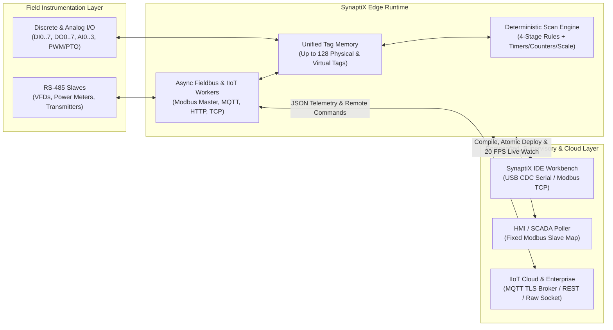

# Ecosystem Overview & Device Presets

  <strong>Document ID:</strong> SYNX-DOC-CON-001
  <strong>Chapter:</strong> 01. Introduction &amp; Core Concepts
  <strong>Applies To:</strong> SynaptiX IDE v2.x &bull; Contract Profile V2
  <strong>Standard:</strong> IEC/IEEE 82079-1 &bull; ANSI/ISA-101

**SynaptiX IDE** is a software-first industrial engineering environment built on .NET 8 for designing, simulating, commissioning, and monitoring deterministic edge control and IIoT telemetry applications across the **SynaptiX Edge Automation & IIoT Ecosystem**.

Rather than forcing automation engineers to juggle separate tools for discrete/analog control, RS-485 Modbus RTU polling, and cloud MQTT/HTTP payload scripting, **SynaptiX IDE** unifies visual logic authoring, strict physical memory contracts, cycle-accurate offline simulation, atomic two-phase deployment, and 20 FPS live telemetry diagnostics inside a single desktop workbench.

---

## System Topology & Architectural Role

Within an industrial plant or distributed infrastructure deployment, a **SynaptiX Edge Device** operates at the boundary between physical field instrumentation (sensors, relays, VFDs, power meters) and supervisory IT/OT platforms (**SynaptiX IDE**, local SCADA masters, MQTT brokers, and REST webhooks).

### Software-First Engineering Workflow

Every project in **SynaptiX IDE** is governed by an explicit **Product Resource Profile**. Selecting or detecting a device profile automatically configures:

1. **Tag Memory Allocation:** Generates exact hardware and virtual tag slots (`DI`, `DO`, `AI`, `VFLAG`, `VREG`, `VREG_RETAIN`, `COUNTER`) in the [Tag Catalog](/workspaces/tag-catalog-tab).
2. **Capability-Aware Block Toolbox:** Dynamically enables or disables fieldbus and cloud blocks (`MB_READ`, `MB_WRITE`, `MQTT_PUB`, `MQTT_SUB`, `HTTP_CLIENT`, `TCP_CLIENT`) on the [Logic Graph Canvas](/workspaces/logic-graph-tab) — or switches the workbench into [DTU Gateway Studio](/tools/dtu-gateway-studio) when targeting a dedicated Data Transfer Unit.
3. **Pre-Flight Compile & Deploy Gates:** Enforces maximum rule counts and hardware capability flags during compilation (`F7`) and [Atomic Deploy](/workspaces/deploy-tab) (`Ctrl+F5`), preventing incompatible configurations from ever reaching field hardware.

---

## Built-In Device Presets Matrix

**SynaptiX IDE** ships with **7 standardized commercial device presets** covering distributed remote I/O, standalone edge control, sensor datalogging, protocol gateways, and transparent RS-485 DTUs.

### Resource Capacity Comparison

| Preset Name | Device Family | Local Physical I/O (`DI / DO / AI`) | Virtual & Retentive Slots (`VFLAG / VREG / RETAIN / CNT`) | Total Tags (Ceiling: 128) | Max Rules (Ceiling: 100) |
| :--- | :--- | :---: | :---: | :---: | :---: |
| **SynaptiX Remote I/O** | Remote I/O (Default) | `8 / 8 / 4` | `32 / 32 / 32 / 8` | `124` | `100` |
| **SynaptiX Compact I/O** | Remote I/O (Compact) | `4 / 4 / 0` | `16 / 16 / 16 / 4` | `60` | `50` |
| **SynaptiX Relay Unit** | Remote I/O (Discrete) | `8 / 8 / 0` | `32 / 32 / 32 / 8` | `120` | `100` |
| **SynaptiX Data Logger** | Data Logger | `4 / 2 / 4` | `16 / 32 / 32 / 4` | `94` | `50` |
| **SynaptiX Gateway** | Protocol Gateway | `2 / 2 / 0` | `32 / 32 / 32 / 4` | `104` | `50` |
| **SynaptiX Controller** | Edge Controller | `8 / 8 / 4` | `32 / 32 / 32 / 8` | `124` | `100` |
| **SynaptiX DTU** | RS-485 Network DTU | `0 / 0 / 0` | `32 / 32 / 32 / 4` | `100` | `50` |

### Enabled Hardware & Subsystem Capabilities

Each preset declares a bitmask of hardware subsystem flags that **SynaptiX IDE** validates at design time and pre-deployment:

| Preset Name | Base Logic & Retentive | Hardware RTC | SD Datalog | Modbus RTU Master | Modbus TCP | Ethernet / Wi-Fi | MQTT Pub/Sub | HTTP Client | Transparent TCP Stream |
| :--- | :---: | :---: | :---: | :---: | :---: | :---: | :---: | :---: | :---: |
| **SynaptiX Remote I/O** | Yes | — | — | Yes | — | — | — | — | — |
| **SynaptiX Compact I/O** | Yes | — | — | Yes | — | — | — | — | — |
| **SynaptiX Relay Unit** | Yes | — | — | Yes | — | — | — | — | — |
| **SynaptiX Data Logger** | Yes | Yes | Yes | — | — | — | — | — | — |
| **SynaptiX Gateway** | Yes | — | — | Yes | Yes | Ethernet | Yes | Yes | Yes |
| **SynaptiX Controller** | Yes | Yes | Yes | Yes | — | Ethernet + Wi-Fi | Yes | Yes | Yes |
| **SynaptiX DTU** | DTU Engine | — | — | Yes | Yes | Ethernet + Wi-Fi | Yes | Yes | Yes |

::: info Selecting Between SynaptiX Gateway, SynaptiX Controller, and SynaptiX DTU
- Choose **`SynaptiX Controller`** when your application requires full local I/O (`8 DI / 8 DO / 4 AI`), RTC calendar scheduling, SD card logging, RS-485 master polling, and simultaneous Wi-Fi/Ethernet IIoT cloud telemetry.
- Choose **`SynaptiX Gateway`** when bridging RS-485 Modbus RTU field buses to Ethernet (`Modbus TCP`, `MQTT`, `HTTP`) with minimal local discrete interlocks (`2 DI / 2 DO`).
- Choose **`SynaptiX DTU`** when commissioning a pure RS-485-to-Cloud Data Transfer Unit (`0` local physical I/O). Selecting this preset automatically activates the specialized [DTU Gateway Studio](/tools/dtu-gateway-studio) interface instead of the node-wiring canvas.
:::

---

## Project Provisioning Modes in New Project Dialog

When creating a project via **File -> New Project** (`Ctrl+N`), **SynaptiX IDE** presents the **New Project Provisioning Dialog** with real-time resource matrix preview on the right-hand specification card.

Engineers can provision a project's target resource contract using three distinct workflows:

### 1. Standard Commercial Preset Selection
Select one of the **7 Built-in Presets** from the **Target Hardware Preset** dropdown. The right-hand **Hardware Specification Preview** immediately updates the exact index spans (for example, `8 (DI0 - DI7)`, `32 (RETAIN0 - RETAIN31)`) and total tag budget (`124 / 128 tags`).

### 2. Detect from Connected Device (Hardware-First Discovery)
If a physical **SynaptiX Edge Device** is already connected via **USB CDC** or **Modbus TCP** (`F4`), click **Detect from Connected Device** inside the New Project dialog:
- **SynaptiX IDE** queries the live device descriptor and runtime resource profile directly from the connected controller.
- Hardware revision, firmware version, exact I/O channel counts, retentive capacity, and maximum rule limits are imported automatically.
- The microcontroller acts as the **Single Source of Truth**, eliminating manual preset mismatch errors during field commissioning.

::: warning Active Session Required for Auto-Detect
If no active communication session is open when clicking **Detect from Connected Device**, the dialog displays a non-blocking status warning prompting you to connect via the top connection bar (`F4`) first, or continue offline using a standard preset.
:::

### 3. Custom Resource Mode (Parameterized Allocation)
For OEM board variants or tailored memory budgets within the SynaptiX Wire Profile V2 architectural ceiling, custom resource allocation allows fine-grained adjustment of individual resource pools up to hard architectural limits:

| Resource Pool | Tag Prefix | Configurable Range | Architectural Ceiling |
| :--- | :--- | :---: | :---: |
| **Digital Inputs** | `DI` | `0 .. 8` | `8` |
| **Digital Outputs** | `DO` | `0 .. 8` | `8` |
| **Analog Inputs** | `AI` | `0 .. 4` | `4` |
| **Virtual Flags** | `VFLAG` | `0 .. 32` | `32` |
| **Virtual Registers** | `VREG` | `0 .. 32` | `32` |
| **Retentive Registers** | `VREG_RETAIN` | `0 .. 32` | `32` |
| **High-Range Counters** | `COUNTER` | `0 .. 8` | `8` |
| **Compiled Logic Rules** | `Rule #` | `1 .. 100` | `100` |

::: danger Hard Architectural Ceiling Enforcement
The sum of all declared runtime tags across all seven pools can never exceed **128 tags**, and maximum rules can never exceed **100 rules**. Both the domain profile builder and the deployment gate strictly reject any profile that violates these ceilings.
:::

---

## Related Documentation

- [Tag Architecture & Physical Data Types](/concepts/data-model-and-types) — Deep dive into the 7 tag families, `BOOL`/`INT32`/`REAL` memory contracts, and Bad-Data Defense.
- [Deterministic Execution Pipeline](/concepts/execution-pipeline) — How the 4-stage rule engine, stateful function blocks, and async network workers execute each scan.
- [10-Minute First Project](/getting-started/quickstart-first-project) — Step-by-step walkthrough using the `SynaptiX Controller` preset.
