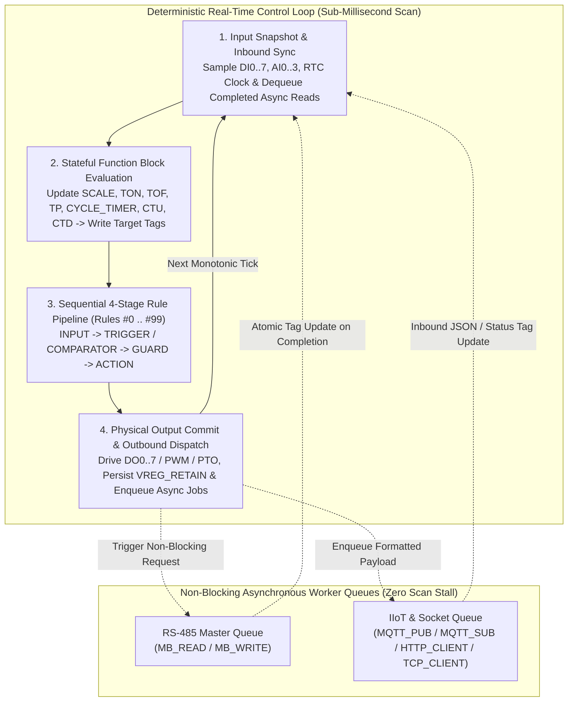
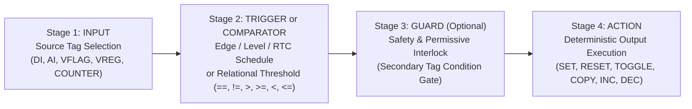

# Deterministic Execution Pipeline

  <strong>Document ID:</strong> SYNX-DOC-CON-003
  <strong>Chapter:</strong> 01. Introduction &amp; Core Concepts
  <strong>Applies To:</strong> SynaptiX IDE v2.x &bull; Hybrid Scan Engine
  <strong>Standard:</strong> IEC 61131-3 &bull; IEC 61508-3

Conventional edge gateways often suffer from a fatal architectural flaw: executing slow network sockets or serial bus retries on the same thread as local safety interlocks. A single unresponsive RS-485 slave or Wi-Fi packet retransmission can freeze discrete output actuation for hundreds of milliseconds.

The **SynaptiX Edge Runtime** solves this through a **Hybrid Deterministic Execution Architecture**: local input sampling, stateful function blocks, and up to **100 compiled Event-Condition-Action rules** execute in a bounded, zero-allocation deterministic scan loop, while fieldbus and cloud transactions operate in **decoupled non-blocking asynchronous worker queues**.

---

## Anatomy of a Complete Scan Cycle

Every deterministic scan cycle progresses through five ordered phases while exchanging snapshots atomically with background fieldbus and IIoT workers:

### Scan Determinism Guarantees
- **Input Image Freeze:** Physical inputs (`DI0..7`, `AI0..3`) and inbound network values are latched at the top of the scan (`Step 1`). A tag's sampled input value never mutates mid-scan between `Rule #0` and `Rule #99`.
- **Sequential Rule Ordering:** Compiled rules execute strictly in ascending index order (`Rule #0`, `Rule #1`, ...) as displayed in the [Rule Table](/workspaces/rule-table-tab) (`Ctrl+4`).
- **Monotonic Timekeeping:** All timers (`TON`, `TOF`, `TP`, `CYCLE_TIMER`) reference hardware monotonic ticks rather than wall-clock time, guaranteeing immunity against NTP/RTC clock adjustments during active timing intervals.

---

## Pillar 1: The 4-Stage Event-Condition-Action Rule Pipeline

When you wire nodes on the [Logic Graph Canvas](/workspaces/logic-graph-tab) (`Ctrl+2`) and press **Compile** (`F7`), the graph compiler lowers visual chains into deterministic **4-Stage Rules** (up to **100 rules** on `SynaptiX Controller`, `SynaptiX Remote I/O`, and `SynaptiX Relay Unit`; up to **50 rules** on compact/gateway presets):

| Pipeline Stage | Visual Blocks | Runtime Responsibility |
| :--- | :--- | :--- |
| **Stage 1 — Source** | [`INPUT`](/blocks/input) | Selects the primary physical, virtual, retentive, counter, or system tag to observe. |
| **Stage 2 — Evaluation** | [`TRIGGER`](/blocks/trigger) or [`COMPARATOR`](/blocks/comparator) | Detects boolean edges (`RISING`, `FALLING`, `ANY_CHANGE`), steady levels, RTC time windows, or evaluates signed `INT32` / IEEE-754 `REAL` relational comparisons (`` `==` ``, `` `!=` ``, `` `>` ``, `` `>=` ``, `` `<` ``, `` `<=` ``) against a constant or second tag. |
| **Stage 3 — Interlock** | [`GUARD`](/blocks/guard) *(Optional)* | Acts as a series safety permissive gate. Even if Stage 2 evaluates to `TRUE`, the rule is blocked from firing unless the Guard condition (for example, `SafetyDoorOk == 1`) is simultaneously satisfied. Multiple chained guards compile cleanly with logical `AND` semantics. |
| **Stage 4 — Execution** | [`ACTION`](/blocks/action) / [`DIRECT_WRITE`](/blocks/direct-write) | Executes deterministic state mutations (`SET`, `RESET`, `TOGGLE`, value assignment, tag-to-tag `COPY`, `INCREMENT`, `DECREMENT`) or drives hardware pulse/PWM actuators (`DIRECT_WRITE`). |

::: info Why Explicit GUARD Stages Improve Industrial Safety
Separating the process event (`TankTemp > 65.0`) from the safety permissive (`SafetyDoorOk == 1`) into dedicated [`COMPARATOR`](/blocks/comparator) and [`GUARD`](/blocks/guard) blocks makes safety interlocks visually unmistakable during peer review, [Rule Table](/workspaces/rule-table-tab) auditing, and [Online Live Debug](/tools/simulator-and-live-debug) (`F8`).
:::

---

## Pillar 2: Stateful Function Blocks & Tag Binding

Alongside pure 4-stage combinational/edge rules, **SynaptiX IDE** provides **7 stateful timing, counting, and analog calibration blocks** that maintain internal state across scan cycles and bind directly to intermediate or output tags:

| Category | Function Block | Stateful Mechanism & Tag Binding Behavior |
| :--- | :--- | :--- |
| **Timing** | [`TON`](/blocks/ton) — On-Delay Timer | Accumulates elapsed milliseconds while input condition remains `1`. Asserts its bound target boolean tag (`VFLAG` or `DO`) to `1` only after elapsed time reaches `PresetMs`; resets immediately when input drops to `0`. |
| **Timing** | [`TOF`](/blocks/tof) — Off-Delay Timer | Immediately sets bound target tag to `1` when input is `1`, and holds output at `1` for `PresetMs` milliseconds after input transitions `1 -> 0` (ideal for post-purge cooling fans). |
| **Timing** | [`TP`](/blocks/tp) — Monostable Pulse | Generates a fixed-duration non-retriggerable pulse of `PresetMs` milliseconds on its bound output tag upon a rising trigger edge (`0 -> 1`). |
| **Timing** | [`CYCLE_TIMER`](/blocks/cycle-timer) | Asymmetric astable oscillator with independent `OnTimeMs` and `OffTimeMs` intervals while enabled — ideal for periodic Modbus polling triggers, warning beacons, and dosing pumps. |
| **Counting** | [`CTU`](/blocks/ctu) — Count Up | Increments a bound `COUNTER0..7` tag on each rising edge (`0 -> 1`) and asserts its completion flag when `Counter >= Preset`. Supports dedicated reset tag binding. |
| **Counting** | [`CTD`](/blocks/ctd) — Count Down | Loads `Preset` on reload and decrements a bound `COUNTER0..7` tag on each rising edge, asserting output state when `Counter <= 0`. |
| **Calibration** | [`SCALE`](/blocks/scale) — Linear Calibration | Continuously maps raw input span `[InMin .. InMax]` (such as `4-20 mA` ADC counts on `AI0`) to calibrated engineering units `[OutMin .. OutMax]` (such as `0.0 .. 100.0 °C` in `REAL`) with optional clamping, writing into a target `VREG` or `VREG_RETAIN`. |

### Chaining Blocks Through Unified Tags
Function blocks compose seamlessly with rules through shared tags. For example:
1. A [`SCALE`](/blocks/scale) block converts raw `AI0` (`INT32`) into calibrated temperature `VREG0` (`TankTempC`, `REAL`).
2. A [`COMPARATOR`](/blocks/comparator) monitors `VREG0 > 65.0` and feeds a [`TON`](/blocks/ton) (`5000 ms` debounce) bound to `VFLAG0` (`OverTempConfirmed`).
3. Downstream rules use `VFLAG0` to energize `DO0` (`CoolingFan`) and trigger an [`MQTT_PUB`](/blocks/mqtt-pub) alert simultaneously.

---

## Pillar 3: Non-Blocking Asynchronous Fieldbus & IIoT Workers

Network I/O inherently involves variable latency — an RS-485 sensor may take `25 ms` to reply at `9600 bps`, while a cellular/Wi-Fi TLS handshake or HTTP webhook may take `150–800 ms`.

To guarantee that **communication delays never stall local deterministic control**, all six fieldbus and network function blocks execute asynchronously via lock-free internal request/completion queues:

| Subsystem | Visual Blocks | Non-Blocking Decoupling Contract |
| :--- | :--- | :--- |
| **RS-485 Modbus RTU Master** | [`MB_READ`](/blocks/mb-read), [`MB_WRITE`](/blocks/mb-write) | Trigger edges enqueue read/write transactions onto the dedicated RS-485 Master scheduler. The fast scan loop continues uninterrupted; once CRC-verified reply frames arrive, target `VREG`/`VFLAG` tags update atomically at the next scan boundary. |
| **MQTT Telemetry & Control** | [`MQTT_PUB`](/blocks/mqtt-pub), [`MQTT_SUB`](/blocks/mqtt-sub) | `MQTT_PUB` snapshots tag values, expands payload macros (such as `` `{val1}` ``, `` `{ts}` ``), and hands the packet to the background TCP/TLS client. Inbound `MQTT_SUB` JSON messages are parsed in the background and staged for atomic tag commit at `Step 1`. |
| **REST & Raw Socket Egress** | [`HTTP_CLIENT`](/blocks/http-client), [`TCP_CLIENT`](/blocks/tcp-client) | Outbound HTTP `POST`/`PUT`/`GET` webhooks and raw TCP/ASCII/Hex socket transmissions execute on the network worker thread with bounded timeouts and status/error reporting without adding jitter to `DI -> DO` response time. |

::: danger Avoiding Write Contention (Multiple Writers to One Tag)
While multiple rules or blocks can safely read the same tag concurrently, avoid configuring two independent continuous blocks to overwrite the exact same `DO` or `VREG` tag on the same scan cycle unless coordinated by mutually exclusive [`GUARD`](/blocks/guard) conditions. **SynaptiX IDE** highlights potential write-conflict hazards during validation (`Tools -> Validate Logic`) and AI Copilot safety checks.
:::

---

## Related Documentation

- [Function Blocks Catalog & Pin Legend](/blocks/overview) — Pin conventions and quick lookup for all 18 blocks.
- [Rule Table Workspace (`Ctrl+4`)](/workspaces/rule-table-tab) — Inspecting compiled rule execution order and lowering output.
- [Simulator & Online Live Debug (`F5` / `F8`)](/tools/simulator-and-live-debug) — Stepping through scan cycles offline and observing live wire states at 20 FPS.
