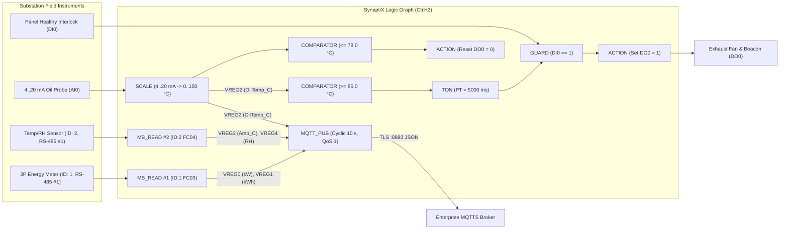
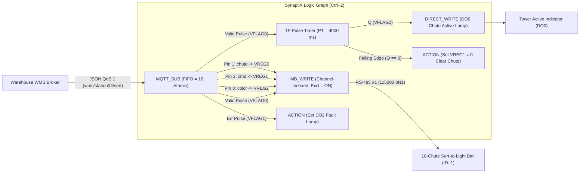

# Integration Application Notes (`AN-001` & `AN-002`)

<div class="doc-meta-bar">
  <span><strong>Document ID:</strong> SYNX-DOC-TOOL-006</span>
  <span><strong>Blueprints:</strong> <code>AN-001</code> (Telemetry &amp; Local Alarm) &bull; <code>AN-002</code> (Sort-to-Light Chute Control)</span>
  <span><strong>Target Presets:</strong> <code>SynaptiX Controller</code> &bull; <code>SynaptiX Gateway</code></span>
  <span><strong>Verification:</strong> Offline Simulator (<code>F5</code>) &amp; Live Debug (<code>F8</code>) Tested</span>
</div>

This section provides two complete, field-proven multi-block reference architectures demonstrating how **SynaptiX IDE** unifies RS-485 fieldbus polling, local deterministic protection rules, hardware pulse actuation, and bidirectional MQTT JSON cloud messaging on a single canvas.

---

## AN-001: Industrial RS-485 Energy & Environmental Telemetry Gateway

### 1.1 Engineering Objective
An unattended substation cabinet houses a 3-phase RS-485 energy analyzer (`Slave ID = 1`), an RS-485 cabinet temperature/humidity transmitter (`Slave ID = 2`), and a 4–20 mA transformer oil temperature probe wired to `AI0`. The **SynaptiX Controller (`SYNX-CTRL-884`)** must:
1. Poll electrical power and ambient cabinet metrics over `RS-485 #1` (`9600 8N1`).
2. Linearly calibrate the `4..20 mA` analog probe (`AI0`) into `0.0 .. 150.0 °C`.
3. Trigger a local cabinet exhaust fan & alarm beacon (`DO0`) **autonomously**—even if WAN internet is down—whenever transformer temperature exceeds `85.0 °C` continuously for `5 seconds`, gated by panel door E-Stop (`DI0 == 1`), with auto-reset below `78.0 °C`.
4. Publish a consolidated multi-variable JSON telemetry packet to an enterprise MQTTS broker (`port 8883`) every `10 seconds`.

### 1.2 System Topology & Logic Graph Wiring



### 1.3 Tag Catalog Allocation (`Ctrl+3`)

| Tag Name | Alias | Data Type | Kind / Source | Engineering Unit | Role in Pipeline |
| :--- | :--- | :--- | :--- | :--- | :--- |
| `DI0` | `Panel_Interlock_OK` | `BOOL` | Discrete Input | — | Active-high (`1`) safety permissive for fan contactor. |
| `DO0` | `Cabinet_Exhaust_Alarm` | `BOOL` | Discrete Output | — | Local over-temperature cooling fan & strobe relay. |
| `AI0` | `OilProbe_Raw_mA` | `REAL` | Analog Input | `mA` | Raw `4.0 .. 20.0 mA` analog current loop input. |
| `VREG0` | `Active_Power_kW` | `REAL` | Virtual Register | `kW` | Polled from Energy Meter (`40001..40002`, `FLOAT32 ABCD`). |
| `VREG1` | `Total_Energy_kWh` | `REAL` | Virtual Register | `kWh` | Polled from Energy Meter (`40003..40004`, `FLOAT32 ABCD`). |
| `VREG2` | `Oil_Temp_C` | `REAL` | Virtual Register | `°C` | Output of [`SCALE`](/blocks/scale) block (`4..20 mA -> 0..150 °C`). |
| `VREG3` | `Ambient_Temp_C` | `REAL` | Virtual Register | `°C` | Polled from Temp/RH probe (`30001`, `INT16 x 0.1`). |
| `VREG4` | `Ambient_RH_Pct` | `REAL` | Virtual Register | `%RH` | Polled from Temp/RH probe (`30002`, `UINT16 x 0.1`). |
| `VFLAG0` | `OverTemp_Dwell_Q` | `BOOL` | Virtual Flag | — | Output `Q` of `5000 ms` [`TON`](/blocks/ton) debounce timer. |

### 1.4 Block Parameter Configuration Summary

| Block Instance | Key Parameters |
| :--- | :--- |
| **`MB_READ #1`** | Port = `RS-485 #1` (`9600 8N1`), Slave ID = `1`, `FC03` Start = `40001`, Poll = `1000 ms`, Pin 1 -> `VREG0` (`REAL ABCD`, Scale `1.0`), Pin 2 -> `VREG1` (`REAL ABCD`, Scale `1.0`). |
| **`MB_READ #2`** | Port = `RS-485 #1`, Slave ID = `2`, `FC04` Start = `30001`, Poll = `2000 ms`, Pin 1 -> `VREG3` (`INT16`, Scale `0.1`), Pin 2 -> `VREG4` (`UINT16`, Scale `0.1`). |
| **`SCALE`** | Input = `AI0`, `InMin = 4.0`, `InMax = 20.0`, `OutMin = 0.0`, `OutMax = 150.0`, `Clamp = Enabled`, Output = `VREG2` (`°C`). |
| **Local Protection Chain** | Rule 1: `VREG2 >= 85.0` -> `TON` (`PT = 5000 ms`, `Q = VFLAG0`) -> `GUARD` (`DI0 == 1`) -> `ACTION` (`Set DO0 = 1`). Rule 2: `VREG2 <= 78.0` -> `ACTION` (`Reset DO0 = 0`). |
| **`MQTT_PUB`** | Topic = `substation/tx01/telemetry`, Mode = `Cyclic` (`10000 ms`), `QoS = 1`, `Retain = false`, `PayloadMode = JSON` (`IncludeDevice = true`, `IncludeTimestamp = true`, `WrapValues = true`). |

### 1.5 Sample Outbound JSON Payload (`substation/tx01/telemetry`)

```json
{
  "device": "SYNX-CTRL-884-TX01",
  "ts": 1730877600,
  "values": {
    "active_power_kw": 42.85,
    "total_energy_kwh": 158420.4,
    "oil_temp_c": 68.2,
    "ambient_temp_c": 31.4,
    "ambient_rh_pct": 58.0
  }
}
```

---

## AN-002: Warehouse Sort-to-Light Chute Controller

### 2.1 Engineering Objective
In an e-commerce parcel sorting station, an overhead barcode scanner sends parcel IDs to a Warehouse Management System (WMS). Within `50 ms`, the WMS publishes a sorting command JSON to topic `wms/station04/sort` specifying which destination chute (`1..18`) and operator RGB indicator code (`1 = Green`, `2 = Amber`, `3 = Blue`) must illuminate. The **SynaptiX Edge Controller** must:
1. Parse inbound JSON commands **atomically** via [`MQTT_SUB`](/blocks/mqtt-sub) (`FIFO` queue depth `16` so rapid back-to-back parcels are never dropped).
2. Drive an 18-chute RS-485 indicator bar via [`MB_WRITE`](/blocks/mb-write) (or addressable strip via [`DIRECT_WRITE`](/blocks/direct-write)) in **Exclusive Channel-Indexed Mode (`IsExclusiveChannel = true`)**—automatically turning OFF the previously lit chute while illuminating the new target chute in one deterministic transaction.
3. Start a [`TP`](/blocks/tp) monostable pulse timer (`PT = 4000 ms`) on every `Valid` command pulse to drive an audible sort-confirmation buzzer (`DO1` for `250 ms`) and auto-extinguish the chute indicator if no new parcel arrives within `4 seconds`.

### 2.2 System Topology & Logic Graph Wiring



### 2.3 Tag Catalog Allocation (`Ctrl+3`)

| Tag Name | Alias | Data Type | Kind | Description |
| :--- | :--- | :--- | :--- | :--- |
| `VREG0` | `Target_Chute_Idx` | `INT32` | Virtual Register | Destination sorting chute number (`1 .. 18`) extracted from JSON `"chute"`. |
| `VREG1` | `Light_Command` | `INT32` | Virtual Register | Actuator command (`1 = Solid ON`, `2 = Fast Blink`, `0 = Extinguish`). |
| `VREG2` | `Color_Preset` | `INT32` | Virtual Register | Operator color code (`1 = Green`, `2 = Amber`, `3 = Blue`). |
| `VFLAG0` | `Sort_Cmd_Valid` | `BOOL` | Virtual Flag | Single-scan pulse from `MQTT_SUB.Valid` when all 3 JSON keys parse cleanly. |
| `VFLAG1` | `Sort_Cmd_Error` | `BOOL` | Virtual Flag | Pulse from `MQTT_SUB.Err` on malformed JSON or out-of-range type mismatch. |
| `VFLAG2` | `Chute_Window_Active` | `BOOL` | Virtual Flag | Output `Q` of [`TP`](/blocks/tp) `4000 ms` active sorting window timer. |
| `DO0` | `Station_Active_Lamp` | `BOOL` | Discrete Output | Physical green dome light energized during the `4 s` put-to-light window. |
| `DO2` | `Payload_Fault_Lamp` | `BOOL` | Discrete Output | Amber diagnostic indicator latched if WMS sends an invalid JSON schema. |

### 2.4 Block Parameter Configuration Summary

| Block Instance | Key Parameters |
| :--- | :--- |
| **`MQTT_SUB`** | Topic = `wms/station04/sort`, `QoS = 1`, `QueueMode = FIFO (16)`, `IgnoreRetainedOnBoot = true` *(prevents stale parcel chutes lighting up after a power cycle!)*, Dynamic Pins: `"chute"` -> `VREG0` (`INT32`), `"cmd"` -> `VREG1` (`INT32`), `"color"` -> `VREG2` (`INT32`). |
| **`MB_WRITE`** | Port = `RS-485 #1` (`115200 8N1`), Slave ID = `1`, `WriteMode = ChannelIndexed`, `ChannelCount = 18`, `IsExclusiveChannel = true`, `TriggerMode = OnTriggerRisingEdge` (`Trig` wired to `MQTT_SUB.Valid`), `Channel` = `VREG0`, `Command` = `VREG1`, `Param` = `VREG2`, `TimeoutMs = 300 ms`. |
| **`DIRECT_WRITE` *(Alternative)* ** | For direct addressable LED/actuator strips wired to `DO1`: `Mode = AddressableBus`, `ChannelCount = 18`, `IsExclusiveChannel = true`, `TriggerMode = OnTriggerRisingEdge`. |
| **`TP` Pulse Timer** | `IN` = `VFLAG0` (`Sort_Cmd_Valid`), `PT = 4000 ms`, `Q` = `VFLAG2` (`Chute_Window_Active`). Falling edge of `VFLAG2` resets `VREG1 = 0` to auto-extinguish the bar after `4 seconds`. |

### 2.5 Sample Inbound WMS Command & Atomic Rejection Test

**Valid WMS Dispatch Payload (`wms/station04/sort`):**
```json
{
  "chute": 7,
  "cmd": 1,
  "color": 1
}
```
- **Deterministic Execution:** `MQTT_SUB` validates all three keys as `INT32`, commits `VREG0 = 7`, `VREG1 = 1`, `VREG2 = 1` atomically in the same scan, pulses `Valid` (`VFLAG0`), causes `MB_WRITE` to extinguish any prior chute (`1..18`) and illuminate **Chute #7** in green, and holds `DO0` active for `4000 ms` via `TP`.

**Adversarial / Malformed Payload Test (Verify in `F5` Offline Simulator):**
```json
{
  "chute": "CHUTE_SEVEN",
  "cmd": 1
}
```
- **Atomic All-or-Nothing Guarantee:** Because `"chute"` violates the `INT32` contract and `"color"` is missing, `MQTT_SUB` **aborts the entire update**—`VREG0`, `VREG1`, and `VREG2` retain their previous valid values untouched, `Valid` stays `0`, and `Err` (`VFLAG1`) pulses to alert operators via `DO2`.

---

## Related Documentation

- [MB_READ — Modbus RTU Poller](/blocks/mb-read) & [MB_WRITE — Modbus RTU Writer](/blocks/mb-write)
- [DIRECT_WRITE — DO / PWM / PTO / Addressable Bus](/blocks/direct-write)
- [MQTT_PUB — Telemetry Publisher](/blocks/mqtt-pub) & [MQTT_SUB — Command Subscriber](/blocks/mqtt-sub)
- [Payload Macros & System Capacity Limits](/appendices/macro-tokens-and-limits)
