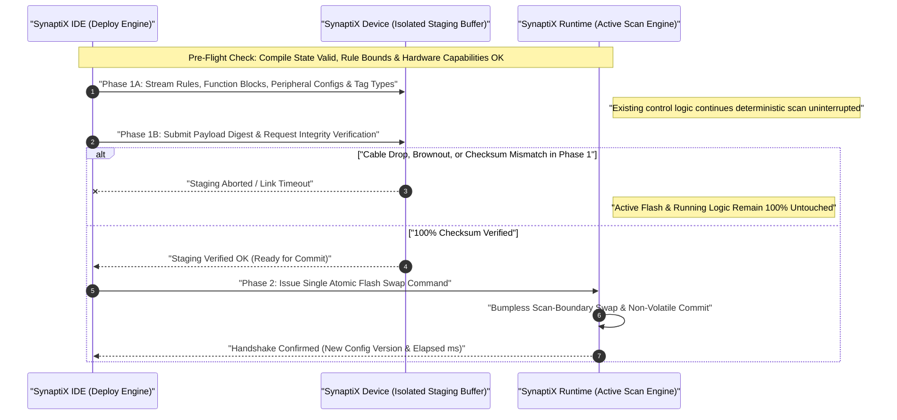

# 6. Atomic Deploy (`Ctrl+6`)

  <strong>Document ID:</strong> SYNX-DOC-WS-006
  <strong>Workspace:</strong> Tab 6 &bull; Shortcut <code>Ctrl+6</code> &bull; Execute <code>Ctrl+F5</code>
  <strong>Scope:</strong> Pre-Flight Static Verification, Two-Phase Atomic Flash Commit, Hardware Upload (F6) &amp; Binary Provisioning
  <strong>Standard:</strong> IEC 61508-3 &bull; IEC/IEEE 82079-1 &bull; ANSI/ISA-101

---

## 1. Purpose & Operational Role

The **Atomic Deploy Workspace** (`Ctrl+6`) is the release gate and non-volatile configuration commit engine of **SynaptiX IDE**. In industrial automation, partial or interrupted downloads caused by cabinet power brownouts, RS-485 bus contention, or accidental USB cable disconnects can leave conventional controllers in an undefined half-programmed state. **SynaptiX IDE** eliminates this hazard through a **Two-Phase Atomic Safe Commit** protocol (`Ctrl+F5`).

Across the commissioning and production lifecycle, the **Atomic Deploy Workspace** governs four high-integrity operations:

1. **Pre-Flight Static & Capability Verification:** Auditing connection readiness, [Logic Graph](/workspaces/logic-graph-tab) compilation freshness (`Valid` vs `Stale`/`Invalid`), domain rule invariants, and target hardware capability gates before a single byte is transmitted.
2. **Two-Phase Atomic Safe Commit (`Ctrl+F5`):** Streaming the complete project payload into an isolated staging region and verifying payload checksums (**Phase 1**) before executing a single bumpless atomic pointer/Flash swap (**Phase 2**) while active machine control continues uninterrupted.
3. **Full Reverse Engineering Readback (`F6` — Upload from Device):** Extracting active ECA rules, stateful Function Blocks, RS-485 Modbus schedules, MQTT topics, and DTU parameters directly from a live **SynaptiX Edge Controller** and reconstructing both the [Rule Table](/workspaces/rule-table-tab) and visual [Logic Graph](/workspaces/logic-graph-tab).
4. **CRC-Verified Binary Image Provisioning (`*.bin`):** Exporting and importing compiled binary firmware configuration images for version-controlled release archives and high-speed batch factory provisioning across identical edge units.

---

## 2. Visual Layout & Controls Reference

The **Atomic Deploy Workspace** is structured into a **Left Pre-Flight & Deployment Manifest Column** and a **Right 5-Stage Pipeline Stepper & Diagnostic Console Column**:

### 2.1. Deployment Manifest & Pipeline Controls Reference

| Panel / Control | Shortcut / Location | Description & Operational Behavior |
| :--- | :--- | :--- |
| **Pre-Flight Readiness Banner** | Left Column Top | Displays overall deployment eligibility (`Ready to Deploy`, `Compile Stale`, `Validation Error`, or `Device Offline`) alongside **Semantic Program Hash** sync status. |
| **Deployment Manifest Card** | Left Column Body | Summarizes exact artifact counts queued for transfer: active ECA `Logic Rules`, stateful `Function Blocks` (Timers/Counters), `RS-485 Modbus` channels, `MQTT Services`, `Direct Output` modes, `DTU Gateway` settings, and the `Tag Data Type Registry` (`BOOL` / `INT32` / `REAL`). |
| **Commit / Atomic Deploy Button** | `Ctrl+F5` (Left Action Bar) | Initiates the 5-step Two-Phase Atomic Safe Commit workflow to the connected **SynaptiX Device** (or virtual simulator). |
| **Upload from Device Button** | `F6` (Top / Action Bar) | Reads active configuration from the connected controller into **SynaptiX IDE** (guarded by an unsaved-changes confirmation prompt if the local project is dirty). |
| **5-Stage Atomic Pipeline Stepper** | Right Column Upper | Visualizes live execution progress across: **1. Pre-Flight Validation**, **2. Phase 1 Staging Transfer**, **3. Checksum Integrity Verification**, **4. Phase 2 Atomic Flash Swap**, and **5. Active Version Handshake**. |
| **Deployment Console Output Log** | Right Column Lower | Monospace timestamped audit trail recording every validated subsystem, elapsed transfer duration (`ms`), and confirmed runtime configuration version, complete with **Copy Log** and **Clear Log** actions. |
| **Binary Image Export / Import** | `File → Export / Import → Binary (*.bin)` | Generates or loads standalone `CRC-16` protected binary configuration images for offline archiving and batch production programming. |

### 2.2. Two-Phase Atomic Safe Commit Architecture (`Ctrl+F5`)

The sequence diagram below illustrates how **SynaptiX IDE** and the **SynaptiX Runtime** guarantee zero half-written states even under sudden power loss or cable disconnection:

::: tip SEMANTIC HASH INTELLIGENCE
**SynaptiX IDE** tracks a **Semantic Program Hash** computed strictly over compiled logic rules, tag data types, and peripheral configurations. Purely visual adjustments on the [Logic Graph Canvas](/workspaces/logic-graph-tab)—such as panning, aligning nodes (`Alt+M`), or redistributing spacing (`Alt+Shift+H`)—do **not** invalidate a verified deployment state.
:::

---

## 3. Step-by-Step Operational Procedures

### Procedure 3.1: Executing a Two-Phase Atomic Deployment (`Ctrl+F5`)

1. Verify that your target **SynaptiX Edge Controller** (or `SIMULATOR (VIRTUAL)`) shows `Connected` in the top connection bar (`F4`).
2. Press `F7` to ensure the [Logic Graph Canvas](/workspaces/logic-graph-tab) compile badge is green (`Valid`), then press `Ctrl+6` to open the **Atomic Deploy Workspace**.
3. Review the **Deployment Manifest Card** on the left to confirm the expected count of enabled ECA rules, timers/counters, RS-485 channels, and MQTT topics.
4. Click **Atomic Deploy** (or press `Ctrl+F5` from any workspace).
5. Observe the **5-Stage Atomic Pipeline Stepper** advance sequentially through Pre-Flight Validation, Phase 1 Staging, Checksum Verification, Phase 2 Atomic Swap, and Version Handshake.
6. Confirm the final `[SUCCESS]` summary line in the **Deployment Console Output Log**, recording the active configuration version and total commit time in milliseconds.

### Procedure 3.2: Uploading & Reconstructing a Project from Field Hardware (`F6`)

1. Connect to the field **SynaptiX Edge Controller** via USB CDC or Modbus TCP (`F4`).
2. Press `F6` (**Upload from Device**). If the currently open `.synx` project has unsaved edits, confirm whether to save first before overwriting the workspace.
3. **SynaptiX IDE** reads back all active ECA rules, stateful Function Block instances, RS-485 port parameters, MQTT configurations, and tag types, then automatically reconstructs both the tabular [Rule Table](/workspaces/rule-table-tab) (`Ctrl+4`) and clean visual networks on the [Logic Graph Canvas](/workspaces/logic-graph-tab) (`Ctrl+2`).
4. Press `Ctrl+S` immediately to save a dated `.synx` backup copy of the field configuration.

### Procedure 3.3: Exporting & Importing `.bin` Images for Batch Factory Provisioning

1. With a verified project compiled (`F7`), select **File → Export → Binary (`*.bin`)** and save the release artifact (for example, `skid_controller_rev2.bin`). Every exported `.bin` image embeds a cryptographic `CRC-16` integrity frame.
2. On the production test bench, technicians can load the approved `.bin` image via **File → Import → Binary (`*.bin`)**—which validates the `CRC-16` checksum upon load—and press `Ctrl+F5` sequentially across multiple identical controllers with guaranteed binary equivalence.

---

## 4. Engineering Best Practices & Edge Cases

::: warning HARDWARE CAPABILITY MISMATCH HANDLING
If a project authored for a full **IIoT Edge Controller** contains `MQTT_PUB` or `Wi-Fi` configurations, and you connect to a compact **RS-485 Remote I/O** variant that lacks network silicon, the **Pre-Flight Verifier** detects the capability delta automatically—flagging or gating unsupported network subsystems while protecting valid core I/O rules. Always align your target preset in the [Device Workspace](/workspaces/device-tab) (`Ctrl+1`) before final sign-off.
:::

- **Recovering from Mid-Deploy Power Interruption:** If plant power drops during **Step 2 (Phase 1 Staging)** or **Step 3 (Checksum Verification)**, simply restore cabinet power, wait for **SynaptiX IDE** to transition from `Reconnecting` back to `Connected`, and press `Ctrl+F5` again. The controller boots cleanly on its previous committed Flash image without corruption.
- **Archiving Deployment Logs for FAT Sign-Off:** Click **Copy Log** in the Deployment Console immediately after commissioning each cabinet and paste the timestamped handshake record into your Factory Acceptance Test checklist.

---

## Related Documentation

- [Deterministic Execution Pipeline](/concepts/execution-pipeline)
- [1. Device Workspace (`Ctrl+1`)](/workspaces/device-tab)
- [4. Rule Table (`Ctrl+4`)](/workspaces/rule-table-tab)
- [7. Live Watch & Trends (`Ctrl+7`)](/workspaces/live-watch-tab)
- [Error Codes & Troubleshooting](/appendices/error-codes-and-troubleshooting)
