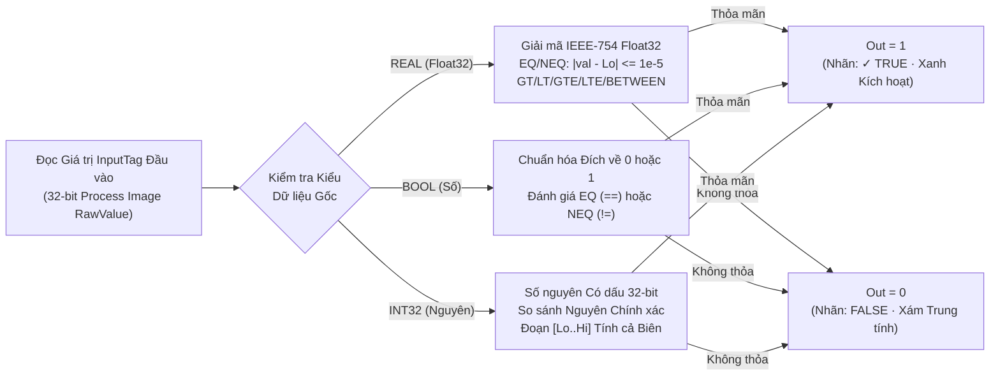
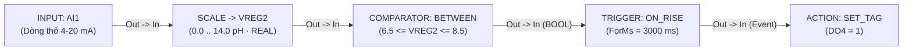

# COMPARATOR — Bộ So sánh Quan hệ

  <strong>Mã khối:</strong> COMPARATOR (CMP)
  <strong>Nhóm danh mục:</strong> Chuỗi Luật Cốt lõi (Core Rule Pipeline)
  <strong>Lớp thực thi:</strong> Hàm Tổ hợp Thuần túy (IEC 61131-3 CMP)
  <strong>Đích biên dịch:</strong> Bộ Đánh giá Điều kiện Quan hệ

## 1. Tóm tắt Chức năng & Ngữ nghĩa Thực thi

Khối **`COMPARATOR`** (`CMP`) là hàm toán tử so sánh khóa chặt theo kiểu dữ liệu, thực hiện đối chiếu liên tục giá trị Tag hoặc đại lượng vật lý đã hiệu chuẩn ở ngõ vào (`In`) với một hoặc hai ngưỡng tham chiếu (`ThresholdLo`, `ThresholdHi`) và xuất ra tín hiệu logic nhị phân `BOOL` thuần túy (`Out` = `TRUE` hoặc `FALSE`) ở mọi chu kỳ quét.

- **Đánh giá Khóa Chặt theo Kiểu Vật lý:** Ngay khi nối dây từ khối [`INPUT`](/vi/blocks/input) hoặc [`SCALE`](/vi/blocks/scale) vào chân `In`, khối `COMPARATOR` tự động khóa chế độ toán học và bộ định dạng ô nhập trên Inspector khớp hoàn toàn với kiểu dữ liệu nguồn (`INT32`, số thực IEEE-754 `REAL` hoặc `BOOL`).
- **Dung sai Epsilon An toàn cho Số thực (`REAL`):** Phép so sánh bằng tuyệt đối từng bit trên số thực dấu phẩy động IEEE-754 thường xuyên gây sai lệch do làm tròn nhị phân. Khi đầu vào mang kiểu `REAL` (`Float32`), `COMPARATOR` tự động áp dụng vùng dung sai công nghiệp `1e-5` (`0.00001`) cho hai toán tử `EQ` (`==`) và `NEQ` (`!=`).
- **Ngõ ra Mức Logic Liên tục:** Do chân `Out` là chân giá trị `BOOL` (`IsEvent = false`), nó có thể nối vào khối [`TRIGGER`](/vi/blocks/trigger) để bắt sườn kèm lọc chống dội, hoặc đấu trực tiếp tới [`GUARD`](/vi/blocks/guard), [`ACTION`](/vi/blocks/action), [`MQTT_PUB`](/vi/blocks/mqtt-pub), [`HTTP_CLIENT`](/vi/blocks/http-client) và [`TCP_CLIENT`](/vi/blocks/tcp-client).
- **Ứng dụng Công nghiệp Điển hình:** Giám sát ngưỡng mức bồn cao/thấp, kiểm tra dải nhiệt độ/độ ẩm cho phép (`BETWEEN`), xác nhận đủ định lượng mẻ cân và phát hiện quá áp/quá dòng sau khối quy đổi `SCALE`.

---

## 2. Sơ đồ Chân & Hợp đồng Tín hiệu

| Chân (Pin) | Chiều | Loại Tín hiệu | Kiểu Dữ liệu | Mô tả Kỹ thuật |
| :--- | :--- | :--- | :--- | :--- |
| `In` | Ngõ vào (Input) | Giá trị / Dữ liệu (`IsEvent = false`) | `INT32` \| `REAL` \| `BOOL` | Nhận giá trị Tag trực tiếp hoặc đại lượng vật lý đã quy đổi từ khối [`INPUT`](/vi/blocks/input) hoặc [`SCALE`](/vi/blocks/scale) (hoặc chân dữ liệu từ [`MB_READ`](/vi/blocks/mb-read)). |
| `Out` | Ngõ ra (Output) | Giá trị / Dữ liệu (`IsEvent = false`) | `BOOL` (`0` / `1`) | Xuất mức `1` (`✓ TRUE`) chừng nào biểu thức quan hệ còn đúng, và xuất `0` (`FALSE`) khi điều kiện không thỏa mãn. |

---

## 3. Tham số Inspector & Giới hạn Kiểm tra

| Tham số | Kiểu / Tùy chọn | Mặc định | Ràng buộc & Giới hạn | Hành vi Thời gian thực |
| :--- | :--- | :--- | :--- | :--- |
| `CompareOp` | `EQ`, `NEQ`, `GT`, `LT`, `GTE`, `LTE`, `BETWEEN` | `GT` (`>`) | Toán tử quan hệ bắt buộc; đối với Tag `BOOL`, toán tử `EQ` và `NEQ` đối chiếu trực tiếp trạng thái nhị phân với `ThresholdLo`. | Chọn phép toán quan hệ được tính toán ở mỗi chu kỳ quét (xem bảng chi tiết 7 toán tử bên dưới). |
| `ThresholdLo` | Ô số Khóa theo Kiểu / Nút `[ 0 ]` `[ 1 ]` | `50` (`"50.0"` nếu là `REAL`) | Khóa chặt theo kiểu `INT32`, `REAL` hoặc `BOOL` của `InputTag`. | Ngưỡng chuẩn cho các phép so sánh đơn, hoặc cận dưới tính cả biên (`Lo`) khi chọn `CompareOp = BETWEEN`. |
| `ThresholdHi` | Ô số Khóa theo Kiểu | `100` (`"100.0"` nếu là `REAL`) | Chỉ hiển thị và có hiệu lực khi `CompareOp = BETWEEN`. Cần đặt `ThresholdHi >= ThresholdLo`. | Cận trên tính cả biên (`Hi`) cho phép kiểm tra trong dải (`ThresholdLo <= In <= ThresholdHi`). |
| `CustomLabel` | Chuỗi văn bản tự do | Rỗng (`"CMP (Comparator)"`) | Nhãn tùy biến trên sơ đồ. | Đổi tiêu đề khối nhưng vẫn giữ nguyên dòng công thức toán học `FormulaExpression` trực quan trên thân thẻ. |

### Bảng Đặc tả 7 Toán tử Quan hệ

| Mã Toán tử | Ký hiệu | Biểu thức Công thức | Ngữ nghĩa Số nguyên (`INT32`) | Ngữ nghĩa Số thực (`REAL` / `Float32`) |
| :--- | :--- | :--- | :--- | :--- |
| `EQ` | `==` | `Tag == Lo` | Bằng chính xác số nguyên (`val == loInt`) | Bằng có dung sai: `abs(val - lo) <= 1e-5` |
| `NEQ` | `!=` | `Tag != Lo` | Khác chính xác số nguyên (`val != loInt`) | Khác có dung sai: `abs(val - lo) > 1e-5` |
| `GT` | `>` | `Tag > Lo` | Lớn hơn nghiêm ngặt (`val > loInt`) | Lớn hơn nghiêm ngặt (`val > lo`) |
| `LT` | `<` | `Tag < Lo` | Nhỏ hơn nghiêm ngặt (`val < loInt`) | Nhỏ hơn nghiêm ngặt (`val < lo`) |
| `GTE` | `>=` | `Tag >= Lo` | Lớn hơn hoặc bằng (`val >= loInt`) | Lớn hơn hoặc bằng (`val >= lo`) |
| `LTE` | `<=` | `Tag <= Lo` | Nhỏ hơn hoặc bằng (`val <= loInt`) | Nhỏ hơn hoặc bằng (`val <= lo`) |
| `BETWEEN` | `IN_RANGE` | `Lo <= Tag <= Hi` | Thuộc đoạn nguyên `[loInt..hiInt]` | Thuộc đoạn thực `[lo..hi]` tính cả hai đầu mút |

---

## 4. Máy Trạng thái / Giản đồ Thời gian

Lưu đồ dưới đây trình bày luồng phân nhánh đánh giá theo kiểu dữ liệu vật lý bên trong khối `COMPARATOR` ở từng chu kỳ quét cũng như khi giám sát trực tuyến 20 FPS:

---

## 5. Cơ chế Bảo vệ Nhập liệu & Chẩn đoán Trực tuyến

### 5.1 Tự động Khóa lại Kiểu & Bảo vệ Chống Nhập sai

Khối `COMPARATOR` bảo vệ tính toàn vẹn kiểu vật lý trên cả hai ô ngưỡng (`CommitThresholdLo` và `CommitThresholdHi`) ngay khi nhấn `Enter` hoặc rời ô nhập (`LostFocus`):

- **Khi nối Tag Số nguyên (`INT32`):** Nhập `"100.0"` được tự động rút gọn sạch thành `"100"`. Mọi thao tác gõ số lẻ thập phân như `"25.5"` hoặc chuỗi chữ `"abc"` đều bị **từ chối tuyệt đối** và tự động hoàn nguyên về số nguyên hợp lệ gần nhất — ngăn chặn triệt để lỗi làm tròn ngầm gây sai lệch giữa màn hình và bộ điều khiển.
- **Khi nối Tag Số thực (`REAL`):** Gõ số tròn `"25"` tự động chuẩn hóa thành `"25.0"`, gõ dấu phẩy `"37,5"` tự động chuyển thành `"37.5"`.
- **Khi nối Tag Nhị phân (`BOOL`):** Ẩn ô nhập tự do, hiển thị cặp nút gạt chuẩn công nghiệp `[ 0 ]` / `[ 1 ]` và chuẩn hóa các từ khóa (`"true"`, `"on"`, `"bật"` → `"1"`).
- **Tự động Định dạng lại khi Đổi dây Nguồn:** Nếu tháo dây từ một Tag `INT32` và nối sang Tag `REAL`, cả `ThresholdLoText` và `ThresholdHiText` lập tức định dạng lại (`"50"` → `"50.0"`) đồng thời chuyển huy hiệu kiểu từ `INT32` sang `REAL`.

### 5.2 Nhãn Chẩn đoán trong Mô phỏng (`F5`) & Gỡ lỗi Trực tuyến (`F8`)

- **Hiển thị Biểu thức Toán học Trực tiếp:** Thân khối luôn hiển thị tường minh công thức đang áp dụng, ví dụ `6.5 <= Tank_pH <= 8.5` hoặc `Nhiet_Do_Lo >= 650`.
- **Nhãn Kết quả Đúng/Sai & Chất lượng Dữ liệu:** Hiển thị `✓ TRUE` (sáng viền xanh lá) khi điều kiện thỏa mãn và `FALSE` (xám trung tính) khi chưa đạt. Nếu chất lượng cảm biến đầu vào rơi vào trạng thái `Stale` khi chạy Live Debug (`F8`), khối lập tức chuyển sang trạng thái cảnh báo `Stale` để người vận hành nhận biết.

---

## 6. Kịch bản Đấu nối Công nghiệp Thực tế

### Bài toán: Giám sát Vùng pH Trung hòa An toàn Hệ thống CIP (`6.5 <= pH <= 8.5`)

Tại bồn trung hòa nước thải trạm rửa CIP nhà máy thực phẩm, giá trị đo `pH` kiểu số thực `REAL` lưu tại `VREG2` (đầu ra từ khối [`SCALE`](/vi/blocks/scale) quy đổi dòng `4–20 mA` của `AI1` sang dải `0.0–14.0 pH`) phải nằm ổn định trong vùng an toàn **`6.5` đến `8.5 pH`** liên tục đủ `3 giây` mới được phép mở van điện từ xả ra môi trường (`DO4`).

### Khai báo Bảng Tag

| Tên Tag | Phân loại | Kiểu Dữ liệu | Mô tả / Tên Bí danh (Alias) |
| :--- | :--- | :--- | :--- |
| `AI1` | `AI` | `INT32` | `Giá trị Thô Cảm biến pH (4000-20000)` |
| `VREG2` | `VREG` | `REAL` | `Giá trị pH Bồn Trung hòa (0.0-14.0)` |
| `DO4` | `DO` | `BOOL` | `Van Điện từ Xả Nước Đạt chuẩn` |

### Trình tự Đấu nối trên Canvas

1. Đấu nối `INPUT (AI1)` → **[`SCALE`](/vi/blocks/scale)** (`RawMin = 4000`, `RawMax = 20000`, `EngMin = 0.0`, `EngMax = 14.0`, `OutputTag = VREG2`).
2. Chọn khối `SCALE` rồi nhấp thêm khối **`COMPARATOR`** trên thanh công cụ. Hệ thống tự động nối dây `SCALE.Out → COMPARATOR.In` và khóa nhãn kiểu dữ liệu thành `REAL`.
3. Trên bảng **Inspector** của `COMPARATOR`, chọn `CompareOp = BETWEEN`, nhập `ThresholdLo = 6.5` và `ThresholdHi = 8.5`. Quan sát biểu thức trên thân khối hiển thị `6.5 <= VREG2 <= 8.5`.
4. Nối tiếp `COMPARATOR.Out` → **[`TRIGGER`](/vi/blocks/trigger)** (`TriggerType = ON_RISE`, `ForMs = 3000`) → **[`ACTION`](/vi/blocks/action)** (`ActionType = SET_TAG`, `TargetTag = DO4`, `ActionParam = 1`).
5. Nhấn `F5` chạy mô phỏng: bơm giá trị tương ứng `pH = 7.2` (`AI1 = 12228`), quan sát khối `COMPARATOR` bật `✓ TRUE`, chờ bộ lọc `TRIGGER` đếm đủ `3000 ms` và xác nhận van `DO4` đóng lên mức `1`.

