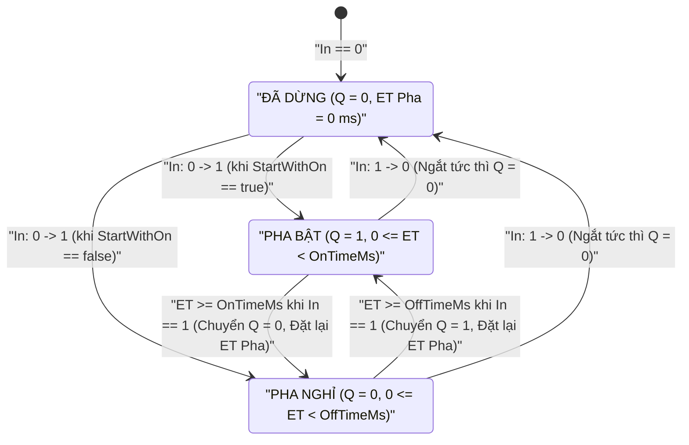
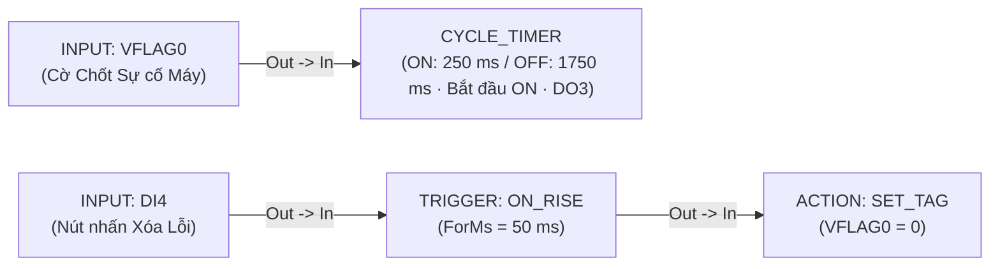

# CYCLE_TIMER — Tạo Xung Chu kỳ Bất đối xứng

  <strong>Mã khối:</strong> CYCLE_TIMER (CYCLE)
  <strong>Nhóm danh mục:</strong> Định thời, Bộ đếm &amp; Chuẩn hóa
  <strong>Lớp thực thi:</strong> Bộ Tạo Dao động / Chớp Nháy Chu kỳ Bất đối xứng
  <strong>Đích biên dịch:</strong> Động cơ Dao động Đơn điệu Hai Pha

## 1. Tóm tắt Chức năng & Ngữ nghĩa Thực thi

Khối **`CYCLE_TIMER`** là **bộ phát xung vuông tuần hoàn bất đối xứng (asymmetric flasher / oscillator)** điều khiển theo mức. Chừng nào tín hiệu cho phép ở chân `In` còn giữ mức tích cực (`1`), khối `CYCLE_TIMER` liên tục đảo luân phiên ngõ ra nhị phân `Q` giữa **pha BẬT (`OnTimeMs`)** và **pha NGHỈ (`OffTimeMs`)** hoàn toàn độc lập, với pha khởi đầu tùy chọn.

- **Tỷ lệ Chu kỳ Bất đối xứng Độc lập:** Khác với các bit xung nhịp đối xứng `50%` cố định vốn đòi hỏi ghép thêm bộ đếm và bộ so sánh phức tạp, `CYCLE_TIMER` cho phép phối hợp trực tiếp pha đóng tính bằng mili-giây/giây với pha nghỉ tính bằng phút/giờ ngay trong một khối duy nhất (ví dụ: bơm mỡ bôi trơn `OnTimeMs = 500 ms` lặp lại sau mỗi `OffTimeMs = 15 min`).
- **Tùy chọn Pha Khởi đầu (`StartWithOn`):**
  - **`Bắt đầu bằng ON` (`true`):** Lập tức đóng `Q = 1` trong khoảng `OnTimeMs` ngay ở chu kỳ đầu tiên khi `In` lên `1`, sau đó chuyển sang nghỉ `Q = 0` trong `OffTimeMs` và lặp lại liên tục.
  - **`Bắt đầu bằng OFF` (`false`):** Vào pha nghỉ `Q = 0` hết khoảng `OffTimeMs` trước, sau đó mới phát xung `Q = 1`.
- **Ngắt Dứt khoát Khi Dừng Cho phép:** Ngay khoảnh khắc `In` hạ về `0`, bộ tạo dao động dừng tức thì, xóa bộ đếm pha nội bộ về `0` và đưa ngõ ra `Q` về trạng thái an toàn `0`.
- **Ứng dụng Công nghiệp Điển hình:** Đèn tháp chớp cảnh báo sự cố Andon và còi báo ngắt quãng, bơm mỡ bôi trơn ổ bi tự động định kỳ, phun sương làm mát nhà màng nông nghiệp công nghệ cao và sục rửa ngược màng lọc theo chu kỳ.

---

## 2. Sơ đồ Chân & Hợp đồng Tín hiệu

| Chân (Pin) | Chiều | Loại Tín hiệu | Kiểu Dữ liệu | Mô tả Kỹ thuật |
| :--- | :--- | :--- | :--- | :--- |
| `In` | Ngõ vào (Input) | Sự kiện / Thực thi (`IsEvent = true`) | Cấp Mức Cho phép (`BOOL`) | Cho phép dao động tuần hoàn `ON`/`OFF` chừng nào giữ mức `1`; dừng dao động và ép `Q = 0` ngay lập tức khi về `0`. |
| `Q` | Ngõ ra (Output) | Giá trị / Dữ liệu (`IsEvent = false`) | `BOOL` (`0` / `1`) | Ngõ ra chuỗi xung bất đối xứng gắn với `OutputTag`; nối dây tới [`ACTION`](/vi/blocks/action), [`MQTT_PUB`](/vi/blocks/mqtt-pub), [`HTTP_CLIENT`](/vi/blocks/http-client) hoặc [`TCP_CLIENT`](/vi/blocks/tcp-client). |

---

## 3. Tham số Inspector & Giới hạn Kiểm tra

| Tham số | Kiểu / Tùy chọn | Mặc định | Ràng buộc & Giới hạn | Hành vi Thời gian thực |
| :--- | :--- | :--- | :--- | :--- |
| `OnDurationValueText` + `OnTimeUnit` | Số không âm + Đơn vị (`ms`, `s`, `min`, `h`) | `"1"` `s` (`1000 ms`) | Quy đổi đơn vị độc lập; kẹp `OnTimeMs` trong dải `[1 .. 4,294,967,295] ms`. | Thiết lập độ rộng pha đóng (`Q = 1`) mỗi chu kỳ và hiển thị dòng xác nhận `= 1,000 ms (1s)`. |
| `OffDurationValueText` + `OffTimeUnit` | Số không âm + Đơn vị (`ms`, `s`, `min`, `h`) | `"1"` `s` (`1000 ms`) | Quy đổi đơn vị độc lập; kẹp `OffTimeMs` trong dải `[1 .. 4,294,967,295] ms`. | Thiết lập độ rộng pha nghỉ (`Q = 0`) mỗi chu kỳ và hiển thị dòng xác nhận `= 1,000 ms (1s)`. |
| `StartWithOn` (`StartPhaseIndex`) | `Bắt đầu bằng ON` (`0`) \| `Bắt đầu bằng OFF` (`1`) | `Bắt đầu bằng ON` (`true`) | Bộ chọn 2 chế độ pha đầu. | Quyết định `Q` bật `1` ngay (`OnTimeMs`) hay chờ nghỉ `0` trước (`OffTimeMs`) khi `In` chuyển `0 → 1`. |
| `InputTag` | Tag Số (`DI`, `DO`, `VFLAG`) | Tự động nhận từ dây nối vào | Phải tham chiếu tới Tag số nhị phân. | Tín hiệu duy trì mức cho phép bộ tạo dao động hoạt động khi `!= 0`. |
| `OutputTag` (`Q`) | Tag Số Cho phép Ghi (`DO`, `VFLAG`) | Chưa gán *(bắt buộc chọn)* | Phải là Tag nhị phân cho phép ghi (`DO` hoặc `VFLAG`). | Đảo luân phiên giữa `1` (`OnTimeMs`) và `0` (`OffTimeMs`) khi `In == 1`; ép về `0` khi `In == 0`. |
| `CustomLabel` | Chuỗi văn bản tự do | Rỗng (`"Cycle Timer"`) | Nhãn tùy biến trên sơ đồ. | Ghi đè tiêu đề hiển thị trên thẻ khối đồ họa. |

::: warning Lưu ý Chọn Ngõ ra Bán dẫn Cho Tần số Chớp Cao
Đối với các chu kỳ chớp đèn nhanh (`OnTimeMs` hoặc `OffTimeMs` nhỏ hơn `2,000 ms`), bắt buộc gán `OutputTag` vào **ngõ ra bán dẫn Transistor / MOSFET / SSR** thay vì rơ-le cơ khí để bảo vệ tuổi thọ tiếp điểm.
:::

---

## 4. Máy Trạng thái / Giản đồ Thời gian

Sơ đồ trạng thái dưới đây trình bày chi tiết vòng đời dao động hai pha, bao gồm bước phân nhánh pha khởi đầu (`StartWithOn`) và cơ chế ngắt an toàn tức thì khi `In` hạ về `0`:

---

## 5. Cơ chế Bảo vệ Nhập liệu & Chẩn đoán Trực tuyến

### 5.1 Hai Bộ Quy đổi Đơn vị Độc lập & Chống Nhập sai

- **Tự do Phối hợp Khác Thang Thời gian:** `OnTimeUnit` và `OffTimeUnit` vận hành tách biệt hoàn toàn — kỹ sư dễ dàng đặt `Pha ON = 500 ms` đi kèm `Pha OFF = 10 min` mà không cần quy đổi thủ công `10 phút = 600,000 ms`. Cả hai ô đều hiển thị tường minh số mili-giây thực tế ngay bên dưới (`CalculatedOnMsSummary` và `CalculatedOffMsSummary`).
- **Kẹp Biên Chống Chu kỳ Bằng 0:** Tự động chuẩn hóa dấu phẩy thập phân (`"0,5"` → `"0.5"`), kẹp giá trị `"0"` về mức tối thiểu `1 ms` để ngăn vòng lặp chia không, và loại bỏ mọi ký tự không hợp lệ.

### 5.2 Nhãn Chẩn đoán trong Mô phỏng (`F5`) & Gỡ lỗi Trực tuyến (`F8`)

- **Tóm tắt Tỷ lệ Chu kỳ & Nhãn Chớp Trực tiếp:** Thân khối hiển thị rõ `CYCLE (250ms/1.75s) → DO3` cùng dòng thông số `ON: 250ms | OFF: 1.75s`, trong khi nhãn trạng thái nhấp nháy trực quan giữa `● ON` (xanh lá kích hoạt) và `● OFF` (xám trung tính) cả khi chạy Simulator (`F5`) lẫn Live Debug 20 FPS (`F8`).

---

## 6. Kịch bản Đấu nối Công nghiệp Thực tế

### Bài toán: Đèn Tháp Chớp Cảnh báo Lỗi Máy Bất đối xứng (`Chớp 250 ms` / `Nghỉ 1750 ms`)

Mỗi khi cờ chốt sự cố máy (`VFLAG0 = 1`) kích hoạt, đèn tháp cảnh báo LED đấu tại ngõ ra bán dẫn `DO3` phải phát chuỗi **chớp sáng ngắn hiệu suất cao** (`Sáng 250 ms`, `Tắt 1,750 ms` = chu kỳ `2.0 s`, hệ số lấp đầy `12.5%`) bắt đầu sáng ngay lập tức ở khoảnh khắc phát sinh lỗi, và tắt hẳn ngay khi người vận hành nhấn nút Xóa Lỗi (`DI4`).

### Khai báo Bảng Tag

| Tên Tag | Phân loại | Kiểu Dữ liệu | Mô tả / Tên Bí danh (Alias) |
| :--- | :--- | :--- | :--- |
| `VFLAG0` | `VFLAG` | `BOOL` | `Cờ Chốt Sự cố Máy Đang Tồn tại (1 = Có lỗi)` |
| `DI4` | `DI` | `BOOL` | `Nút nhấn Xác nhận Xóa Lỗi trên Mặt tủ` |
| `DO3` | `DO` | `BOOL` | `Đèn Tháp LED Cảnh báo (Ngõ ra Transistor)` |

### Trình tự Đấu nối trên Canvas

1. **Nhánh 1 (Bộ Dao động Chớp Đèn):** Đặt khối **`INPUT`** (`Tag = VFLAG0`, `CustomLabel = "Cờ Sự cố Máy"`) và nối `INPUT.Out` → **`CYCLE_TIMER`**.
2. Trên bảng **Inspector** của `CYCLE_TIMER`, thiết lập:
   - `OnDurationValueText = "250"`, `OnTimeUnit = "ms"` (`= 250 ms`)
   - `OffDurationValueText = "1750"`, `OffTimeUnit = "ms"` (hoặc `"1.75"` `s`, `= 1,750 ms`)
   - `StartWithOn = Bắt đầu bằng ON`
   - `OutputTag = DO3` (`CustomLabel = "Chớp Đèn Cảnh báo"`)
3. **Nhánh 2 (Nút nhấn Xóa Lỗi):** Đặt khối **`INPUT`** (`Tag = DI4`) → **[`TRIGGER`](/vi/blocks/trigger)** (`ON_RISE`, `ForMs = 50` ms) → **[`ACTION`](/vi/blocks/action)** (`SET_TAG`, `TargetTag = VFLAG0`, `ActionParam = 0`).
4. Nhấn `F5` chạy mô phỏng: gạt `VFLAG0` lên `1`, quan sát `DO3` lập tức chớp sáng `● ON` (`250 ms`) và nghỉ `● OFF` (`1,750 ms`) tuần hoàn; bấm nút `DI4` xóa `VFLAG0 = 0`, xác nhận đèn `DO3` tắt dứt khoát về `0`.

