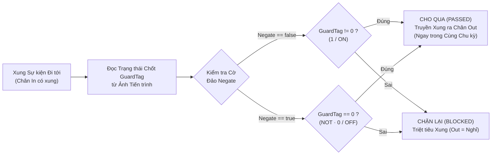
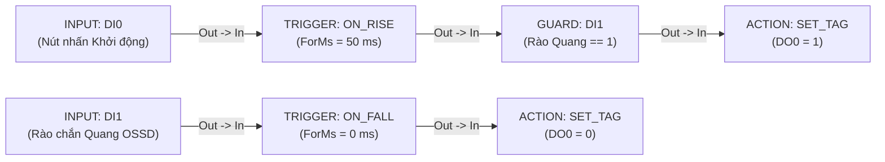

# GUARD — Cổng Khóa Liên động An toàn

  <strong>Mã khối:</strong> GUARD
  <strong>Nhóm danh mục:</strong> Chuỗi Luật Cốt lõi (Core Rule Pipeline)
  <strong>Lớp thực thi:</strong> Cổng Điều kiện Cho phép Đồng bộ
  <strong>Đích biên dịch:</strong> Giai đoạn 2 của Luật (Guard Interlock Engine)

## 1. Tóm tắt Chức năng & Ngữ nghĩa Thực thi

Khối **`GUARD`** là cổng khóa liên động và điều kiện cho phép (permissive gate) nằm xen giữa nguồn phát sự kiện ([`TRIGGER`](/vi/blocks/trigger), [`INPUT`](/vi/blocks/input), [`COMPARATOR`](/vi/blocks/comparator), [`MB_READ`](/vi/blocks/mb-read) hoặc [`MQTT_SUB`](/vi/blocks/mqtt-sub)) và khối thực thi phía sau ([`ACTION`](/vi/blocks/action), [`TON`](/vi/blocks/ton), [`CTU`](/vi/blocks/ctu), [`MB_WRITE`](/vi/blocks/mb-write), [`DIRECT_WRITE`](/vi/blocks/direct-write) hoặc các khối mạng IIoT).

- **Cơ chế Cổng Chặn Xung Đồng bộ:** Bản thân khối `GUARD` không bao giờ tự phát xung sự kiện. Thay vào đó, ngay tại chu kỳ quét khi có xung kích hoạt đi tới chân `In`, `GUARD` kiểm tra tức thời trạng thái chốt trong ảnh tiến trình của `GuardTag`:
  - **Cho qua (`Điều kiện Đúng`):** Xung sự kiện truyền thẳng qua chân `Out` ngay trong cùng chu kỳ quét đó (độ trễ `0` chu kỳ).
  - **Chặn lại (`Điều kiện Sai`):** Xung sự kiện bị triệt tiêu hoàn toàn; cơ cấu chấp hành phía sau giữ nguyên trạng thái an toàn.
- **Hỗ trợ Thuận & Đảo Logic (`NOT`):** Đáp ứng cả khóa liên động mức cao (`Negate = false`, cho qua khi `GuardTag == 1`, ví dụ *"Cửa Buồng Máy Đã Đóng = 1"*) lẫn khóa chặn lỗi mức thấp (`Negate = true`, cho qua khi `GuardTag == 0`, ví dụ *"Lỗi Rơ-le Nhiệt == 0"*).
- **Ứng dụng Công nghiệp Điển hình:** Khóa liên động cửa an toàn và rào chắn quang, kiểm tra trạng thái dừng khẩn cấp / quá nhiệt động cơ, cổng chọn chế độ Tự động / Bằng tay (`Auto/Man`) và bảo vệ chống chạy khô bơm.

---

## 2. Sơ đồ Chân & Hợp đồng Tín hiệu

| Chân (Pin) | Chiều | Loại Tín hiệu | Kiểu Dữ liệu | Mô tả Kỹ thuật |
| :--- | :--- | :--- | :--- | :--- |
| `In` | Ngõ vào (Input) | Sự kiện / Thực thi (`IsEvent = true`) | Xung Sự kiện (Event Pulse) | Nhận xung chuyển trạng thái từ khối [`TRIGGER`](/vi/blocks/trigger), [`INPUT`](/vi/blocks/input), [`COMPARATOR`](/vi/blocks/comparator) hoặc chân `Valid`/`Done` của khối truyền thông. |
| `Out` | Ngõ ra (Output) | Sự kiện / Thực thi (`IsEvent = true`) | Xung Sự kiện Đã Lọc | Chuyển tiếp xung sự kiện sang khối kế tiếp khi và chỉ khi điều kiện khóa liên động `GuardTag` thỏa mãn. |

::: warning Quy tắc Cấu trúc Cổng Guard Đơn tầng
Trình biên dịch không cho phép nối chuỗi hai cổng `GUARD` trực tiếp (`GUARD → GUARD`) hoặc nối ngược về `TRIGGER` (`GUARD → TRIGGER`) nhằm đảm bảo thời gian quét hằng số tất định. Khi cần kiểm tra đồng thời nhiều điều kiện an toàn (ví dụ: `Cửa_Đóng AND Đủ_Áp_Dầu`), hãy tổng hợp vào một cờ trung gian `VFLAG` rồi gắn cờ đó vào `GuardTag`.
:::

---

## 3. Tham số Inspector & Giới hạn Kiểm tra

| Tham số | Kiểu / Tùy chọn | Mặc định | Ràng buộc & Giới hạn | Hành vi Thời gian thực |
| :--- | :--- | :--- | :--- | :--- |
| `GuardTag` | Bộ chọn Tag Số (`DI`, `DO`, `VFLAG`) | Chưa gán *(bắt buộc chọn)* | Phải trỏ tới một Tag số kiểu nhị phân (`IsDigital == true`). Chọn nhầm Tag tương tự/thanh ghi sẽ bật cờ cảnh báo `IsInvalidTagType`. | Được đọc đồng bộ từ ảnh tiến trình ngay tại thời điểm có xung kích hoạt đi vào chân `In`. |
| `Negate` | Cờ Đảo Cực tính (`Cho qua khi 1/ON` so với `Đảo NOT — Cho qua khi 0/OFF`) | `false` (`Cho qua khi 1/ON`) | Lựa chọn nhị phân 2 chế độ. | **`false`:** Cho xung đi qua khi `GuardTag != 0`. **`true`:** Chỉ cho xung đi qua khi `GuardTag == 0` (hiển thị ký hiệu `! Tên_Tag`). |
| `CustomLabel` | Chuỗi văn bản tự do | Rỗng (`"Guard"`) | Nhãn tùy biến trên sơ đồ. | Tùy chỉnh tiêu đề hiển thị trên thẻ khối đồ họa. |

### Bảng Chân trị Cực tính Khóa Liên động

| Cấu hình `Negate` | Nhãn trên Khối | Khi `GuardTag = 0` (`OFF`) | Khi `GuardTag = 1` (`ON`) | Mẫu Đấu dây Hiện trường Điển hình |
| :--- | :--- | :--- | :--- | :--- |
| `false` (Thuận) | `Tag` (`1/ON`) | **CHẶN LẠI** (Hủy xung) | **CHO QUA** (Phát xung `Out`) | Tiếp điểm an toàn thường đóng NC (`1` = Bình thường / Đã đóng kín) |
| `true` (Đảo `NOT`) | `! Tag` (`0/OFF`) | **CHO QUA** (Phát xung `Out`) | **CHẶN LẠI** (Hủy xung) | Cờ báo lỗi hoặc cờ báo bận (`0` = Không có lỗi tồn tại) |

---

## 4. Máy Trạng thái / Giản đồ Thời gian

Lưu đồ dưới đây mô tả quá trình xét duyệt đồng bộ trong một chu kỳ quét duy nhất của khối `GUARD` khi nhận xung sự kiện đầu vào:

---

## 5. Cơ chế Bảo vệ Nhập liệu & Chẩn đoán Trực tuyến

### 5.1 Cảnh báo Gán Sai Kiểu Phi Nhị phân (`IsInvalidTagType`)

Khóa liên động an toàn công nghiệp bắt buộc phải dựa trên trạng thái nhị phân rõ ràng (`0` hoặc `1`), tuyệt đối không đánh giá cảm tính trên giá trị ADC thô chưa qua ngưỡng chuẩn. Nếu kỹ sư vô tình chọn một Tag không phải kiểu số (`AI`, `VREG`, `COUNTER`) làm `GuardTag`, thuộc tính `IsInvalidTagType` lập tức bật lên `true` và hiển thị **khung cảnh báo chuẩn ANSI Z535.6** ngay trên Inspector để nhắc chọn lại Tag số (`DI`, `DO`, `VFLAG`) hoặc chèn khối [`COMPARATOR`](/vi/blocks/comparator) phía trước.

### 5.2 Nhãn Chẩn đoán trong Mô phỏng (`F5`) & Gỡ lỗi Trực tuyến (`F8`)

- **Nút Đảo Nhanh & Báo Kết quả Cổng (`F5`):** Trong chế độ Simulator, khối tích hợp nút đảo nhanh `○ 0` / `● 1` cho `GuardTag` và hiển thị rõ trạng thái `CHO QUA` (`PASSED`) hay `ĐÃ CHẶN` (`BLOCKED`) mỗi khi có xung kích hoạt thử nghiệm.
- **Hiển thị Kép Cực tính & Trạng thái Thực 20 FPS (`F8`):** Hiển thị đồng thời quy tắc cổng và mức điện áp thực tế của Tag trên cùng một nhãn — ví dụ `Cho qua 1/ON (Cua_An_Toan: 1)` hoặc `Đảo 0/OFF (Loi_Qua_Nhiet: 0)`.
- **Cảnh báo Dữ liệu Cũ (`[STALE]`):** Gắn hậu tố ` [STALE]` khi dữ liệu giám sát suy giảm chất lượng và giữ lại trạng thái biết gần nhất khi ngắt kết nối trực tuyến.

---

## 6. Kịch bản Đấu nối Công nghiệp Thực tế

### Bài toán: Khóa Liên động Rào Chắn Quang An toàn cho Máy Dập Thủy lực

Nút nhấn khởi động chu kỳ dập tại `DI0` điều khiển cuộn hút van điện từ đi xuống (`DO0`) của máy dập thủy lực. Để bảo vệ an toàn tuyệt đối cho công nhân đứng máy, lệnh đi xuống phải bị chặn hoàn toàn nếu **Rào chắn Quang An toàn** (`DI1`, đấu dây an toàn mức `1` = Vùng thao tác thông thoáng) đang bị che khuất tại thời điểm bấm nút, đồng thời một nhánh luật bảo vệ độc lập sẽ ngắt `DO0` về `0` tức thì nếu tay người đi vào vùng quang giữa hành trình.

### Khai báo Bảng Tag

| Tên Tag | Phân loại | Kiểu Dữ liệu | Mô tả / Tên Bí danh (Alias) |
| :--- | :--- | :--- | :--- |
| `DI0` | `DI` | `BOOL` | `Nút nhấn Khởi động Dập (NO)` |
| `DI1` | `DI` | `BOOL` | `Rào chắn Quang OSSD (1 = Thông thoáng, 0 = Chắn tia)` |
| `DO0` | `DO` | `BOOL` | `Van Điện từ Hành trình Dập Xuống` |

### Trình tự Đấu nối trên Canvas

1. **Nhánh 1 (Khởi động có Khóa liên động):** Đấu nối **`INPUT`** (`DI0`) → **[`TRIGGER`](/vi/blocks/trigger)** (`ON_RISE`, `ForMs = 50` ms lọc dội nút nhấn) → **`GUARD`** (`GuardTag = DI1`, `Negate = false`) → **[`ACTION`](/vi/blocks/action)** (`SET_TAG`, `TargetTag = DO0`, `ActionParam = 1`).
2. **Nhánh 2 (Ngắt Khẩn cấp khi Chắn Tia):** Đấu nối **`INPUT`** (`DI1`) → **[`TRIGGER`](/vi/blocks/trigger)** (`ON_FALL`, `ForMs = 0` ms tác động tức thì) → **[`ACTION`](/vi/blocks/action)** (`SET_TAG`, `TargetTag = DO0`, `ActionParam = 0`).
3. Nhấn `F5` kiểm chứng đầy đủ các tình huống an toàn:
   - Để `DI1 = 0` (vùng dập đang vướng vật cản), bấm `DI0` `0 → 1`: khối `GUARD` báo **ĐÃ CHẶN** và `DO0` giữ nguyên `0`.
   - Chuyển `DI1 = 1` (rào quang thông thoáng), bấm giữ `DI0` `0 → 1` qua `50 ms`: khối `GUARD` báo **CHO QUA**, van `DO0` đóng lên `1`.
   - Đảo `DI1` từ `1 → 0`: Nhánh 2 lập tức cắt `DO0` về `0` ngay ở chu kỳ quét đầu tiên.

