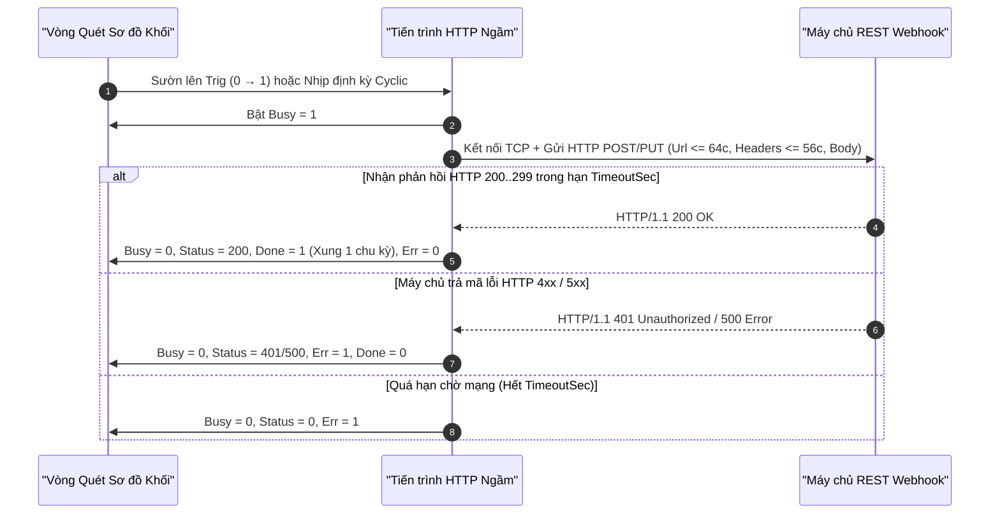
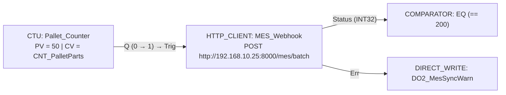

# HTTP_CLIENT — Giao tiếp REST API & Webhook

  <strong>Mã tài liệu:</strong> SYNX-DOC-BLK-HTTP
  <strong>Nhóm khối hàm:</strong> Điện toán Biên IIoT &amp; Mạng IP
  <strong>Phân lớp thực thi:</strong> Trình khách HTTP/HTTPS REST bất đồng bộ không gây nghẽn
  <strong>Tiêu chuẩn:</strong> IETF RFC 9110 HTTP Semantics &bull; JSON Webhook Telemetry

## 1. Tổng quan & Ngữ nghĩa Thực thi

Khối hàm **`HTTP_CLIENT`** (**REST API & Webhook Client**) cho phép thiết bị điều khiển biên SynaptiX đẩy trực tiếp gói tin JSON đo lường, báo cáo hoàn tất mẻ sản xuất hoặc cảnh báo sự cố thiết bị lên hệ thống máy chủ ERP/MES nội bộ, InfluxDB/Grafana hoặc các dịch vụ REST Webhook thông qua phương thức **`POST`** hoặc **`PUT`** mà không bắt buộc phải dựng trung gian MQTT Broker.

Các cam kết thực thi công nghiệp:
- **Tiến trình Mạng Độc lập Không Chặn Vòng Quét:** Toàn bộ quá trình phân giải tên miền DNS, bắt tay TCP/TLS, đóng gói HTTP Request và đọc mã phản hồi diễn ra trên tiến trình mạng riêng có giới hạn thời gian `TimeoutSec` (`1..30 s`), không bao giờ làm trễ chu kỳ quét điều khiển thời gian thực.
- **Xuất Trực tiếp Mã Trạng thái HTTP (`StatusCode`):** Thu nhận chính xác mã phản hồi từ máy chủ (`200`, `201`, `400`, `401`, `500`) ra chân **`Status`**, giúp sơ đồ logic phân biệt rõ ràng giao dịch thành công (`2xx` → phát xung `Done`) với lỗi xác thực hoặc lỗi máy chủ (`4xx`/`5xx` → bật cờ `Err`).
- **Bộ Đệm Cấu hình & Kiểm định Cú pháp JSON Tức thời:** Hộp thoại cấu hình cung cấp bảng ghép trường trực quan **Visual Field Builder**, thanh chèn nhanh biến mẫu, bộ đếm kích thước byte UTF-8 và trình kiểm tra cú pháp JSON trực tiếp trước khi lưu.

---

## 2. Sơ đồ Chân & Hợp đồng Tín hiệu

| Tên chân | Chiều | Bản chất Tín hiệu | Kiểu dữ liệu | Điều kiện Hiển thị | Hợp đồng Chức năng |
| :--- | :---: | :---: | :---: | :---: | :--- |
| **`Trig`** | Ngõ vào | Sự kiện (`0 → 1`) | `BOOL` | Luôn hiển thị | **Xung Kích hoạt Gửi Request:** Khởi phát giao dịch HTTP `POST`/`PUT` tại sườn lên (`0 → 1`) khi `TriggerMode = Event` (đồng thời cho phép kích cưỡng bức ở chế độ `Cyclic`). |
| **`Data`** | Ngõ vào | Giá trị | `BOOL` / `INT32` / `REAL` | Luôn hiển thị | **Dữ liệu Tải trọng Đơn tuyến:** Cấp giá trị đầu vào khi chọn nguồn *Chân cắm DATA trên sơ đồ (Auto-link)* ở chế độ `Raw` hoặc `Custom` đơn biến. Chế độ đa biến lấy trực tiếp từ bảng **Fields**. |
| **`Busy`** | Ngõ ra | Giá trị | `BOOL` | Luôn hiển thị | **Cờ Đang Chờ Phản hồi:** Giữ mức `1` từ lúc phát gói tin cho tới khi máy chủ trả lời hoặc hết thời gian `TimeoutSec`. |
| **`Done`** | Ngõ ra | Sự kiện (Xung) | `BOOL` | Luôn hiển thị | **Xung Hoàn tất Thành công (`2xx`):** Phát xung mức `1` trong 1 chu kỳ quét khi nhận phản hồi HTTP `200..299`. |
| **`Err`** (`Error`) | Ngõ ra | Sự kiện / Cờ | `BOOL` | Luôn hiển thị | **Cờ Báo Lỗi Truyền / HTTP:** Lên mức `1` khi lỗi kết nối socket, quá thời gian chờ hoặc máy chủ trả về mã lỗi `4xx`/`5xx`. |
| **`Status`** (`StatusCode`) | Ngõ ra | Giá trị số | `INT32` | Luôn hiển thị | **Mã Phản hồi HTTP:** Xuất mã số HTTP thực tế (`200`, `201`, `401`, `404`, `500`, hoặc `0` nếu đứt kết nối/quá hạn). |

---

## 3. Tham số Cấu hình & Ràng buộc Inspector

Nhấp nút **`[ Cấu hình HTTP Client... ]`** (hoặc nhấp đúp vào khối) để mở **Hộp thoại Cấu hình REST Webhook**:

| Tham số | Khóa Thuộc tính | Kiểu & Miền giá trị | Mặc định | Giới hạn Firmware & Hợp đồng Kiểm tra |
| :--- | :--- | :--- | :---: | :--- |
| **Phương thức HTTP** | `Method` | `"POST"` \| `"PUT"` | `"POST"` | `POST` để ghi nhận sự kiện/bản ghi mới; `PUT` để cập nhật trạng thái định danh. |
| **Địa chỉ Endpoint (`Url`)** | `Url` | `String` (**`<= 64 ký tự`**) | `"http://api.myserver.com/telemetry"` | Bắt buộc bắt đầu bằng `http://` hoặc `https://` và tối đa **`64` ký tự** (tự động khóa trần và kiểm tra qua `UrlValidationError`). |
| **Tiêu đề HTTP (`CustomHeaders`)** | `CustomHeaders` | `String` (**`<= 56 ký tự`**) | `"Content-Type: application/json"` | Chuỗi Header tùy chỉnh (`<= 56 ký tự`), ví dụ `X-Api-Key: synx-prod-98a1` hoặc `Content-Type: text/plain`. |
| **Thời gian Chờ (`TimeoutSec`)** | `TimeoutSec` | `UINT16` (`1..30 s`) | `5` s *(tối đa 30 s)* | Thời gian đợi phản hồi tối đa (`1..30` giây) trước khi hủy kết nối treo và bật cờ `Err = 1`. |
| **Chế độ Kích hoạt** | `TriggerMode` | `"Event"` \| `"Cyclic"` | `"Event"` | `Event`: gửi khi có sườn lên chân `Trig` (`0 → 1`) · `Cyclic` (`Periodic`): tự động gửi định kỳ theo bộ đếm thời gian. |
| **Chu kỳ Gửi Định kỳ** | `PeriodicIntervalSec` / `IntervalMs` | `UINT16` (`s` / `ms`) | `30` s (`5` s mặc định khối) | Khoảng thời gian lặp lại giữa 2 lần gửi khi chọn `TriggerMode = Cyclic`. |
| **Định dạng Tải trọng** | `PayloadMode` | `"JSON"` \| `"Custom"` \| `"Raw"` | `"JSON"` | Chọn giữa bảng ghép trường **JSON Visual Field Builder**, **Custom Template** (`<= 128 ký tự`) hoặc giá trị thô **Raw**. |
| **Bản mẫu JSON Tùy biến** | `CustomTemplate` | `String` (**`<= 128 ký tự`**) | `{"device":"{device}","ts":{ts},"val":{val}}` | Hiệu lực khi `PayloadMode = Custom`. Hỗ trợ chèn nhanh tại vị trí con trỏ các biến `` `{device}` ``, `` `{ts}` ``, `` `{val}` `` và `` `{tag}` ``. |

*(Xem thêm mẹo tối ưu độ dài URL và ngân sách chuỗi tại [Từ điển Macro & Giới hạn Tài nguyên](/vi/appendices/macro-tokens-and-limits)).*

---

## 4. Biểu đồ Vòng đời Giao dịch HTTP Bất đồng bộ

---

## 5. Kiểm tra Hợp lệ, Xử lý Lỗi & Chẩn đoán Trực tuyến

- **Bảo vệ Chặt chẽ Giới hạn Chuỗi của Firmware:**
  - Trường `Url` được khóa cứng **`<= 64 ký tự`** và bắt buộc tiền tố `http://` hoặc `https://` (`HasUrlError`). Mẹo kỹ thuật: Với các dịch vụ đám mây có chuỗi đường dẫn dài, hãy định tuyến qua cổng API nội bộ ngắn gọn (ví dụ `http://10.0.10.50:8080/api/v1/ingest`) và đặt khóa xác thực gọn trong `CustomHeaders` (`<= 56 ký tự`).
  - Trường `CustomTemplate` giới hạn **`<= 128 ký tự`** và được kiểm tra cú pháp tức thời bằng `JsonDocument.Parse` (`HasJsonError`), phát hiện ngay lập tức lỗi thiếu dấu ngoặc kép hoặc thừa dấu phẩy trước khi đóng hộp thoại.
- **Chống Chồng lấp Giao dịch (`Busy = 1`):** Trong lúc `Busy = 1`, các xung `Trig` phát sinh thêm sẽ được bỏ qua an toàn để bảo vệ tài nguyên Socket của vi điều khiển khi mạng WAN phản hồi chậm.
- **Huy hiệu Trạng thái Trực tuyến (`F8`):** Hiển thị rõ ràng **`SẴN SÀNG`**, **`ĐANG GỬI...`**, **`HTTP 200 (#14)`** (mã HTTP gần nhất kèm tổng số lần gửi) hoặc **`LỖI: <Chi tiết>`**.

---

## 6. Ví dụ Đấu nối Công nghiệp Thực tế

### Báo cáo Hoàn tất Pallet Sản xuất lên Máy chủ MES Nội bộ (`CTU` → `HTTP_CLIENT` `POST`)

**Bài toán:** Mỗi khi bộ đếm [`CTU`](/vi/blocks/ctu) đếm đủ `50` sản phẩm trên một pallet (chân `Q` chuyển sườn lên), tự động gửi bản tin HTTP `POST` chứa số lượng thực tế (`CNT_PalletParts`) và nhiệt độ dây chuyền (`VREG0_LineTemp`) về máy chủ MES nhà máy tại `http://192.168.10.25:8000/mes/batch`.

**Các bước cấu hình:**
1. Kéo khối **`HTTP_CLIENT`** ra vùng vẽ và mở hộp thoại cấu hình:
   - `Method = "POST"`
   - `Url = "http://192.168.10.25:8000/mes/batch"` (`35` ký tự `<= 64`)
   - `CustomHeaders = "X-Api-Key: synx-mes-01"` (`22` ký tự `<= 56`)
   - `TimeoutSec = 5`, `TriggerMode = "Event"`, `PayloadMode = "JSON"`
2. Trong bảng **Visual Field Builder**, thêm 2 trường dữ liệu:
   - `qty` → `CNT_PalletParts` (`INT32`)
   - `temp_c` → `VREG0_LineTemp` (`REAL`)
3. Nhấn **Áp dụng**, nối dây `CTU.Q` vào `HTTP_CLIENT.Trig` và quan sát huy hiệu `HTTP 200 (#1)` cập nhật trực tiếp khi nghiệm thu.
