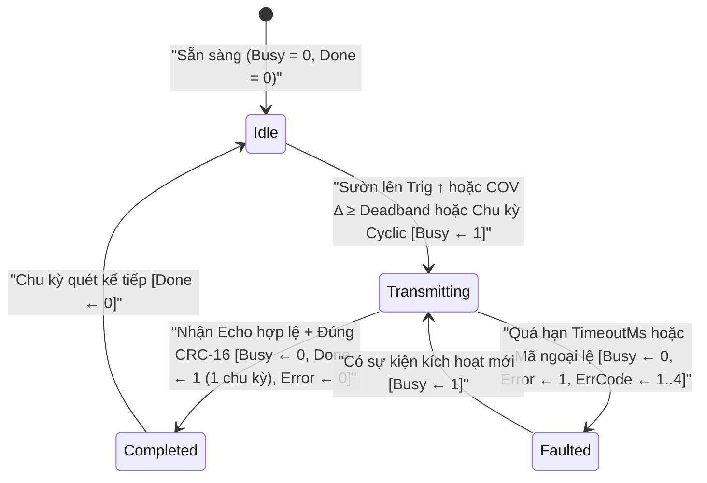
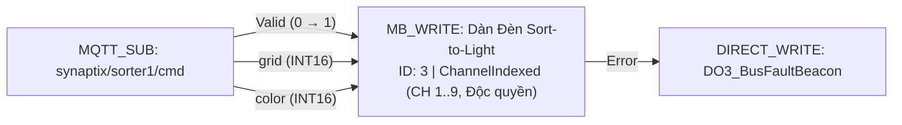

# MB_WRITE — Ghi Chấp hành Modbus RTU Master

  <strong>Mã tài liệu:</strong> SYNX-DOC-BLK-MBWRITE
  <strong>Nhóm khối hàm:</strong> Truyền thông Fieldbus &amp; Xuất Phần cứng
  <strong>Phân lớp thực thi:</strong> Bộ phát lệnh Modbus RTU Master bất đồng bộ
  <strong>Tiêu chuẩn:</strong> Modbus Application Protocol V1.1b3 &bull; IEC 61131-3

## 1. Tổng quan & Ngữ nghĩa Thực thi

Khối hàm **`MB_WRITE`** (**Modbus RTU Master Write**) thực hiện phát khung lệnh điều khiển và cài đặt giá trị đặt (Setpoint) qua bus RS-485 (`RS-485 #1` hoặc `RS-485 #2`) xuống các cơ cấu chấp hành ngoại vi như biến tần (VFD), module I/O mở rộng từ xa, dàn đèn phân loại hàng Sort-to-Light và cụm van điện từ.

Khối `MB_WRITE` tích hợp **2 chế độ vận hành chuyên biệt** trong cùng một khối:
1. **Chế độ 1 — `ChannelIndexed` (Điều khiển theo Chỉ số Kênh — Mặc định):** Tối ưu hóa cho hệ thống chia chọn hàng hóa Sort-to-Light / Pick-to-Light, cụm van chia khí và tháp đèn nhiều tầng. Sơ đồ chỉ cần nối 3 chân ngữ nghĩa (`Channel`, `Command`, `Param`), khối sẽ tự động ánh xạ sang thanh ghi `BaseAddressCommand + (Channel - 1)` và `BaseAddressParam + (Channel - 1)`. Đặc biệt hỗ trợ cờ **Kênh Độc quyền (`IsExclusiveChannel = true`)**: khi bật sáng ô chia hàng số `#4`, các ô còn lại tự động tắt mà không cần viết hàng chục nhánh reset thủ công.
2. **Chế độ 2 — `DirectRegisters` (Ghi Thanh ghi Trực tiếp):** Hỗ trợ đầy đủ 4 mã hàm ghi chuẩn Modbus gồm **`FC 05`** (Ghi 1 Coil đơn), **`FC 06`** (Ghi 1 Thanh ghi đơn), **`FC 15`** (Ghi nhiều Coils) và **`FC 16`** (Ghi nhiều Thanh ghi) với danh sách chân ngõ vào động, mã hóa thứ tự byte 32-bit và nhân tỷ lệ.

---

## 2. Sơ đồ Chân & Hợp đồng Tín hiệu

Khối `MB_WRITE` tự động đồng bộ hệ thống chân cắm ngõ vào bên trái dựa theo tổ hợp **`TriggerMode`** và **`WriteMode`**, loại bỏ hoàn toàn các chân thừa không dùng đến trên Canvas:

### 2.1. Ma trận Chân Ngõ vào Động

| Tên chân | Chiều | Bản chất Tín hiệu | Kiểu dữ liệu | Điều kiện Hiển thị | Hợp đồng Chức năng |
| :--- | :---: | :---: | :---: | :---: | :--- |
| **`Trig`** | Ngõ vào | Sự kiện (`0 → 1`) | `BOOL` | **Chỉ hiển thị khi `TriggerMode = OnTriggerRisingEdge`** *(ẩn ở chế độ `Cyclic` & `OnDataChange`)* | **Xung Kích hoạt Phát lệnh:** Đưa yêu cầu ghi vào hàng đợi phát RS-485 tại mỗi sườn lên (`0 → 1`). |
| **`Channel`** | Ngõ vào | Giá trị | `UINT16` | **Chỉ hiển thị khi `WriteMode = ChannelIndexed`** | **Chỉ số Kênh Đích (`1..ChannelCount`):** Chọn kênh chấp hành cần tác động. |
| **`Command`** | Ngõ vào | Giá trị | `UINT16` | **Chỉ hiển thị khi `WriteMode = ChannelIndexed`** | **Mã Lệnh Tác động:** Ghi vào địa chỉ `BaseAddressCommand + (Channel - 1)` (ví dụ: `0` = Tắt, `1` = Sáng tĩnh, `2` = Nhấp nháy). |
| **`Param`** | Ngõ vào | Giá trị | `INT32` / `UINT16` | **Chỉ hiển thị khi `WriteMode = ChannelIndexed`** | **Tham số Phụ trợ:** Ghi vào địa chỉ `BaseAddressParam + (Channel - 1)` (ví dụ: mã màu hoặc tần số nháy). |
| **`<Pin.Label>`** | Ngõ vào *(Động)* | Giá trị | `BOOL` / `INT32` / `REAL` | **Chỉ hiển thị khi `WriteMode = DirectRegisters`** | **Chân Dữ liệu Thanh ghi:** Mỗi dòng trong bảng `Pins` sinh ra 1 chân vào, tự động đóng gói ghi xuống `StartAddress + RegOffset`. |

### 2.2. Nhóm Chân Bắt tay & Chẩn đoán Ngõ ra Cố định

| Tên chân | Chiều | Bản chất Tín hiệu | Kiểu dữ liệu | Điều kiện Hiển thị | Hợp đồng Chức năng |
| :--- | :---: | :---: | :---: | :---: | :--- |
| **`Done`** | Ngõ ra | Sự kiện (Xung 1 chu kỳ) | `BOOL` | Luôn hiển thị | Phát xung mức `1` trong đúng 1 chu kỳ quét ngay khi Slave phản hồi xác nhận ghi thành công. |
| **`Busy`** | Ngõ ra | Giá trị | `BOOL` | Luôn hiển thị | Giữ mức `1` trong suốt thời gian khung tin đang truyền trên bus hoặc đang chờ Slave xác nhận. |
| **`Error`** | Ngõ ra | Giá trị (Chốt trạng thái) | `BOOL` | Luôn hiển thị | Lên mức `1` nếu quá thời gian `TimeoutMs`, lỗi mã CRC-16 hoặc Slave trả về bản tin Exception. |
| **`ErrCode`** | Ngõ ra | Giá trị số | `UINT16` | Luôn hiển thị | Mã lỗi chi tiết (`0` = Không lỗi, `1` = Timeout, `2` = Sai CRC-16, `3` = Ngoại lệ Slave, `4` = Khung phản hồi hỏng). |

---

## 3. Tham số Cấu hình & Ràng buộc Inspector

### 3.1. Nhóm Tham số Cổng truyền & Cơ chế Kích hoạt

| Tham số | Khóa Thuộc tính | Kiểu & Miền giá trị | Mặc định | Mô tả Kỹ thuật & Cơ chế Bảo vệ Bus |
| :--- | :--- | :--- | :---: | :--- |
| **Cổng vật lý RS-485** | `PortIndex` | `0` (`RS-485 #1`) \| `1` (`RS-485 #2`) | `0` | Chọn cổng phần cứng RS-485 đóng vai trò Modbus RTU Master. |
| **Địa chỉ Trạm (`Slave ID`)** | `SlaveId` | `Byte` (`1..247`) | `1` | Địa chỉ thiết bị chấp hành đích trên mạng RS-485. |
| **Chế độ Ghi** | `WriteMode` | `ChannelIndexed` \| `DirectRegisters` | `ChannelIndexed` | Chuyển đổi giữa điều khiển kênh định danh và ghi thanh ghi trực tiếp `FC 05/06/15/16`. |
| **Chế độ Kích hoạt** | `TriggerMode` | `OnTriggerRisingEdge` \| `Cyclic` \| `OnDataChange` | `OnTriggerRisingEdge` | Quy định thời điểm phát lệnh: theo sườn lên chân `Trig`, định kỳ theo chu kỳ hoặc khi dữ liệu biến thiên (COV). |
| **Chu kỳ Ghi Định kỳ** | `CyclicIntervalMs` | `UINT32` (`50..60000 ms`) | `500` | Chu kỳ phát lệnh lặp lại khi `TriggerMode = Cyclic` (thường dùng nuôi Watchdog biến tần). |
| **Ngưỡng Chết COV** | `Deadband` | `Float` (`≥ 0.0`) | `0.5` | Độ lệch tối thiểu (`Δ ≥ Deadband`) để phát lệnh ghi khi `TriggerMode = OnDataChange`. Ngăn nhiễu ADC làm bão hòa băng thông RS-485. |
| **Thời gian Chờ Phản hồi** | `TimeoutMs` | `UINT32` (`50..5000 ms`) | `300` | Thời gian chờ tối đa bản tin Echo xác nhận từ Slave trước khi bật cờ `Error = 1`. |

### 3.2. Tham số Chế độ 1 — `ChannelIndexed`

| Tham số | Khóa Thuộc tính | Kiểu & Miền giá trị | Mặc định | Mô tả Kỹ thuật |
| :--- | :--- | :--- | :---: | :--- |
| **Địa chỉ Gốc Lệnh** | `BaseAddressCommand` | `UINT16` (Hex/Dec) | `0x0100` (`256`) | Thanh ghi Holding bắt đầu của vùng lệnh (`CH 1 → 0x0100`, `CH k → BaseAddressCommand + k - 1`). |
| **Địa chỉ Gốc Tham số** | `BaseAddressParam` | `UINT16` (Hex/Dec) | `0x0120` (`288`) | Thanh ghi Holding bắt đầu của vùng tham số (`CH 1 → 0x0120`, `CH k → BaseAddressParam + k - 1`). |
| **Tổng số Kênh** | `ChannelCount` | `UINT16` (`1..64`) | `9` | Giới hạn số lượng kênh chấp hành do trạm ngoại vi quản lý. |
| **Kênh Độc quyền** | `IsExclusiveChannel` | `BOOL` | `true` | Khi `true`, kích hoạt kênh `k` sẽ tự động tắt toàn bộ các kênh khác (`1..ChannelCount ≠ k`) về `0` (chế độ One-Hot). Khi `false`, từng kênh bật/tắt độc lập. |

### 3.3. Tham số Chế độ 2 — `DirectRegisters`

| Tham số | Khóa Thuộc tính | Kiểu & Miền giá trị | Mặc định | Mô tả Kỹ thuật |
| :--- | :--- | :--- | :---: | :--- |
| **Mã Hàm Ghi (`FC`)** | `FunctionCode` | `FC 05`, `FC 06`, `FC 15`, `FC 16` | `FC 06` | `FC 05`: Ghi 1 Coil (`0x`) · `FC 06`: Ghi 1 Thanh ghi (`4x`) · `FC 15`: Ghi nhiều Coils (`0x`) · `FC 16`: Ghi nhiều Thanh ghi (`4x`). |
| **Địa chỉ Bắt đầu** | `StartAddress` | `UINT16` (`0..65535`) | `0` | Địa chỉ Coil hoặc Holding Register bắt đầu cần ghi trên Slave ngoại vi. |
| **Số lượng Điểm Ghi** | `PointCount` | `UINT16` (`1..16`) | `1` | Số lượng phần tử ghi đồng thời khi dùng mã hàm đa điểm `FC 15` / `FC 16`. |
| **Danh sách Chân Vào Động** | `Pins` | `0..4` chân | `1` chân | Khai báo `Label`, `RegOffset`, `DataType` (`BOOL`, `INT16`, `UINT16`, `INT32`, `UINT32`, `REAL`), `Endianness` (`ABCD`, `CDAB`, `BADC`, `DCBA`) và `Multiplier`. |

---

## 4. Máy Trạng thái & Biểu đồ Giao dịch

---

## 5. Kiểm tra Hợp lệ, Xử lý Lỗi & Chẩn đoán Trực tuyến

- **Bảng Phân rã Khung Hex & Ánh xạ Kênh Trực quan:** Hộp thoại cấu hình `MB_WRITE` hiển thị trực tiếp bảng **Actuator Channel Mappings** kèm khung phân tích từng byte truyền đi (`Slave ID`, `FC`, `Addr Hi/Lo`, `Data`, `CRC-16`), giúp đối chiếu tài liệu thiết bị ngay trước khi nạp.
- **Chống Nghẽn Bus RS-485:** Không đặt `Deadband = 0` khi nối tín hiệu tương tự dao động liên tục vào chế độ `OnDataChange`. Luôn giữ `Deadband ≥ 0.5` (ví dụ `0.5 Hz` khi ghi tần số đặt biến tần) để giữ tải đường truyền ổn định.
- **Huy hiệu Trạng thái Trực tuyến (`F8`):** Tự động chuyển trạng thái rõ ràng giữa **`SẴN SÀNG`**, **`ĐANG GỬI...`** (khi `Busy = 1`), **`HOÀN TẤT #N`** (tổng số lệnh thành công) và **`LỖI: <Nguyên nhân>`**.

---

## 6. Ví dụ Đấu nối Công nghiệp Thực tế

### Dàn Đèn Phân loại Bưu kiện 9 Cửa Điều khiển từ Đám mây (`MQTT_SUB` → `MB_WRITE` Channel-Indexed)

**Bài toán:** Nhận gói tin JSON phân hướng kiện hàng `{"grid": 4, "color": 2}` từ hệ thống điều phối kho qua khối [`MQTT_SUB`](/vi/blocks/mqtt-sub), lập tức bật sáng đèn hướng dẫn tại ô chia hàng số `#4` trên bộ điều khiển RS-485 (`SlaveId = 3`) đồng thời tự động tắt đèn của ô trước đó.

**Các bước cấu hình:**
1. Cấu hình khối [`MQTT_SUB`](/vi/blocks/mqtt-sub) lắng nghe topic `synaptix/sorter1/cmd` (`QueueMode = FIFO`) với 2 chân ra động `grid` (`INT16`) và `color` (`INT16`).
2. Kéo khối **`MB_WRITE`** ra vùng vẽ và thiết lập:
   - `PortIndex = RS-485 #1`, `SlaveId = 3`
   - `WriteMode = ChannelIndexed`, `ChannelCount = 9`, `IsExclusiveChannel = true`
   - `BaseAddressCommand = 0x0100`, `BaseAddressParam = 0x0120`
   - `TriggerMode = OnTriggerRisingEdge`, `TimeoutMs = 250`
3. Nối chân `MQTT_SUB.Valid` → `MB_WRITE.Trig`, `MQTT_SUB.grid` → `MB_WRITE.Channel`, đặt `Command = 1` (Bật sáng) và nối `MQTT_SUB.color` → `MB_WRITE.Param`.
