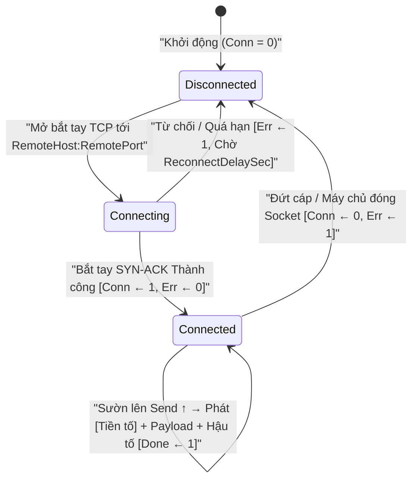
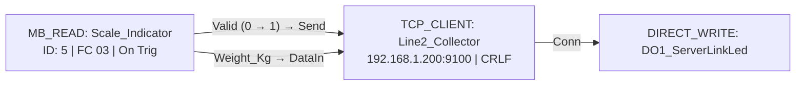

# TCP_CLIENT — Truyền nhận Raw Socket & Luồng DTU

  <strong>Mã tài liệu:</strong> SYNX-DOC-BLK-TCP
  <strong>Nhóm khối hàm:</strong> Điện toán Biên IIoT &amp; Mạng IP
  <strong>Phân lớp thực thi:</strong> Trình khách TCP Socket hai chiều duy trì kết nối liên tục
  <strong>Tiêu chuẩn:</strong> IETF RFC 9293 TCP &bull; Truyền thông Chuỗi ASCII / Raw Socket Công nghiệp

## 1. Tổng quan & Ngữ nghĩa Thực thi

Khối hàm **`TCP_CLIENT`** (**Raw TCP Socket & Stream Client**) thiết lập và duy trì kết nối TCP Socket hai chiều liên tục tới máy chủ từ xa (`RemoteHost:RemotePort`), phục vụ đắc lực cho các giao thức công nghiệp độ trễ thấp như máy chủ camera xử lý ảnh (Machine Vision), đầu đọc mã vạch mạng, máy in tem nhãn công nghiệp (ZPL/TSPL), phần mềm thu thập dữ liệu Socket nội bộ và trạm truyền dẫn viễn thông DTU.

Các năng lực vận hành cốt lõi:
- **Tự động Phục hồi Kết nối (Self-Healing Socket):** Tự động mở phiên kết nối khi khởi động, phát hiện tức thời sự cố đứt cáp hoặc máy chủ đóng kết nối và tự động thử kết nối lại sau mỗi `ReconnectDelaySec` giây mà không gây treo vòng quét.
- **Gói Báo danh Định danh & Nhịp tim Giữ Kết nối NAT:** Hỗ trợ tự động gửi gói tin định danh trạm (`OnConnect` ngay khi vừa nối thông hoặc `PrependToEveryPacket` đính kèm đầu mỗi bản tin) cùng chu kỳ bắn gói giữ kết nối (`HeartbeatIntervalSec` + `HeartbeatPayload`) chống hiện tượng trạm viễn thông 4G/Firewall tự ngắt phiên rỗi.
- **Đóng khung Ký tự Kết thúc Chuẩn xác (`FramingDelimiter`):** Tự động gắn hậu tố ngắt dòng (`CRLF \r\n`, `LF \n`, ký tự tùy chọn `Custom` hoặc `None` cho dữ liệu nhị phân thuần) vào sau dữ liệu thô **Raw** hoặc bản mẫu chuỗi **Custom** (`<= 128 ký tự`).

---

## 2. Sơ đồ Chân & Hợp đồng Tín hiệu

| Tên chân | Chiều | Bản chất Tín hiệu | Kiểu dữ liệu | Điều kiện Hiển thị | Hợp đồng Chức năng |
| :--- | :---: | :---: | :---: | :---: | :--- |
| **`Send`** | Ngõ vào | Sự kiện (`0 → 1`) | `BOOL` | Luôn hiển thị | **Xung Kích hoạt Phát:** Đóng khung và đẩy gói tin lên luồng TCP đang mở tại mỗi sườn lên (`0 → 1`). |
| **`DataIn`** | Ngõ vào | Giá trị | `INT32` / `REAL` / `BOOL` | Luôn hiển thị | **Dữ liệu Luồng Gửi đi:** Cấp dữ liệu đầu vào khi chọn nguồn *Chân cắm DataIn (FBD Auto-link)*. |
| **`Conn`** (`Connected`) | Ngõ ra | Giá trị | `BOOL` | Luôn hiển thị | **Cờ Trạng thái Kết nối Socket:** Xuất mức `1` khi phiên bắt tay TCP đang thông suốt; hạ về `0` ngay khi rớt mạng. |
| **`Done`** | Ngõ ra | Sự kiện (Xung) | `BOOL` | Luôn hiển thị | **Xung Báo Đã Gửi Gói tin:** Phát xung mức `1` trong 1 chu kỳ quét khi ghi thành công khung dữ liệu vào bộ đệm phát TCP. |
| **`Err`** (`Error`) | Ngõ ra | Sự kiện / Cờ | `BOOL` | Luôn hiển thị | **Cờ Báo Lỗi Socket:** Lên mức `1` khi không thể kết nối máy chủ, bị ngắt cưỡng bức (`RST`) hoặc kích xung `Send` lúc đang mất kết nối. |
| **`DataOut`** | Ngõ ra | Giá trị | `INT32` / `STRING` | Luôn hiển thị | **Dữ liệu Nhận Về:** Xuất dữ liệu phản hồi do máy chủ TCP từ xa gửi ngược xuống thiết bị biên. |

---

## 3. Tham số Cấu hình & Ràng buộc Inspector

Nhấp nút **`[ Cấu hình TCP Client... ]`** (hoặc nhấp đúp vào khối) để mở **Hộp thoại Cấu hình Socket TCP** kèm màn hình xem trước trực tiếp kịch bản luồng byte `[CONNECT]` / `[TX AUTH]` / `[TX PING]` / `[TX DATA]`:

| Tham số | Khóa Thuộc tính | Kiểu & Miền giá trị | Mặc định | Giới hạn Firmware & Ý nghĩa Vận hành |
| :--- | :--- | :--- | :---: | :--- |
| **Địa chỉ Máy chủ (`RemoteHost`)** | `RemoteHost` | `String` (**`<= 48 ký tự`**) | `"192.168.1.100"` | Địa chỉ IPv4 hoặc tên miền máy chủ đích (tối đa **`48` ký tự**; tự động kiểm tra chống bỏ trống qua `HostValidationError`). |
| **Cổng Máy chủ (`RemotePort`)** | `RemotePort` | `UINT16` (`1..65535`) | `8888` | Cổng lắng nghe TCP trên máy chủ từ xa (nhập `0` sẽ tự động kẹp an toàn về `1`). |
| **Thời gian Chờ Kết nối lại** | `ReconnectDelaySec` | `UINT16` (`s`) | `5` s | Khoảng nghỉ tính bằng giây trước khi thử mở lại Socket sau khi mất liên lạc. |
| **Chu kỳ Nhịp tim (`Heartbeat`)** | `HeartbeatIntervalSec` | `UINT16` (`s`, `0` = Tắt) | `30` s | Chu kỳ gửi gói giữ kết nối khi đường truyền rỗi. Đặt bằng `0` nếu muốn tắt hẳn tính năng bắn nhịp tim. |
| **Nội dung Nhịp tim** | `HeartbeatPayload` | `String` | `"PING"` | Chuỗi ký tự giữ kết nối phát đi định kỳ mỗi `HeartbeatIntervalSec` giây. |
| **Kiểu Báo danh Trạm** | `RegistrationType` | `"None"` \| `"OnConnect"` \| `"PrependToEveryPacket"` | `"None"` | `None`: tắt · `OnConnect`: gửi `RegistrationPayload` đúng 1 lần ngay khi vừa nối TCP thành công · `PrependToEveryPacket`: ghép vào đầu mọi gói dữ liệu gửi đi. |
| **Gói tin Báo danh** | `RegistrationPayload` | `String` | `""` | Chuỗi mã định danh trạm/thiết bị khi bật chế độ báo danh (ví dụ `"ID:SYNX-NODE-01;"`). |
| **Chế độ Tải trọng** | `PayloadMode` | `"Raw"` \| `"Custom"` | `"Raw"` | `Raw` truyền trực tiếp dữ liệu thô; `Custom` định dạng chuỗi ASCII/JSON theo mẫu `CustomTemplate`. |
| **Bản mẫu Chuỗi Tùy biến** | `CustomTemplate` | `String` (**`<= 128 ký tự`**) | `"{val}"` | Áp dụng khi `PayloadMode = Custom` (`<= 128 ký tự`). Hỗ trợ các biến `` `{val}` ``, `` `{tag}` ``, `` `{device}` `` và `` `{ts}` ``. |
| **Ký tự Kết thúc Khung** | `FramingDelimiter` | `"CRLF"` \| `"LF"` \| `"None"` \| `"Custom"` | `"CRLF"` | Hậu tố ngắt khung tự động gắn cuối bản tin: `CRLF` (`\r\n`), `LF` (`\n`), `None` (luồng nhị phân không ngắt dòng) hoặc `Custom`. |
| **Ký tự Ngắt Tùy chọn** | `CustomDelimiterText` | `String` | `";"` | Chuỗi ký tự kết thúc khung riêng biệt khi chọn `FramingDelimiter = Custom`. |

---

## 4. Máy Trạng thái Duy trì Kết nối & Giữ Nhịp tim

---

## 5. Kiểm tra Hợp lệ, Xử lý Lỗi & Chẩn đoán Trực tuyến

- **Khóa Trần Địa chỉ Máy chủ & Cổng Mạng:** Trường `RemoteHost` từ chối chuỗi rỗng và tự động cắt gọn nếu dán vượt quá **`48` ký tự** (`HostValidationError`), đồng thời `RemotePort` chặn giá trị cổng `0` không hợp lệ.
- **Liên động Khóa Gửi qua Chân `Conn`:** Với các dây chuyền yêu cầu không mất mẫu dữ liệu khi máy chủ bảo trì, kỹ sư có thể đưa chân **`Conn`** vào cổng [`GUARD`](/vi/blocks/guard) đặt trước chân `Send` để tạm dừng chu trình cấp phôi khi mất kết nối máy chủ.
- **Khung Xem trước Luồng Dữ liệu (`PreviewStreamText`):** Hiển thị trực quan toàn bộ kịch bản giao thức (`[CONNECT]`, `[TX AUTH]`, `[TX PING]`, `[TX DATA]`) ngay trong hộp thoại cấu hình theo thời gian thực.
- **Huy hiệu Trạng thái Trực tuyến (`F8`):** Hiển thị tức thời **`MẤT KẾT NỐI`**, **`ĐÃ KẾT NỐI`**, **`KẾT NỐI (TX:N)`** hoặc **`LỖI: <Chi tiết Socket>`**.

*(Đối với bài toán cầu nối trong suốt RS-485 sang TCP/MQTT không cần vẽ sơ đồ khối, tham khảo thêm [Không gian DTU Gateway Studio](/vi/tools/dtu-gateway-studio)).*

---

## 6. Ví dụ Đấu nối Công nghiệp Thực tế

### Truyền Bản ghi Cân Kiểm tra Chuẩn ASCII lên Máy chủ Thu thập Nhà máy

**Bài toán:** Duy trì kết nối Socket liên tục tới máy chủ xưởng `192.168.1.200:9100`, gửi chuỗi báo danh `"REG,SYNX_LINE2"` ngay khi kết nối, bắn gói giữ nhịp `"PING"` mỗi `30 s`, và đẩy dòng dữ liệu cân `"WT,{device},{val},KG\r\n"` kết thúc bằng `CRLF` mỗi khi khối [`MB_READ`](/vi/blocks/mb-read) báo có kết quả cân mới (`Valid`).

**Các bước cấu hình:**
1. Kéo khối **`TCP_CLIENT`** ra vùng vẽ và cài đặt trong hộp thoại:
   - `RemoteHost = "192.168.1.200"`, `RemotePort = 9100`, `ReconnectDelaySec = 5`
   - `HeartbeatIntervalSec = 30`, `HeartbeatPayload = "PING"`
   - `RegistrationType = "OnConnect"`, `RegistrationPayload = "REG,SYNX_LINE2"`
   - `PayloadMode = "Custom"`, `CustomTemplate = "WT,{device},{val},KG"`, `FramingDelimiter = "CRLF"`
2. Nối dây `MB_READ.Valid` → `TCP_CLIENT.Send`, `MB_READ.Weight_Kg` → `TCP_CLIENT.DataIn` và nối chân `TCP_CLIENT.Conn` ra đèn báo trạng thái kết nối máy chủ `DO1_ServerLinkLed`.
