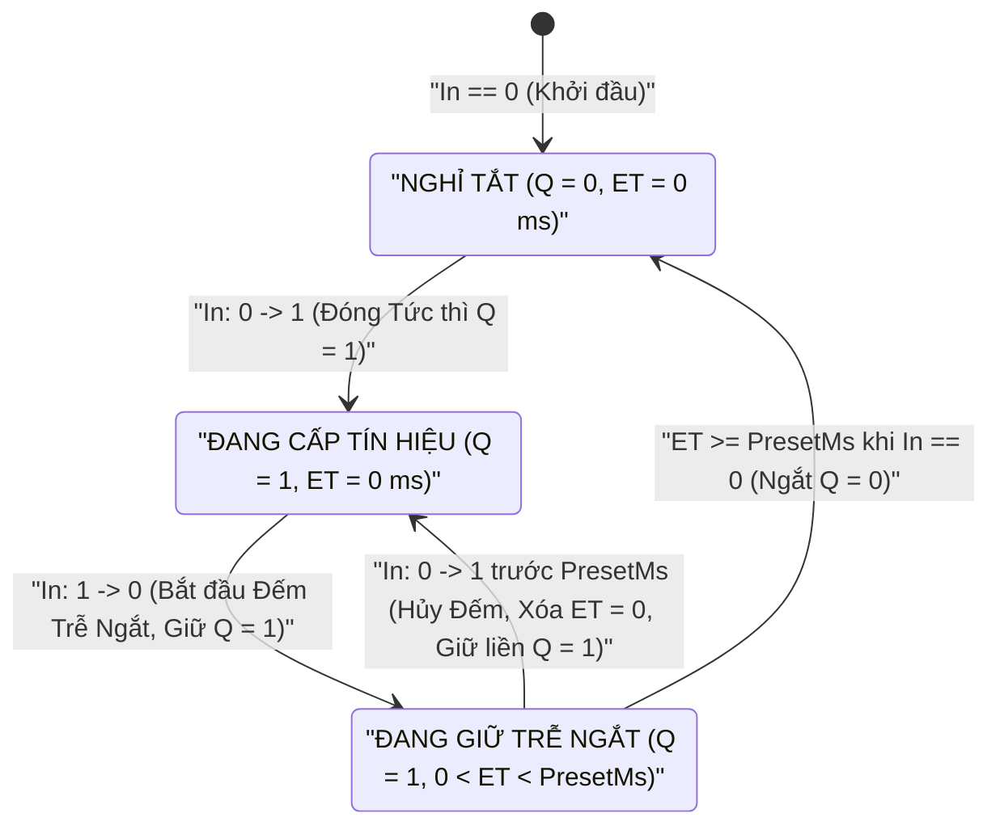

# TOF — Hẹn giờ Trễ Ngắt (Off-Delay)

  <strong>Mã khối:</strong> TOF
  <strong>Nhóm danh mục:</strong> Định thời, Bộ đếm &amp; Chuẩn hóa
  <strong>Lớp thực thi:</strong> Bộ Hẹn giờ Lưu Trạng thái Đơn điệu (IEC 61131-3 TOF)
  <strong>Đích biên dịch:</strong> Macro Định thời / Máy Trạng thái Duy trì Sau Ngắt

## 1. Tóm tắt Chức năng & Ngữ nghĩa Thực thi

Khối **`TOF`** (**Timer Off-Delay — Hẹn giờ Trễ Ngắt**) đóng ngõ ra nhị phân `Q` lên mức `1` **ngay lập tức** khi tín hiệu `In` lên mức `1`, và **tiếp tục giữ `Q = 1` thêm đúng khoảng thời gian `PresetMs`** sau khi tín hiệu `In` ngắt từ `1 → 0`.

- **Đóng Tức thì, Ngắt Có Trễ:** Chừng nào `In == 1`, ngõ ra `Q` luôn bằng `1` và bộ đếm thời gian trễ ngắt `ET` giữ ở `0`. Quá trình đếm thời gian duy trì chỉ bắt đầu ngay tại **sườn xuống** (`In: 1 → 0`).
- **Tái Kích hoạt Mượt Không Nháy Ngõ ra:** Nếu `In` bật lại lên `1` trong lúc bộ đếm trễ ngắt vẫn chưa chạy hết (`0 < ET < PresetMs`), `ET` lập tức xóa về `0` và `Q` giữ liền mạch ở mức `1` mà không hề bị ngắt quãng. Chỉ khi `In` duy trì mức `0` suốt trọn vẹn `PresetMs`, ngõ ra `Q` mới hạ về `0`.
- **Ứng dụng Công nghiệp Điển hình:** Duy trì quạt cưỡng bức giải nhiệt trục chính CNC hoặc buồng đốt sau khi dừng máy, duy trì bơm dầu bôi trơn trong giai đoạn máy nén chạy đà dừng, giữ đèn chiếu sáng kho hàng sau khi cảm biến chuyển động ngắt và quạt hút thông gió buồng đệm khí.

---

## 2. Sơ đồ Chân & Hợp đồng Tín hiệu

| Chân (Pin) | Chiều | Loại Tín hiệu | Kiểu Dữ liệu | Mô tả Kỹ thuật |
| :--- | :--- | :--- | :--- | :--- |
| `In` | Ngõ vào (Input) | Sự kiện / Thực thi (`IsEvent = true`) | Tín hiệu Điều khiển (`BOOL`) | Đóng `Q = 1` tức thì khi ở mức `1`; kích hoạt bộ đếm giữ trễ ngắt `PresetMs` ngay tại sườn xuống `1 → 0`. |
| `Q` | Ngõ ra (Output) | Giá trị / Dữ liệu (`IsEvent = false`) | `BOOL` (`0` / `1`) | Ngõ ra nhị phân trễ ngắt gắn với `OutputTag`; nối dây tới [`ACTION`](/vi/blocks/action), [`MQTT_PUB`](/vi/blocks/mqtt-pub), [`HTTP_CLIENT`](/vi/blocks/http-client) hoặc [`TCP_CLIENT`](/vi/blocks/tcp-client). |

---

## 3. Tham số Inspector & Giới hạn Kiểm tra

| Tham số | Kiểu / Tùy chọn | Mặc định | Ràng buộc & Giới hạn | Hành vi Thời gian thực |
| :--- | :--- | :--- | :--- | :--- |
| `DurationValueText` | Số thực / Số nguyên không âm | `"3"` | Chấp nhận dấu chấm hoặc dấu phẩy (`"1.5"`, `"1,5"`). Kẹp `PresetMs` trong dải `[1 .. 4,294,967,295] ms`. | Nhân với hệ số `TimeUnit` để tính ra thời gian duy trì trễ ngắt chính xác `PresetMs`. |
| `TimeUnit` | `ms`, `s`, `min`, `h` | `"s"` (`×1,000`) | Hệ số quy đổi: `ms = 1`, `s = 1,000`, `min = 60,000`, `h = 3,600,000`. | Tự động quy đổi sang mili-giây và hiển thị dòng xác nhận trực quan `= 3,000 ms (3s)`. |
| `PresetMs` | Số nguyên không dấu 32-bit (`uint`) | `3000` (`3,000 ms`) | `1 .. 4,294,967,295 ms` (~`49.7 ngày`). | Khoảng thời gian giữ `Q = 1` tính từ thời điểm `In` chuyển từ `1` về `0`. |
| `InputTag` | Tag Số (`DI`, `DO`, `VFLAG`) | Tự động nhận từ dây nối vào | Phải tham chiếu tới Tag số nhị phân. | Giám sát mỗi chu kỳ quét để đóng tức thì (`1`) và bắt sườn xuống khởi động đếm trễ (`1 → 0`). |
| `OutputTag` (`Q`) | Tag Số Cho phép Ghi (`DO`, `VFLAG`) | Chưa gán *(bắt buộc chọn)* | Phải là Tag nhị phân cho phép ghi (`DO` hoặc `VFLAG`). | Giữ mức `1` khi `In == 1` hoặc đang trong thời gian trễ ngắt; hạ về `0` khi `ET >= PresetMs`. |
| `CustomLabel` | Chuỗi văn bản tự do | Rỗng (`"TOF Timer"`) | Nhãn tùy biến trên sơ đồ. | Tùy chỉnh tiêu đề hiển thị trên thẻ khối đồ họa. |

---

## 4. Máy Trạng thái / Giản đồ Thời gian

Sơ đồ trạng thái dưới đây thể hiện đầy đủ quy trình đóng tức thì (`In = 1`), đếm duy trì sau sườn xuống (`In: 1 → 0`), hủy đếm khi kích lại sớm (`In: 0 → 1`) và ngắt hoàn toàn khi hết thời gian đặt:

| Giai đoạn Xung | Ngõ vào `In` | Thời gian Trễ Ngắt `ET` | Ngõ ra `Q` | Trạng thái Vận hành Thực tế |
| :--- | :--- | :--- | :--- | :--- |
| **1. Nghỉ Ban đầu** | `0` | `0 ms` | `0` | Cơ cấu chấp hành đang tắt (`OFF`) |
| **2. Cấp Tín hiệu Vào** | `1` | `0 ms` | `1` (`ON`) | Đóng ngõ ra tức thì (độ trễ `0 ms`) |
| **3. Sườn Xuống (`1 → 0`)** | `0` | `0 → PresetMs` | `1` (`ON`) | Đang chạy duy trì sau ngắt; `ET` đếm tiến tới `PresetMs` |
| **4. Kích Lại Giữa chừng** | `1` | Xóa ngay về `0 ms` | `1` (`ON`) | Duy trì liền mạch, không làm nháy tiếp điểm ngõ ra |
| **5. Hết Thời gian Giữ** | `0` | `PresetMs` | `0` (`OFF`) | Hoàn tất chu trình làm mát/duy trì; ngắt ngõ ra |

---

## 5. Cơ chế Bảo vệ Nhập liệu & Chẩn đoán Trực tuyến

### 5.1 Quy đổi Đa Đơn vị & Bảo vệ Dữ liệu Xấu

- **Nhập Trực tiếp Đơn vị Phút / Giờ:** Các chu trình làm mát kéo dài `2 min` hoặc `0.5 h` có thể chọn thẳng qua `TimeUnit` (`min` hoặc `h`) kèm dòng đối chiếu `= 120,000 ms (2min)` thay vì phải nhân nhẩm hàng trăm nghìn mili-giây dễ nhầm số `0`.
- **Chuẩn hóa Dấu Phẩy & Chặn Dữ liệu Sai:** Tự động đổi `"0,5"` thành `"0.5"`, kẹp giá trị `"0"` về `1 ms` tối thiểu, và bỏ qua mọi ký tự sai quy cách để bảo toàn giá trị `PresetMs` đã chốt.

### 5.2 Nhãn Chẩn đoán trong Mô phỏng (`F5`) & Gỡ lỗi Trực tuyến (`F8`)

- **Theo dõi Đếm Trễ Ngắt (`F5`):** Khi chạy Simulator, khối `TOF` bật sáng `Q = ON` ngay khi `In = 1` và hiển thị bộ đếm `ElapsedMs / PresetMs` sau khi `In` hạ về `0` cho đến lúc `Q` ngắt hẳn.
- **Giám sát Phần cứng 20 FPS (`F8`):** Hiển thị trực tiếp trạng thái thực tế của `OutputTag` (`Q = ON` / `OFF`) tốc độ 20 FPS kèm cảnh báo `[STALE]` nếu luồng dữ liệu gián đoạn.

---

## 6. Kịch bản Đấu nối Công nghiệp Thực tế

### Bài toán: Chạy Duy trì Quạt Giải nhiệt Cưỡng bức Trục chính CNC Thêm `2 Phút` Sau Khi Dừng

Khi biến tần trục chính máy phay CNC vận hành (tiếp điểm báo chạy biến tần `DI1 = 1`), quạt thổi gió giải nhiệt cưỡng bức (`DO1`) phải bật ngay lập tức. Khi kết thúc chương trình gia công (`DI1: 1 → 0`), quạt giải nhiệt phải **tiếp tục chạy thêm `2 phút` (`120,000 ms`)** để tản hết nhiệt dư trong cuộn dây stato — đồng thời giữ chạy liên tục không nhấp nhả nếu công nhân gá phôi mới và chạy lại trục chính trước khi hết 2 phút.

### Khai báo Bảng Tag

| Tên Tag | Phân loại | Kiểu Dữ liệu | Mô tả / Tên Bí danh (Alias) |
| :--- | :--- | :--- | :--- |
| `DI1` | `DI` | `BOOL` | `Báo Chạy Biến tần Trục chính CNC (1 = Đang quay)` |
| `DO1` | `DO` | `BOOL` | `Contactor Quạt Gió Giải nhiệt Trục chính` |

### Trình tự Đấu nối trên Canvas

1. Đặt khối **`INPUT`** (`Tag = DI1`, `CustomLabel = "Trục chính Đang Chạy"`).
2. Chọn khối `INPUT` rồi nhấp thêm khối **`TOF`** trên thanh công cụ để nối dây `INPUT.Out → TOF.In`.
3. Trên bảng **Inspector** của `TOF`, nhập `DurationValueText = "2"`, chọn đơn vị `TimeUnit = "min"` (kiểm tra dòng `= 120,000 ms (2min)`) và chọn `OutputTag = DO1` (`CustomLabel = "Trễ Tắt Quạt Làm mát"`).
4. Nhấn `F5` mô phỏng kiểm tra (có thể đặt thử `3 s` để quan sát nhanh trên máy tính rồi trả lại `2 min` trước khi nạp xuống thiết bị):
   - Đảo `DI1` từ `0 → 1`: quạt `DO1` đóng lên `1` ngay tức khắc.
   - Đảo `DI1` từ `1 → 0`: `DO1` vẫn giữ mức `1` trong khi `ET` đếm tăng dần tới `PresetMs`.
   - Đảo `DI1` lên lại `1` khi chưa hết giờ: `ET` xóa về `0` và `DO1` giữ nguyên mức `1` mượt mà.
   - Đảo `DI1` về `0` và chờ hết trọn thời gian đặt: `DO1` ngắt gọn về `0`.

