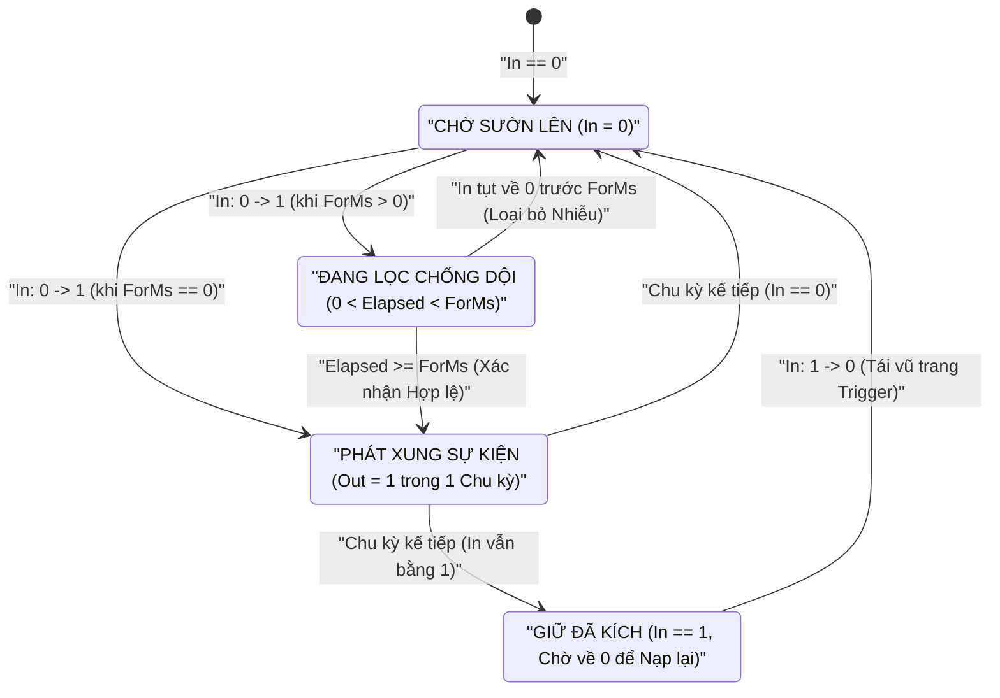
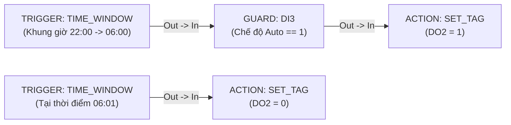

# TRIGGER — Phát hiện Sườn & Lịch RTC

  <strong>Mã khối:</strong> TRIGGER
  <strong>Nhóm danh mục:</strong> Chuỗi Luật Cốt lõi (Core Rule Pipeline)
  <strong>Lớp thực thi:</strong> Bộ Đánh giá Sườn Xung, Chống dội &amp; Lịch Thời gian thực
  <strong>Đích biên dịch:</strong> Giai đoạn 1 của Luật (Event Trigger Engine)

## 1. Tóm tắt Chức năng & Ngữ nghĩa Thực thi

Khối **`TRIGGER`** chuyển đổi tín hiệu trạng thái liên tục, biến thiên thanh ghi, nhịp đồng hồ đơn điệu nội bộ hoặc lịch Thời gian thực (`RTC`) thành các **xung sự kiện thực thi rời rạc** (`Out`) dùng để kích hoạt các khối [`GUARD`](/vi/blocks/guard), [`ACTION`](/vi/blocks/action), [`TON`](/vi/blocks/ton), [`CTU`](/vi/blocks/ctu) cũng như các khối truyền thông Fieldbus và IIoT.

- **Ngữ nghĩa Phát Xung Đơn (Single-Shot Edge):** Khác với mạch tổ hợp theo mức vốn kích hoạt lặp đi lặp lại ở mọi chu kỳ quét khi cảm biến giữ mức cao, chế độ `ON_RISE` và `ON_FALL` đối chiếu giá trị ảnh tiến trình chu kỳ hiện tại với trạng thái chốt của chu kỳ liền trước, đảm bảo **chỉ phát duy nhất một xung sự kiện cho mỗi lần chuyển mức hợp lệ**.
- **Bộ Lọc Chống dội / Duy trì Tích hợp (`ForMs`):** Tiếp điểm cơ khí, phao báo mức hoặc tín hiệu tương tự dao động quanh ngưỡng có thể được lọc nhiễu trực tiếp ngay trong khối `TRIGGER` mà không tốn thêm khối Timer rời. Khi đặt `ForMs > 0`, điều kiện kích hoạt phải duy trì liên tục đủ `ForMs` mili-giây mới phát xung.
- **Vận hành Độc lập theo Thời gian:** Ở chế độ `INTERVAL` hoặc `TIME_WINDOW`, khối `TRIGGER` tự vận hành dựa trên bộ đếm thời gian hệ thống hoặc chip đồng hồ `RTC` có pin nuôi mà không bắt buộc phải nối dây từ khối [`INPUT`](/vi/blocks/input).
- **Ứng dụng Công nghiệp Điển hình:** Bắt sườn nút nhấn khởi động và công tắc hành trình, chống rung tiếp điểm rơ-le, phát nhịp gửi gói tin định kỳ (`INTERVAL`), lập lịch bật/tắt thiết bị theo ca ngày/đêm qua nửa đêm (`TIME_WINDOW`) và giám sát vượt ngưỡng gọn nhẹ.

---

## 2. Sơ đồ Chân & Hợp đồng Tín hiệu

| Chân (Pin) | Chiều | Loại Tín hiệu | Kiểu Dữ liệu | Mô tả Kỹ thuật |
| :--- | :--- | :--- | :--- | :--- |
| `In` | Ngõ vào (Input) | Giá trị / Dữ liệu (`IsEvent = false`) | `BOOL` \| `INT32` \| `REAL` *(Tùy chọn với `INTERVAL` / `TIME_WINDOW`)* | Nhận tín hiệu trạng thái hoặc giá trị số liên tục từ khối [`INPUT`](/vi/blocks/input), [`COMPARATOR`](/vi/blocks/comparator), [`SCALE`](/vi/blocks/scale), [`MB_READ`](/vi/blocks/mb-read) hoặc [`MQTT_SUB`](/vi/blocks/mqtt-sub). |
| `Out` | Ngõ ra (Output) | Sự kiện / Thực thi (`IsEvent = true`) | Xung Sự kiện (Event Pulse) | Phát xung kích hoạt tất định khi thỏa mãn điều kiện sườn xung, thời gian chống dội, chu kỳ lặp hoặc khung giờ RTC. Hỗ trợ rẽ nhánh `1:N`. |

---

## 3. Tham số Inspector & Giới hạn Kiểm tra

| Tham số | Kiểu / Tùy chọn | Mặc định | Ràng buộc & Giới hạn | Hành vi Thời gian thực |
| :--- | :--- | :--- | :--- | :--- |
| `TriggerType` | `ON_RISE`, `ON_FALL`, `ON_CHANGE`, `INTERVAL`, `TIME_WINDOW` | `ON_RISE` | Bắt buộc chọn 1 trong 5 chế độ. | Lựa chọn cơ chế phát hiện sự kiện (xem bảng chi tiết từng chế độ bên dưới). |
| `ForMs` | Số nguyên không dấu 32-bit (`uint`, ms) | `0` | `0 .. 4,294,967,295 ms`. Ở chế độ `INTERVAL`, khuyến nghị đặt `>= 10 ms`. | **Các chế độ sườn:** Thời gian duy trì chống dội tối thiểu (`0` = phát xung ngay ở chu kỳ đầu). **Chế độ `INTERVAL`:** Chu kỳ lặp định kỳ. |
| `Chế độ Lịch` *(RTC)* | `Tại thời điểm` (`Point-in-Time` / `EQ`) \| `Khoảng khung giờ` (`Time Window Range` / `BETWEEN`) | `Point-in-Time` | Chỉ hiển thị khi `TriggerType = TIME_WINDOW`. | Chuyển đổi giữa kích hoạt đúng thời điểm `HH:MM` trong ngày hoặc duy trì trong khung giờ `[Bắt đầu..Kết thúc]`. |
| `TimeStartHour` / `Minute` | Số nguyên (`00..23` : `00..59`) | `07:00` (`700`) | Tự động kẹp biên an toàn trong dải `0..23` giờ và `0..59` phút. | Thời điểm kích hoạt (`Point-in-Time`) hoặc mốc mở khung giờ (`Time Window Range`). |
| `TimeEndHour` / `Minute` | Số nguyên (`00..23` : `00..59`) | `17:00` (`1700`) | Tự động kẹp biên `0..23` giờ và `0..59` phút; hiệu lực ở `Time Window Range`. | Mốc đóng khung giờ. Hỗ trợ **khung giờ vắt qua nửa đêm** khi `Bắt đầu > Kết thúc` (ví dụ: `22:00 → 06:00`). |
| `CompareOp` *(Nội tuyến)* | `NONE`, `EQ`, `NEQ`, `GT`, `LT`, `GTE`, `LTE`, `BETWEEN` | `NONE` | Bộ lọc ngưỡng tích hợp trên chân `In`; nếu cần khóa kiểu trực quan chuyên sâu, ưu tiên dùng khối [`COMPARATOR`](/vi/blocks/comparator). | Đánh giá quan hệ giữa `In` và `ThresholdLo` (cùng `ThresholdHi` nếu chọn `BETWEEN`) trước khi phát xung. |
| `ThresholdLo` / `ThresholdHi` | Số thực/nguyên (`double`) | `0` / `0` | Khả dụng khi `CompareOp != NONE`. | Ngưỡng so sánh dưới/mục tiêu và ngưỡng chặn trên của dải `[ThresholdLo..ThresholdHi]`. |
| `CustomLabel` | Chuỗi văn bản tự do | Rỗng (`"Trigger"`) | Nhãn tùy biến trên sơ đồ. | Ghi đè tiêu đề hiển thị trên khối đồ họa. |

### Bảng Tra cứu Chi tiết 5 Chế độ `TriggerType`

| Chế độ | Biểu thức Điều kiện | Vai trò Tham số `ForMs` |
| :--- | :--- | :--- |
| `ON_RISE` | Chu kỳ trước `== 0` và Chu kỳ hiện tại `!= 0` (hoặc vượt ngưỡng chiều tăng) | Tín hiệu phải giữ mức cao liên tục đủ `ForMs` ms mới phát `1` xung; tự xóa bộ đếm nếu tụt áp sớm. |
| `ON_FALL` | Chu kỳ trước `!= 0` và Chu kỳ hiện tại `== 0` (hoặc tụt ngưỡng chiều giảm) | Trạng thái mức thấp phải duy trì liên tục đủ `ForMs` ms mới phát `1` xung sự kiện. |
| `ON_CHANGE` | Giá trị chu kỳ hiện tại `!=` Giá trị chu kỳ trước | Chờ tín hiệu ổn định đủ `ForMs` ms sau khi biến thiên trước khi kích khối phía sau. |
| `INTERVAL` | Nhịp đồng hồ đơn điệu nội bộ chia hết cho `ForMs` | Tự động phát `1` xung thực thi sau mỗi chu kỳ `ForMs` mili-giây (ví dụ: `5000 ms` = lặp mỗi `5 s`). |
| `TIME_WINDOW` | Đối chiếu giờ-phút `RTC` (`Giờ * 100 + Phút`) | **Trong ngày (`Start <= End`):** `Start <= Hiện_tại <= End`. **Qua đêm (`Start > End`):** `Hiện_tại >= Start` HOẶC `Hiện_tại <= End`. |

---

## 4. Máy Trạng thái / Giản đồ Thời gian

Sơ đồ trạng thái dưới đây minh họa cách khối `TRIGGER` (`ON_RISE` kèm `ForMs > 0`) loại bỏ hoàn toàn xung nhiễu dội tiếp điểm ngắn hơn `ForMs` và chỉ xuất đúng một xung thực thi duy nhất khi tín hiệu đã ổn định đủ thời gian quy định:

---

## 5. Cơ chế Bảo vệ Nhập liệu & Chẩn đoán Trực tuyến

### 5.1 Chuẩn hóa Đầu vào & Kẹp biên Đồng hồ RTC

- **Tự động Kẹp biên Giờ / Phút RTC:** Mọi thao tác nhập vượt ngưỡng vào các ô `TimeStartHour` / `TimeEndHour` hoặc `Minute` đều được tự động kẹp về dải đồng hồ 24 giờ chuẩn (`00..23` và `00..59`) và cập nhật tức thì nhãn `HH:MM`. Khi chuyển từ chế độ `Khoảng khung giờ` về `Tại thời điểm`, hệ thống tự đồng bộ `ThresholdHi = ThresholdLo`.
- **Định dạng Ngưỡng Linh hoạt:** Hai ô `ThresholdLoText` và `ThresholdHiText` chấp nhận cả dấu chấm và dấu phẩy thập phân (`"25,5"` → `"25.5"`), đồng thời tự hoàn nguyên về con số hợp lệ gần nhất nếu gõ ký tự sai quy cách. Phép so sánh bằng số thực (`EQ` / `NEQ`) áp dụng ngưỡng dung sai `1e-5`.

### 5.2 Nhãn Chẩn đoán trong Mô phỏng (`F5`) & Gỡ lỗi Trực tuyến (`F8`)

- **Nhãn Tóm tắt Trực quan trên Thân khối:** Hiển thị rõ phương thức kích hoạt ngay trên sơ đồ — chẳng hạn `SƯỜN LÊN (0 → 1)`, `> 80 (500ms)`, `Lặp 1000ms` hoặc `22:00 → 06:00` — kèm huy hiệu `🔗 Connected: <Tên_Tag>` khi đã nối dây đầu vào.
- **Đếm ngược Chống dội & Báo Phát Xung (`F5`):** Khi chạy Simulator, khối hiển thị trực tiếp thời gian chống dội còn lại (`SimDwellRemainingMs`) trong lúc đang lọc sườn xung và bật sáng nhãn trạng thái phát xung ngay khoảnh khắc điều kiện kích hoạt thỏa mãn.

---

## 6. Kịch bản Đấu nối Công nghiệp Thực tế

### Bài toán: Điều khiển Đèn Chiếu sáng Hàng rào Ca Đêm (`22:00 → 06:00` Vắt Qua Nửa Đêm)

Hệ thống đèn pha chiếu sáng vành đai nhà máy đấu tại ngõ ra `DO2` cần tự động bật suốt ca đêm từ **22:00 tối hôm trước đến 06:00 sáng hôm sau**, với điều kiện công tắc chuyển mạch trên mặt tủ đang để ở vị trí `Tự động` (`DI3 = 1`).

### Khai báo Bảng Tag

| Tên Tag | Phân loại | Kiểu Dữ liệu | Mô tả / Tên Bí danh (Alias) |
| :--- | :--- | :--- | :--- |
| `DI3` | `DI` | `BOOL` | `Công tắc Chọn Chế độ Tự động (1 = Auto)` |
| `DO2` | `DO` | `BOOL` | `Contactor Đèn Pha Chiếu sáng Vành đai` |

### Trình tự Đấu nối trên Canvas

1. Thêm khối **`TRIGGER`** lên **Sơ đồ Logic** (`Ctrl+2`) không cần nối `INPUT` phía trước, đặt `CustomLabel = "Lịch Đèn Ca Đêm"`.
2. Trên bảng **Inspector**, chọn `TriggerType = TIME_WINDOW`, bật tùy chọn **Khoảng khung giờ** (`BETWEEN`), nhập giờ bắt đầu `22:00` và giờ kết thúc `06:00`. Do `22:00 > 06:00`, **SynaptiX Runtime** tự động kích hoạt thuật toán vắt qua nửa đêm (`Giờ_hiện_tại >= 22:00` HOẶC `Giờ_hiện_tại <= 06:00`).
3. Nối chân `TRIGGER.Out` sang khối **[`GUARD`](/vi/blocks/guard)** gắn `GuardTag = DI3` (`Negate = false`, cho qua khi `DI3 = 1`), sau đó nối `GUARD.Out` tới khối **[`ACTION`](/vi/blocks/action)** (`ActionType = SET_TAG`, `TargetTag = DO2`, `ActionParam = 1`).
4. Thêm nhánh thứ hai gồm khối `TRIGGER` (`TriggerType = TIME_WINDOW`, chế độ `Tại thời điểm = 06:01`) nối thẳng tới khối **[`ACTION`](/vi/blocks/action)** (`ActionType = SET_TAG`, `TargetTag = DO2`, `ActionParam = 0`) để ngắt dàn đèn khi trời sáng.

::: tip Đồng bộ Đồng hồ RTC Trước khi Vận hành
Trước khi nạp các luật sử dụng `TIME_WINDOW` xuống thiết bị hiện trường, hãy mở [Tab Thiết bị — Device (`Ctrl+1`)](/vi/workspaces/device-tab) để đồng bộ thời gian thực từ máy tính kỹ thuật xuống bộ điều khiển biên **SynaptiX Edge Controller**.
:::
