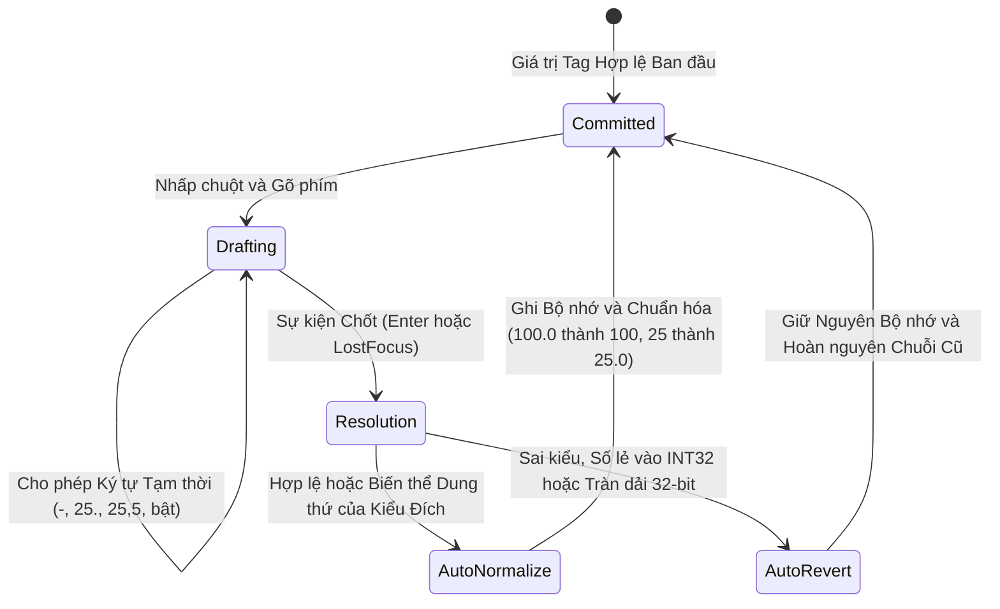

# Kiến trúc Bộ nhớ Tag & Kiểu Dữ liệu Vật lý

  <strong>Mã tài liệu:</strong> SYNX-DOC-CON-002
  <strong>Chương:</strong> 01. Tổng quan &amp; Kiến trúc Cốt lõi
  <strong>Áp dụng cho:</strong> SynaptiX IDE v2.x &bull; Tag Memory Contract
  <strong>Tiêu chuẩn:</strong> IEC 61131-3 &bull; ANSI/ISA-101

Trong **SynaptiX IDE**, mọi chân tín hiệu cảm biến vật lý, ngõ ra rơ-le, cờ trạng thái nội bộ, hệ số hiệu chuẩn và thanh ghi truyền thông đều được ánh xạ vào một **Mô hình Bộ nhớ Tag Hợp nhất (Unified Tag Memory Model)** với sức chứa tối đa **128 Tag thời gian thực**.

Được xây dựng từ nguyên lý nền tảng theo chuẩn IEC 61131-3, **SynaptiX IDE** coi kiểu dữ liệu không phải là nhãn hiển thị hình thức trên giao diện, mà là **hợp đồng bộ nhớ vật lý nghiêm ngặt**, kết hợp cùng **Máy Trạng thái Nhập liệu (Bad-Data Defense)** nhằm đảm bảo tuyệt đối rằng mọi con số kỹ sư nhìn thấy trên màn hình phản ánh chính xác 1:1 giá trị thực thi bên trong **Bộ Điều khiển Biên SynaptiX**.

---

## Mô hình Bộ nhớ Tag Hợp nhất (Tối đa 128 Tag)

Tùy theo [Cấu hình Thiết bị Định sẵn](/vi/concepts/ecosystem-overview) được chọn, dự án sẽ cấp phát tối đa 7 phân vùng Tag vật lý và Tag ảo liên tiếp, bên cạnh nhóm biến chẩn đoán hệ thống:

| Phân vùng Tag | Dải Định danh | Kiểu Mặc định | Kiểu Dữ liệu Cho phép | Quyền Truy cập | Đặc tính Lưu trữ | Mục đích Kỹ thuật Chính |
| :--- | :--- | :---: | :---: | :---: | :---: | :--- |
| **Ngõ vào Số (Digital Inputs)** | `DI0 .. DI7` | `BOOL` | `BOOL` (Cố định) | Chỉ đọc* | Phần cứng Trực tiếp | Đọc tín hiệu cách ly quang từ công tắc hành trình, cửa an toàn, cảm biến tiệm cận. |
| **Ngõ ra Số (Digital Outputs)** | `DO0 .. DO7` | `BOOL` | `BOOL` (Cố định) | Đọc / Ghi | Tạm thời (RAM) | Điều khiển rơ-le, van điện từ, quạt làm mát, còi báo hoặc xuất xung PWM/PTO. |
| **Ngõ vào Tương tự (Analog Inputs)** | `AI0 .. AI3` | `INT32` | `INT32`, `REAL` | Chỉ đọc* | Phần cứng Trực tiếp | Kênh đo ADC phần cứng (`4-20 mA`, `0-10 V`, giá trị thô hoặc số thực đã quy đổi). |
| **Cờ Ảo Nội bộ (Virtual Flags)** | `VFLAG0 .. VFLAG31` | `BOOL` | `BOOL` (Cố định) | Đọc / Ghi | Tạm thời (SRAM) | Cờ chốt trung gian, ngõ ra hoàn thành Timer, trạng thái liên động và lệnh điều khiển từ xa. |
| **Thanh ghi Ảo (Virtual Registers)** | `VREG0 .. VREG31` | `INT32` | `INT32`, `REAL` | Đọc / Ghi | Tạm thời (SRAM) | Thanh ghi đệm 32-bit lưu kết quả khối [`SCALE`](/vi/blocks/scale), dữ liệu đọc [`MB_READ`](/vi/blocks/mb-read) và lệnh [`MQTT_SUB`](/vi/blocks/mqtt-sub). |
| **Thanh ghi Lưu trữ (Retentive)** | `VREG_RETAIN0 .. VREG_RETAIN31` | `INT32` | `INT32`, `REAL` | Đọc / Ghi | **Bộ nhớ Flash Bền vững** | Ngưỡng cài đặt (Setpoint), hệ số hiệu chuẩn và sản lượng tích lũy được bảo toàn khi mất điện. |
| **Bộ đếm (Counters)** | `COUNTER0 .. COUNTER7` | `INT32` | `INT32` (Cố định) | Đọc / Ghi | Tạm thời / Quản lý | Bộ tích lũy số nguyên có dấu 32-bit cho khối [`CTU`](/vi/blocks/ctu), [`CTD`](/vi/blocks/ctd) và lệnh cộng/trừ. |

*\*Lưu ý: Các biến `DI` và `AI` mang thuộc tính chỉ đọc đối với logic người dùng khi chạy trên thiết bị thật vì giá trị của chúng được lấy mẫu trực tiếp từ chân phần cứng đầu mỗi chu kỳ quét. Trong chế độ [Mô phỏng Offline](/vi/tools/simulator-and-live-debug) (`F5`), kỹ sư có thể chủ động bật/tắt `DI` và bơm giá trị thử nghiệm cho `AI`.*

::: tip Bảo toàn Dữ liệu Qua Sự cố Mất điện với `VREG_RETAIN`
Các biến ảo thông thường (`VFLAG0..31` và `VREG0..31`) nằm trên vùng nhớ SRAM nên sẽ trở về `0` (`0.0` đối với `REAL`) khi khởi động lại nguồn. Đối với mọi ngưỡng cảnh báo, thông số cài đặt vận hành hoặc bộ đếm sản lượng cần giữ nguyên sau khi cúp điện nhà máy, hãy luôn gắn vào dải **`VREG_RETAIN0 .. VREG_RETAIN31`** để nhân thực thi tự động lưu bền vững vào bộ nhớ Flash không bay hơi.
:::

### Tên Gợi nhớ (Alias) & Hiển thị Kép

Trong [Danh mục Biến — Tag Catalog](/vi/workspaces/tag-catalog-tab) (`Ctrl+3`), mỗi Tag đều cho phép đặt **Tên gợi nhớ (Alias)** sát với quy trình công nghệ (ví dụ gán `TankTemp` cho `AI0` và `SafetyDoorOk` cho `DI0`). Ngay sau khi đặt tên, toàn bộ danh sách chọn biến, tiêu đề khối trên [Sơ đồ Logic](/vi/workspaces/logic-graph-tab) và bảng đồ thị [Live Watch](/vi/workspaces/live-watch-tab) sẽ hiển thị đồng thời dạng `[AI0] — TankTemp`, giúp kỹ sư vừa nắm rõ ý nghĩa công nghệ vừa đối chiếu ngay được chân đấu dây vật lý.

---

## Hệ thống Kiểu Dữ liệu Vật lý Nghiêm ngặt

Vi điều khiển và nhân thực thi công nghiệp vận hành thuần túy trên các mẫu bit nhị phân trong thanh ghi 32-bit. **SynaptiX IDE** thực thi nhất quán 3 kiểu dữ liệu vật lý trên toàn bộ hệ thống:

### 1. `BOOL` — Trạng thái Nhị phân 1-Bit
- **Miền giá trị hợp lệ:** Chỉ nhận giá trị `0` (Sai / Mức thấp / Tắt) hoặc `1` (Đúng / Mức cao / Bật).
- **Áp dụng cho:** Cố định bắt buộc đối với `DI0..7`, `DO0..7` và `VFLAG0..31`.
- ** Cam kết trên giao diện:** Mọi vị trí cấu hình hằng số logic đều cung cấp nút gạt nhị phân tường minh (`0` / `1`) hoặc chuẩn hóa chuỗi từ khóa logic về đúng `"0"` hoặc `"1"`.

### 2. `INT32` — Số Nguyên Có Dấu 32-Bit (Bù 2 — Two's Complement)
- **Miền giá trị hợp lệ:** Các số nguyên tròn trịa từ `-2,147,483,648` đến `+2,147,483,647` (`-2^31` đến `2^31 - 1`).
- **Áp dụng cho:** Cố định đối với `COUNTER0..7`; tùy chọn trên `AI0..3`, `VREG0..31` và `VREG_RETAIN0..31`.
- **Chân lý Vật lý — Vì sao số lẻ `25.5` Không Thể Tồn Tại trong `INT32`:**
  Trong kiến trúc thanh ghi số nguyên bù 2 của vi xử lý, trọng số của từng bit biểu diễn lũy thừa nguyên của 2 (`2^0 = 1`, `2^1 = 2`, ..., `2^30`). **Hoàn toàn không tồn tại bất kỳ bit nào lưu phần lẻ thập phân.** Một con số như `25.5` về mặt vật lý không thể nằm trong thanh ghi `INT32` nếu không bị cắt cụt ngầm thành `25` hoặc phải nhân hệ số định điểm (`255` đơn vị `0.1`). Vì hành vi tự ý cắt bỏ phần thập phân ngầm sẽ gây sai lệch nghiêm trọng giữa ngưỡng kỹ sư tưởng mình đã nhập và ngưỡng thiết bị thực thi, **SynaptiX IDE** chặn đứng và từ chối mọi giá trị có phần lẻ khác không (như `"25.5"`) trên các ô nhập kiểu `INT32`.

### 3. `REAL` — Số Thực Dấu Phẩy Động 32-Bit Chuẩn IEEE-754
- **Miền giá trị hợp lệ:** Số thực chính xác đơn chuẩn IEEE-754 binary32 (`1` bit dấu, `8` bit mũ, `23` bit định trị; độ chính xác ~7 chữ số có nghĩa).
- **Áp dụng cho:** Tùy chọn trực tiếp trên `AI0..3`, `VREG0..31` và `VREG_RETAIN0..31` trong bảng [Tag Catalog](/vi/workspaces/tag-catalog-tab).
- **Biểu diễn Bộ nhớ & Hiển thị:** Được ánh xạ nguyên vẹn 32-bit theo chuẩn IEEE-754 (`SingleToInt32Bits`) và luôn được **SynaptiX IDE** hiển thị kèm tối thiểu một chữ số sau dấu chấm thập phân (ví dụ `"25.0"`, `"65.25"`) để kỹ sư phân biệt tức thì bằng mắt thường giữa biến `REAL` và biến `INT32`.

::: warning Đồng bộ Tự động Khi Chuyển đổi Kiểu Dữ liệu Tag
Khi bạn đổi kiểu dữ liệu của một Tag trong [Tag Catalog](/vi/workspaces/tag-catalog-tab) (ví dụ chuyển `AI0` từ `INT32` sang `REAL`), mọi khối [`COMPARATOR`](/vi/blocks/comparator) hoặc [`ACTION`](/vi/blocks/action) đang tham chiếu tới Tag đó sẽ lập tức cập nhật quy tắc kiểm tra hằng số theo kiểu mới. Các mẫu bit đặc biệt như `NaN` hay `Infinity` cũng được lọc an toàn về `"0.0"`.
:::

---

## Nguyên lý Sự thật Thị giác & Máy Trạng thái Chống Nhập sai (Bad-Data Defense)

Nhiều sự cố vận hành công nghiệp bắt nguồn từ việc phần mềm cấu hình cho phép người dùng gõ `"25.5"` vào ô ngưỡng số nguyên, vẫn giữ nguyên chữ `"25.5"` trên màn hình nhưng bên dưới lại âm thầm biên dịch thành `25` hoặc `0`.

**SynaptiX IDE** triệt tiêu hoàn toàn rủi ro này thông qua **Nguyên lý Sự thật Thị giác (Visual Truth)** được bảo vệ bởi **Máy Trạng thái Hữu hạn 2 Pha (`SmartInputParser`)** trên tất cả các ô nhập liệu số và logic trong toàn bộ IDE (Property Inspector, Tag Catalog, Simulator và hộp thoại cưỡng bức biến Live Watch):

### Cơ chế Vận hành 2 Pha

1. **Pha A — Trạng thái Soạn thảo Tạm thời (Drafting State):**
   Khi con trỏ đang nằm trong ô nhập liệu, kỹ sư được tự do gõ phím mà không bị chặn phím gây khó chịu. Các chuỗi trung gian đang gõ dở như dấu âm `"-"`, `"25."`, dấu phẩy thập phân vùng miền (`"65,5"`) hoặc từ khóa tiếng Việt/Anh (`"bật"`, `"on"`) đều được chấp nhận tạm thời.
2. **Pha B — Trạng thái Cam kết Chính thức (Committed State khi nhấn `Enter` hoặc `LostFocus`):**
   Ngay khoảnh khắc kỹ sư nhấn phím `Enter` hoặc nhấp chuột ra ngoài (`LostFocus`), bộ phân tích sẽ đối chiếu toàn bộ chuỗi vừa nhập với kiểu vật lý `TagDataType` của biến đích:
   - **Tự động Chuẩn hóa (Auto-Normalize):** Nếu hợp lệ, ghi giá trị nhị phân vào mô hình dữ liệu và định dạng lại chuỗi hiển thị về chuẩn công nghiệp IEC.
   - **Tự động Hoàn nguyên (Auto-Revert):** Nếu sai kiểu hoặc không hợp lệ, từ chối thay đổi, bảo toàn tuyệt đối giá trị trong bộ nhớ và lập tức trả ô văn bản về **giá trị hợp lệ gần nhất trước đó**. Không bao giờ để sót chuỗi rác hay số sai kiểu nằm lại trên giao diện.

### Bảng Tra cứu Quy tắc Chuẩn hóa & Hoàn nguyên Thực tế

Bảng dưới đây minh họa kết quả xử lý chính xác khi giá trị hợp lệ trước đó đang lưu là `10` (với `INT32`), `10.0` (với `REAL`) hoặc `0` (với `BOOL`):

| Kiểu Dữ liệu Đích | Chuỗi Kỹ sư Gõ vào (Drafting) | Kết quả Phân giải | Giá trị Lưu trong Bộ nhớ | Chuỗi Hiển thị Sau khi Chốt |
| :---: | :--- | :--- | :---: | :--- |
| **`INT32`** | `"250"` | Hợp lệ chuẩn | `250` | `"250"` |
| **`INT32`** | `"100.0"` hoặc `"100,0"` | **Tự động Chuẩn hóa** (dung thứ đuôi `.0`) | `100` | `"100"` |
| **`INT32`** | `"25.5"` hoặc `"25,5"` | **Tự động Hoàn nguyên** (cấm phần lẻ trên `INT32`) | `10` *(Giữ nguyên)* | `"10"` |
| **`INT32`** | `"abc"` hoặc `"999999999999"` | **Tự động Hoàn nguyên** (lỗi cú pháp / tràn 32-bit) | `10` *(Giữ nguyên)* | `"10"` |
| **`REAL`** | `"65.25"` | Hợp lệ chuẩn | `65.25f` | `"65.25"` |
| **`REAL`** | `"25"` | **Tự động Chuẩn hóa** (tự gắn đuôi `.0`) | `25.0f` | `"25.0"` |
| **`REAL`** | `"25,5"` | **Tự động Chuẩn hóa** (đổi dấu phẩy `,` thành `.`) | `25.5f` | `"25.5"` |
| **`REAL`** | `"-"`, `"."` hoặc `"err"` | **Tự động Hoàn nguyên** (gõ dở hoặc sai cú pháp) | `10.0f` *(Giữ nguyên)* | `"10.0"` |
| **`BOOL`** | `"1"`, `"true"`, `"on"`, `"yes"`, `"high"`, `"bật"` | **Tự động Chuẩn hóa** (không phân biệt hoa/thường) | `1` | `"1"` |
| **`BOOL`** | `"0"`, `"false"`, `"off"`, `"no"`, `"low"`, `"tắt"` | **Tự động Chuẩn hóa** (không phân biệt hoa/thường) | `0` | `"0"` |
| **`BOOL`** | `"sai_kieu"` | **Tự động Hoàn nguyên** | `0` *(Giữ nguyên)* | `"0"` |

::: tip Hỗ trợ Dấu Phẩy Thập phân Tiện lợi cho Bàn phím Quốc tế & Việt Nam
Kỹ sư thao tác nhanh trên cụm phím số thường gõ `"25,5"` thay vì `"25.5"`. Trên các trường kiểu `REAL`, **SynaptiX IDE** tự động chuyển đổi `"25,5"` về chuẩn `"25.5"` ngay khi chốt. Trên các trường kiểu `INT32`, `"100,0"` được chuẩn hóa gọn thành `"100"`, trong khi `"25,5"` sẽ hoàn nguyên an toàn để cảnh báo kỹ sư rằng biến đích đang là số nguyên.
:::

---

## Tài liệu Liên quan

- [Không gian Danh mục Biến — Tag Catalog (`Ctrl+3`)](/vi/workspaces/tag-catalog-tab) — Cách đặt Alias, chuyển đổi kiểu `INT32`/`REAL` và nhập/xuất danh sách Tag qua tệp CSV.
- [Chu trình Thực thi Tất định](/vi/concepts/execution-pipeline) — Cách các Tag luân chuyển qua chuỗi luật, bộ định thời, bộ đếm và các khối truyền thông.
- [SCALE — Khối Tuyến tính hóa & Hiệu chuẩn 2 Điểm](/vi/blocks/scale) — Quy đổi giá trị ADC thô `INT32` (`AI0..3`) sang đơn vị vật lý `REAL`.
