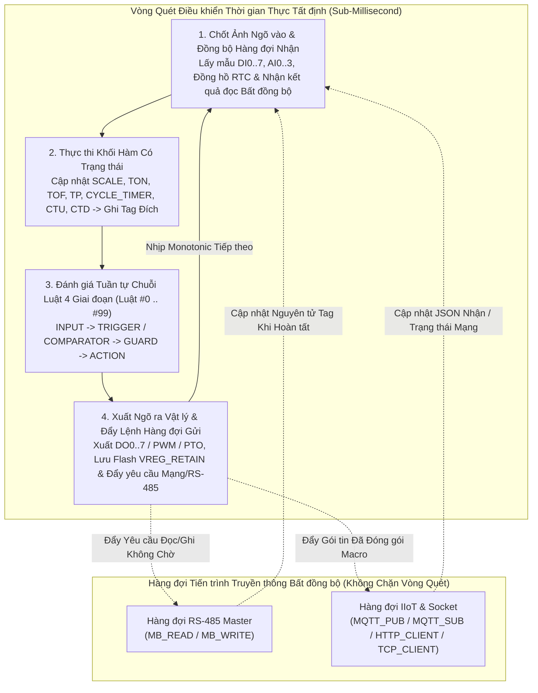
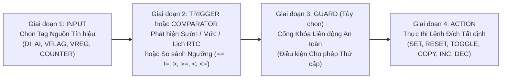

# Chu trình Thực thi Tất định (Execution Pipeline)

  <strong>Mã tài liệu:</strong> SYNX-DOC-CON-003
  <strong>Chương:</strong> 01. Tổng quan &amp; Kiến trúc Cốt lõi
  <strong>Áp dụng cho:</strong> SynaptiX IDE v2.x &bull; Hybrid Scan Engine
  <strong>Tiêu chuẩn:</strong> IEC 61131-3 &bull; IEC 61508-3

Các bộ chuyển đổi biên (Edge Gateway) thông thường hay mắc một nhược điểm kiến trúc chí mạng: đặt tác vụ đọc/ghi mạng TCP hoặc chờ phản hồi RS-485 nằm chung luồng với logic khóa liên động tại chỗ. Chỉ cần một đồng hồ đo RS-485 đứt dây chờ timeout hoặc gói tin Wi-Fi phát lại cũng đủ làm treo việc đóng/cắt rơ-le bảo vệ hàng trăm mili-giây.

**Nhân Thực thi Biên SynaptiX (SynaptiX Edge Runtime)** giải quyết triệt để bài toán này bằng **Kiến trúc Thực thi Lai Tất định (Hybrid Deterministic Architecture)**: toàn bộ khâu lấy mẫu ngõ vào, tính toán khối hàm có trạng thái và đánh giá tối đa **100 luật Sự kiện – Điều kiện – Hành động** chạy trong vòng quét thời gian thực cố định không cấp phát bộ nhớ động, trong khi các giao dịch RS-485 và đám mây IIoT vận hành độc lập trên **hàng đợi tiến trình bất đồng bộ không gây nghẽn (Non-Blocking Async Workers)**.

---

## Giải phẫu Một Chu kỳ Quét Hoàn chỉnh (Scan Cycle)

Mỗi chu kỳ quét tất định tuần tự đi qua 4 bước khép kín, đồng thời trao đổi dữ liệu nguyên tử ở biên chu kỳ với các tiến trình truyền thông chạy nền:

### Các Cam kết Tất định Thời gian Thực
- **Đóng băng Ảnh Ngõ vào (Input Image Freeze):** Giá trị `DI0..7`, `AI0..3` và dữ liệu nhận từ mạng được chốt đồng loạt ngay đầu chu kỳ (`Bước 1`). Giá trị cảm biến không bao giờ biến đổi bất thường giữa chừng khi đang quét từ `Luật #0` đến `Luật #99`.
- **Thứ tự Thực thi Luật Tường minh:** Các luật sau biên dịch luôn chạy đúng thứ tự chỉ số tăng dần (`Luật #0`, `Luật #1`, ...) khớp 100% với bảng hiển thị tại [Bảng Luật — Rule Table](/vi/workspaces/rule-table-tab) (`Ctrl+4`).
- **Định thời Đơn điệu (Monotonic Time):** Toàn bộ các bộ hẹn giờ (`TON`, `TOF`, `TP`, `CYCLE_TIMER`) đếm theo xung nhịp phần cứng đơn điệu độc lập với giờ lịch hệ thống, đảm bảo việc đồng bộ lại giờ lịch RTC/NTP không bao giờ làm sai lệch khoảng thời gian trễ đang đếm.

---

## Trụ cột 1: Chuỗi Luật Sự kiện – Điều kiện – Hành động 4 Giai đoạn

Khi kỹ sư kéo-thả và nối dây các khối trên [Sơ đồ Logic — Logic Graph](/vi/workspaces/logic-graph-tab) (`Ctrl+2`) rồi nhấn **Biên dịch (`F7`)**, trình biên dịch đồ thị sẽ hạ bậc sơ đồ thành các **Luật 4 Giai đoạn Tất định** (tối đa **100 luật** trên `SynaptiX Controller`, `SynaptiX Remote I/O`, `SynaptiX Relay Unit`; tối đa **50 luật** trên các cấu hình nhỏ gọn và cổng giao thức):

| Giai đoạn Chuỗi | Khối Trực quan | Nhiệm vụ Thực thi trong Vòng quét |
| :--- | :--- | :--- |
| **Giai đoạn 1 — Nguồn** | [`INPUT`](/vi/blocks/input) | Chỉ định biến vật lý, biến ảo, biến lưu trữ, bộ đếm hoặc cờ hệ thống làm tín hiệu đầu vào chính. |
| **Giai đoạn 2 — Đánh giá** | [`TRIGGER`](/vi/blocks/trigger) hoặc [`COMPARATOR`](/vi/blocks/comparator) | Bắt sườn xung (`RISING`, `FALLING`, `ANY_CHANGE`), mức trạng thái, khung giờ lịch RTC, hoặc so sánh quan hệ trên `INT32` / `REAL` (`` `==` ``, `` `!=` ``, `` `>` ``, `` `>=` ``, `` `<` ``, `` `<=` ``) với hằng số hoặc biến thứ hai. |
| **Giai đoạn 3 — Khóa An toàn** | [`GUARD`](/vi/blocks/guard) *(Tùy chọn)* | Đóng vai trò cổng điều kiện cho phép mắc nối tiếp. Dù Giai đoạn 2 đã thỏa mãn (`TRUE`), luật vẫn bị chặn không cho tác động trừ khi điều kiện Guard (ví dụ `SafetyDoorOk == 1`) đồng thời đúng. Nhiều khối Guard nối tiếp được biên dịch chuẩn xác theo phép hội logic (`AND`). |
| **Giai đoạn 4 — Chấp hành** | [`ACTION`](/vi/blocks/action) / [`DIRECT_WRITE`](/vi/blocks/direct-write) | Thực thi phép biến đổi trạng thái tất định (`SET`, `RESET`, `TOGGLE`, gán hằng số, sao chép `COPY` giữa hai biến, tăng `INCREMENT`, giảm `DECREMENT`) hoặc điều khiển trực tiếp chân cứng/xung PWM/PTO (`DIRECT_WRITE`). |

::: info Giá trị Kỹ thuật của Khối Khóa Liên động GUARD Độc lập
Việc tách bạch rõ ràng giữa điều kiện công nghệ (`TankTemp > 65.0`) và điều kiện an toàn cho phép (`SafetyDoorOk == 1`) thành hai khối [`COMPARATOR`](/vi/blocks/comparator) và [`GUARD`](/vi/blocks/guard) riêng biệt giúp sơ đồ điều khiển cực kỳ minh bạch khi nghiệm thu chéo, rà soát trên [Rule Table](/vi/workspaces/rule-table-tab) và theo dõi trực quan bằng [Gỡ lỗi Trực tuyến — Live Debug](/vi/tools/simulator-and-live-debug) (`F8`).
:::

---

## Trụ cột 2: Các Khối Hàm Có Trạng thái (Stateful Function Blocks)

Bên cạnh chuỗi luật 4 giai đoạn, **SynaptiX IDE** cung cấp **7 khối hàm định thời, đếm sự kiện và hiệu chuẩn tương tự** duy trì biến trạng thái nội tại qua nhiều chu kỳ quét và ghi kết quả trực tiếp vào Tag trung gian hoặc ngõ ra:

| Phân nhóm | Khối Hàm | Cơ chế Duy trì Trạng thái & Liên kết Tag |
| :--- | :--- | :--- |
| **Định thời** | [`TON`](/vi/blocks/ton) — Trễ Đóng (On-Delay) | Tích lũy thời gian (ms) chừng nào tín hiệu đầu vào giữ mức `1`. Chỉ bật Tag đích (`VFLAG` hoặc `DO`) lên `1` khi thời gian duy trì đạt ngưỡng `PresetMs`; tự động xóa về `0` ngay khi đầu vào ngắt về `0`. |
| **Định thời** | [`TOF`](/vi/blocks/tof) — Trễ Ngắt (Off-Delay) | Bật Tag đích lên `1` tức thì khi đầu vào lên `1`, và tiếp tục duy trì ngõ ra ở mức `1` thêm đúng `PresetMs` mili-giây sau khi đầu vào sụt `1 -> 0` (rất hữu ích cho quạt tản nhiệt trễ sau khi dừng máy). |
| **Định thời** | [`TP`](/vi/blocks/tp) — Phát Xung Đơn ổn | Phát ra một xung chuẩn độ rộng cố định `PresetMs` mili-giây lên Tag đích ngay khi bắt được sườn lên (`0 -> 1`) của tín hiệu kích. |
| **Định thời** | [`CYCLE_TIMER`](/vi/blocks/cycle-timer) | Bộ dao động tạo xung chu kỳ bất đối xứng với `OnTimeMs` và `OffTimeMs` độc lập — lý tưởng để kích đọc cảm biến Modbus định kỳ, chớp đèn cảnh báo hoặc điều khiển bơm định lượng. |
| **Bộ đếm** | [`CTU`](/vi/blocks/ctu) — Bộ Đếm Tiến | Tăng giá trị biến `COUNTER0..7` thêm `1` mỗi khi có sườn lên (`0 -> 1`) và bật cờ hoàn thành khi `Counter >= Preset`. Hỗ trợ gắn biến xóa (Reset) riêng. |
| **Bộ đếm** | [`CTD`](/vi/blocks/ctd) — Bộ Đếm Lùi | Nạp giá trị đặt `Preset` và giảm dần biến `COUNTER0..7` mỗi sườn xung kích, kích hoạt ngõ ra khi `Counter <= 0`. |
| **Tuyến tính hóa** | [`SCALE`](/vi/blocks/scale) — Hiệu chuẩn 2 Điểm | Ánh xạ tuyến tính liên tục từ dải đo thô `[InMin .. InMax]` (như giá trị ADC `4-20 mA` của `AI0`) sang đơn vị vật lý chuẩn `[OutMin .. OutMax]` (như `0.0 .. 100.0 °C` kiểu `REAL`) kèm tùy chọn kẹp biên (Clamp), xuất thẳng vào `VREG` hoặc `VREG_RETAIN`. |

### Phối hợp Liên hoàn Qua Bộ nhớ Tag Chung
Các khối hàm và chuỗi luật ghép nối mượt mà thông qua Tag trung gian. Ví dụ điển hình:
1. Khối [`SCALE`](/vi/blocks/scale) quy đổi tín hiệu thô `AI0` (`INT32`) sang nhiệt độ thực `VREG0` (`TankTempC`, kiểu `REAL`).
2. Khối [`COMPARATOR`](/vi/blocks/comparator) kiểm tra `VREG0 > 65.0` rồi kích vào khối [`TON`](/vi/blocks/ton) (`5000 ms` chống nhiễu dao động) gắn với cờ `VFLAG0` (`OverTempConfirmed`).
3. Các nhánh phía sau dùng chung `VFLAG0` để vừa đóng rơ-le `DO0` (`CoolingFan`) vừa kích khối [`MQTT_PUB`](/vi/blocks/mqtt-pub) bắn cảnh báo tức thời lên máy chủ.

---

## Trụ cột 3: Tiến trình Fieldbus & IIoT Bất đồng bộ Không Chặn (Non-Blocking)

Truyền thông công nghiệp và mạng IP luôn có độ trễ biến thiên tự nhiên — một cảm biến RS-485 tốc độ `9600 bps` cần khoảng `25 ms` để phản hồi khung truyền, trong khi bắt tay bảo mật TLS qua Wi-Fi hoặc gửi HTTP Webhook có thể mất `150–800 ms`.

Để đảm bảo **độ trễ đường truyền không bao giờ làm chậm vòng quét điều khiển cục bộ**, toàn bộ 6 khối truyền thông đều được tách biệt hoàn toàn qua hàng đợi bất đồng bộ:

| Phân hệ Truyền thông | Khối Trực quan | Cơ chế Bất đồng bộ Không Gây Nghẽn |
| :--- | :--- | :--- |
| **RS-485 Modbus RTU Master** | [`MB_READ`](/vi/blocks/mb-read), [`MB_WRITE`](/vi/blocks/mb-write) | Xung kích đưa yêu cầu đọc/ghi vào bộ lập lịch RS-485 Master chạy nền. Vòng quét chính tiếp tục chạy bình thường; ngay khi nhận đủ gói phản hồi đúng CRC, giá trị được cập nhật nguyên tử vào `VREG`/`VFLAG` ở đầu chu kỳ kế tiếp. |
| **Đám mây MQTT Telemetry** | [`MQTT_PUB`](/vi/blocks/mqtt-pub), [`MQTT_SUB`](/vi/blocks/mqtt-sub) | `MQTT_PUB` chụp nhanh giá trị biến tại thời điểm kích, điền các Macro mẫu (như `` `{val1}` ``, `` `{ts}` ``) rồi chuyển giao gói tin cho tiến trình mạng TCP/TLS phát đi. Ở chiều ngược lại, gói JSON nhận từ `MQTT_SUB` được bóc tách nền và cập nhật nguyên tử vào Tag đích tại `Bước 1`. |
| **Giao tiếp HTTP & Raw TCP** | [`HTTP_CLIENT`](/vi/blocks/http-client), [`TCP_CLIENT`](/vi/blocks/tcp-client) | Các truy vấn REST Webhook (`POST`/`PUT`/`GET`) và luồng dữ liệu Socket TCP thô (ASCII/Hex) chạy trên luồng mạng riêng có kiểm soát timeout và mã trạng thái mà không gây trễ mili-giây nào lên tốc độ phản ứng `DI -> DO`. |

::: danger Lưu ý Tránh Xung đột Ghi Trùng Tag (Multiple-Writer Hazard)
Mặc dù hàng chục khối có thể cùng đọc một Tag an toàn tuyệt đối, kỹ sư cần tránh thiết kế hai khối độc lập cùng ghi đè liên tục vào một biến `DO` hoặc `VREG` trong cùng chu kỳ quét mà không có cổng khóa [`GUARD`](/vi/blocks/guard) loại trừ lẫn nhau. **SynaptiX IDE** tích hợp sẵn công cụ kiểm tra logic (`Tools -> Validate Logic`) và chốt kiểm duyệt an toàn của AI Copilot để cảnh báo sớm xung đột ghi.
:::

---

## Tài liệu Liên quan

- [Tổng quan Danh mục Khối hàm & Quy ước Chân](/vi/blocks/overview) — Bảng phân loại và quy ước màu chân kết nối của toàn bộ 18 khối hàm.
- [Không gian Bảng Luật — Rule Table (`Ctrl+4`)](/vi/workspaces/rule-table-tab) — Rà soát thứ tự ưu tiên và kết quả biên dịch từng luật.
- [Mô phỏng Offline & Gỡ lỗi Trực tuyến (`F5` / `F8`)](/vi/tools/simulator-and-live-debug) — Chạy từng bước chu kỳ quét trên máy tính và quan sát dòng chảy tín hiệu trực tiếp 20 FPS.
