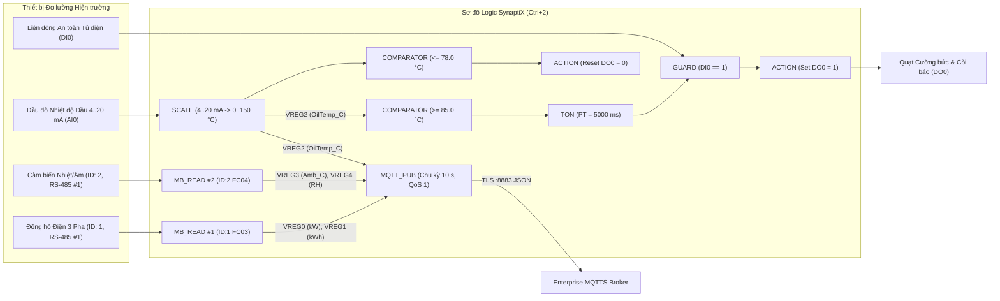
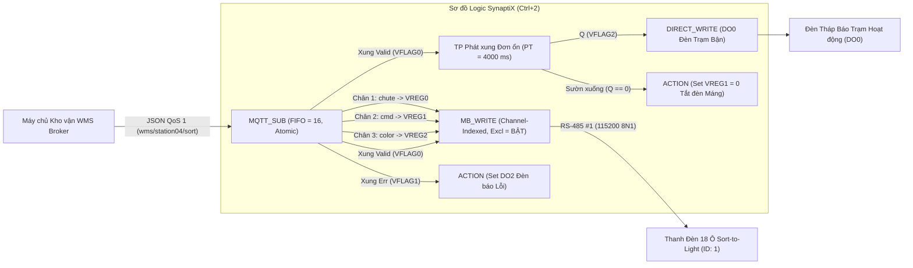

# Kịch bản Tích hợp Thực tế (`AN-001` & `AN-002`)

<div class="doc-meta-bar">
  <span><strong>Mã tài liệu:</strong> SYNX-DOC-TOOL-006</span>
  <span><strong>Thiết kế Tham chiếu:</strong> <code>AN-001</code> (Telemetry Năng lượng &amp; Báo động Tại chỗ) &bull; <code>AN-002</code> (Chia chọn Sort-to-Light)</span>
  <span><strong>Phần cứng Mục tiêu:</strong> <code>SynaptiX Controller</code> &bull; <code>SynaptiX Gateway</code></span>
  <span><strong>Kiểm chứng:</strong> Đã Xác thực trên Offline Simulator (<code>F5</code>) &amp; Live Debug (<code>F8</code>)</span>
</div>

Tài liệu này trình bày hai kiến trúc tích hợp đa khối hoàn chỉnh đã được kiểm chứng thực chiến tại nhà máy, minh họa cách **SynaptiX IDE** hợp nhất luồng quét thiết bị RS-485, mạch bảo vệ tất định tại biên, điều khiển xung phần cứng và truyền thông JSON hai chiều qua MQTT trên một sơ đồ duy nhất.

---

## AN-001: Trạm Thu thập Điện năng & Môi trường RS-485 Kết hợp Bảo vệ Tại chỗ

### 1.1 Bài toán Kỹ thuật
Một tủ trạm biến áp không người trực lắp đặt đồng hồ phân tích điện năng 3 pha chuẩn RS-485 (`Slave ID = 1`), cảm biến nhiệt độ/độ ẩm tủ điện RS-485 (`Slave ID = 2`) và đầu dò nhiệt độ dầu máy biến áp `4..20 mA` đấu vào chân `AI0`. Thiết bị **SynaptiX Controller (`SYNX-CTRL-884`)** cần đảm nhiệm đồng thời:
1. Quét tuần hoàn thông số công suất và vi khí hậu qua tuyến `RS-485 #1` (`9600 8N1`).
2. Tuyến tính hóa dòng tương tự `4..20 mA` từ `AI0` sang dải nhiệt độ thực `0.0 .. 150.0 °C`.
3. Tự động đóng quạt hút cưỡng bức & đèn còi cảnh báo tại chỗ (`DO0`) **hoàn toàn độc lập tại biên** — ngay cả khi đứt cáp quang mất Internet — nếu nhiệt độ dầu vượt ngưỡng `85.0 °C` liên tục suốt `5 giây` (có khóa an toàn liên động cửa tủ `DI0 == 1`), và tự ngắt khi hạ xuống dưới `78.0 °C`.
4. Gom toàn bộ 5 thông số đo lường vào một bản tin JSON duy nhất đẩy lên máy chủ MQTTS (`cổng 8883`) định kỳ mỗi `10 giây`.

### 1.2 Kiến trúc Đấu nối & Lưu đồ Khối hàm FBD



### 1.3 Bảng Quy hoạch Danh mục Biến (`Ctrl+3`)

| Tên Tag | Tên Gợi nhớ (`Alias`) | Kiểu Dữ liệu | Phân loại | Đơn vị | Vai trò trong Chu trình |
| :--- | :--- | :--- | :--- | :--- | :--- |
| `DI0` | `Panel_Interlock_OK` | `BOOL` | Ngõ vào Số | — | Tín hiệu cho phép đóng quạt khi mạch an toàn kín (`1`). |
| `DO0` | `Cabinet_Exhaust_Alarm` | `BOOL` | Ngõ ra Số | — | Rơ-le đóng công-tắc-tơ quạt hút và đèn chớp cảnh báo nhiệt. |
| `AI0` | `OilProbe_Raw_mA` | `REAL` | Ngõ vào Tương tự | `mA` | Tín hiệu dòng điện thô `4.0 .. 20.0 mA` từ can nhiệt dầu. |
| `VREG0` | `Active_Power_kW` | `REAL` | Thanh ghi Ảo | `kW` | Đọc từ đồng hồ điện (`40001..40002`, `FLOAT32 ABCD`). |
| `VREG1` | `Total_Energy_kWh` | `REAL` | Thanh ghi Ảo | `kWh` | Điện năng lũy kế (`40003..40004`, `FLOAT32 ABCD`). |
| `VREG2` | `Oil_Temp_C` | `REAL` | Thanh ghi Ảo | `°C` | Đầu ra của khối [`SCALE`](/vi/blocks/scale) (`4..20 mA -> 0..150 °C`). |
| `VREG3` | `Ambient_Temp_C` | `REAL` | Thanh ghi Ảo | `°C` | Đọc từ cảm biến tủ điện (`30001`, `INT16 x 0.1`). |
| `VREG4` | `Ambient_RH_Pct` | `REAL` | Thanh ghi Ảo | `%RH` | Độ ẩm trong tủ điện (`30002`, `UINT16 x 0.1`). |
| `VFLAG0` | `OverTemp_Dwell_Q` | `BOOL` | Cờ Logic Ảo | — | Ngõ ra `Q` của bộ trễ chống nhiễu [`TON`](/vi/blocks/ton) `5000 ms`. |

### 1.4 Bảng Thông số Cấu hình Chi tiết Từng Khối

| Khối Hàm | Thông số Thiết lập Trọng tâm |
| :--- | :--- |
| **`MB_READ #1`** | Cổng = `RS-485 #1` (`9600 8N1`), Slave ID = `1`, `FC03` Bắt đầu = `40001`, Chu kỳ = `1000 ms`, Chân 1 -> `VREG0` (`REAL ABCD`, Scale `1.0`), Chân 2 -> `VREG1` (`REAL ABCD`, Scale `1.0`). |
| **`MB_READ #2`** | Cổng = `RS-485 #1`, Slave ID = `2`, `FC04` Bắt đầu = `30001`, Chu kỳ = `2000 ms`, Chân 1 -> `VREG3` (`INT16`, Scale `0.1`), Chân 2 -> `VREG4` (`UINT16`, Scale `0.1`). |
| **`SCALE`** | Ngõ vào = `AI0`, `InMin = 4.0`, `InMax = 20.0`, `OutMin = 0.0`, `OutMax = 150.0`, `Clamp = Bật`, Ngõ ra = `VREG2` (`°C`). |
| **Mạch Bảo vệ Nhiệt Tại chỗ** | Luật 1: `VREG2 >= 85.0` -> `TON` (`PT = 5000 ms`, `Q = VFLAG0`) -> `GUARD` (`DI0 == 1`) -> `ACTION` (`Set DO0 = 1`). Luật 2: `VREG2 <= 78.0` -> `ACTION` (`Reset DO0 = 0`). |
| **`MQTT_PUB`** | Topic = `substation/tx01/telemetry`, Chế độ = `Cyclic` (`10000 ms`), `QoS = 1`, `Retain = false`, `PayloadMode = JSON` (`IncludeDevice = true`, `IncludeTimestamp = true`, `WrapValues = true`). |

### 1.5 Mẫu Bản tin JSON Xuất bản Lên Broker (`substation/tx01/telemetry`)

```json
{
  "device": "SYNX-CTRL-884-TX01",
  "ts": 1730877600,
  "values": {
    "active_power_kw": 42.85,
    "total_energy_kwh": 158420.4,
    "oil_temp_c": 68.2,
    "ambient_temp_c": 31.4,
    "ambient_rh_pct": 58.0
  }
}
```

---

## AN-002: Bộ Điều khiển Máng Chia chọn Kho vận Sort-to-Light

### 2.1 Bài toán Kỹ thuật
Tại trạm chia chọn bưu kiện thương mại điện tử, đầu đọc mã vạch phía trên băng tải gửi mã vận đơn về phần mềm quản lý kho (WMS). Trong vòng `50 ms`, WMS phản hồi một lệnh JSON xuống Topic `wms/station04/sort` chỉ định ô máng đích (`1..18`) và mã màu đèn dẫn hướng cho công nhân (`1 = Xanh lá`, `2 = Vàng`, `3 = Xanh dương`). **Bộ điều khiển Biên SynaptiX** cần thực thi:
1. Giải mã gói lệnh JSON **đảm bảo tính nguyên tử (Atomic All-or-Nothing)** qua khối [`MQTT_SUB`](/vi/blocks/mqtt-sub) với hàng đợi `FIFO = 16` để không bỏ sót kiện hàng nào khi các gói đi sát nhau.
2. Điều khiển thanh đèn 18 ô qua RS-485 bằng khối [`MB_WRITE`](/vi/blocks/mb-write) (hoặc dải đèn định địa chỉ nối tiếp qua [`DIRECT_WRITE`](/vi/blocks/direct-write)) ở chế độ **Độc quyền Kênh (`Channel-Indexed`, `IsExclusiveChannel = true`)** — tự động tắt ngay đèn của ô cũ đồng thời bật sáng ô máng mới chỉ trong một giao dịch tất định.
3. Kích hoạt bộ phát xung đơn ổn [`TP`](/vi/blocks/tp) (`PT = 4000 ms`) mỗi khi có xung `Valid` để giữ sáng đèn báo trạm (`DO0`) và tự động xóa tắt đèn máng sau `4 giây` nếu không có kiện hàng kế tiếp.

### 2.2 Kiến trúc Đấu nối & Lưu đồ Khối hàm FBD



### 2.3 Bảng Quy hoạch Danh mục Biến (`Ctrl+3`)

| Tên Tag | Tên Gợi nhớ (`Alias`) | Kiểu Dữ liệu | Phân loại | Chức năng Chi tiết |
| :--- | :--- | :--- | :--- | :--- |
| `VREG0` | `Target_Chute_Idx` | `INT32` | Thanh ghi Ảo | Số thứ tự ô máng chia hàng (`1 .. 18`) bóc tách từ khóa `"chute"`. |
| `VREG1` | `Light_Command` | `INT32` | Thanh ghi Ảo | Mã lệnh đèn (`1 = Sáng tĩnh`, `2 = Nhấp nháy nhanh`, `0 = Tắt`). |
| `VREG2` | `Color_Preset` | `INT32` | Thanh ghi Ảo | Mã màu chỉ dẫn (`1 = Xanh lá`, `2 = Vàng`, `3 = Xanh dương`). |
| `VFLAG0` | `Sort_Cmd_Valid` | `BOOL` | Cờ Logic Ảo | Xung 1 chu kỳ từ chân `MQTT_SUB.Valid` khi cả 3 khóa JSON hợp lệ. |
| `VFLAG1` | `Sort_Cmd_Error` | `BOOL` | Cờ Logic Ảo | Xung từ chân `MQTT_SUB.Err` khi gói JSON sai cú pháp hoặc sai kiểu số. |
| `VFLAG2` | `Chute_Window_Active` | `BOOL` | Cờ Logic Ảo | Ngõ ra `Q` của bộ định thời [`TP`](/vi/blocks/tp) duy trì cửa sổ `4000 ms`. |
| `DO0` | `Station_Active_Lamp` | `BOOL` | Ngõ ra Số | Đèn vòm xanh báo hiệu phiên bỏ hàng đang kích hoạt trong `4 giây`. |
| `DO2` | `Payload_Fault_Lamp` | `BOOL` | Ngõ ra Số | Đèn vàng cảnh báo khi máy chủ WMS gửi bản tin sai định dạng. |

### 2.4 Bảng Thông số Cấu hình Chi tiết Từng Khối

| Khối Hàm | Thông số Thiết lập Trọng tâm |
| :--- | :--- |
| **`MQTT_SUB`** | Topic = `wms/station04/sort`, `QoS = 1`, `QueueMode = FIFO (16)`, `IgnoreRetainedOnBoot = true` *(chặn bản tin lưu cũ làm bật nhầm máng khi vừa đóng điện tủ!)*, Chân động: `"chute"` -> `VREG0` (`INT32`), `"cmd"` -> `VREG1` (`INT32`), `"color"` -> `VREG2` (`INT32`). |
| **`MB_WRITE`** | Cổng = `RS-485 #1` (`115200 8N1`), Slave ID = `1`, `WriteMode = ChannelIndexed`, `ChannelCount = 18`, `IsExclusiveChannel = true`, `TriggerMode = OnTriggerRisingEdge` (chân `Trig` nối vào `MQTT_SUB.Valid`), `Channel` = `VREG0`, `Command` = `VREG1`, `Param` = `VREG2`, `TimeoutMs = 300 ms`. |
| **`DIRECT_WRITE` *(Tùy chọn thay thế)*** | Nếu đấu dải đèn định địa chỉ trực tiếp vào cọc `DO1`: chọn `Mode = AddressableBus`, `ChannelCount = 18`, `IsExclusiveChannel = true`, `TriggerMode = OnTriggerRisingEdge`. |
| **Bộ tạo xung `TP`** | `IN` = `VFLAG0` (`Sort_Cmd_Valid`), `PT = 4000 ms`, `Q` = `VFLAG2` (`Chute_Window_Active`). Bắt sườn xuống `VFLAG2` ghi `VREG1 = 0` để tự động tắt thanh đèn sau `4 giây`. |

### 2.5 Mẫu Gói lệnh Điều khiển WMS & Kiểm thử Từ chối Nguyên tử

**Bản tin Điều khiển Hợp lệ từ WMS (`wms/station04/sort`):**
```json
{
  "chute": 7,
  "cmd": 1,
  "color": 1
}
```
- **Thực thi Tất định:** `MQTT_SUB` xác thực trọn vẹn cả 3 trường đúng kiểu `INT32`, chốt đồng thời `VREG0 = 7`, `VREG1 = 1`, `VREG2 = 1` trong cùng một chu kỳ quét, phát xung `Valid` (`VFLAG0`), kích hoạt `MB_WRITE` tắt mọi ô máng cũ (`1..18`) và bật sáng **Ô máng số 7** màu xanh lá, đồng thời giữ `DO0` sáng đúng `4000 ms` qua khối `TP`.

**Bản tin Lỗi Kiểm thử Chống Dữ liệu Xấu (Thử trực tiếp trong `F5` Offline Simulator):**
```json
{
  "chute": "MANG_SO_7",
  "cmd": 1
}
```
- **Bảo chứng Nguyên tử Toàn vẹn:** Do trường `"chute"` truyền chuỗi chữ vi phạm khế ước `INT32` và thiếu khóa `"color"`, khối `MQTT_SUB` **hủy bỏ toàn bộ bản tin** — giữ nguyên giá trị hợp lệ trước đó của `VREG0`, `VREG1`, `VREG2`, chân `Valid` đứng yên ở `0` và phát xung cảnh báo ra chân `Err` (`VFLAG1`) để bật đèn lỗi `DO2`.

---

## Tài liệu Liên quan

- [MB_READ — Đọc Thiết bị Modbus RTU](/vi/blocks/mb-read) & [MB_WRITE — Ghi Chấp hành Modbus RTU](/vi/blocks/mb-write)
- [DIRECT_WRITE — Xuất DO / PWM / PTO / Bus Định địa chỉ](/vi/blocks/direct-write)
- [MQTT_PUB — Đẩy Telemetry lên Broker](/vi/blocks/mqtt-pub) & [MQTT_SUB — Nhận Lệnh Điều khiển JSON](/vi/blocks/mqtt-sub)
- [Từ điển Macro & Giới hạn Tài nguyên Hệ thống](/vi/appendices/macro-tokens-and-limits)
